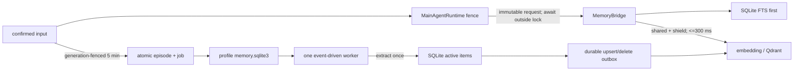

# Task 9 Implementation Report

## Delivery identity

- Baseline/parent HEAD: `3fcf44ca07c1a682a89c039b2d269cd324d2248b`
- Delivery commit: the commit containing this report (final SHA is reported to the parent task;
  a commit cannot embed its own content hash).
- Worktree: `/private/tmp/aurabot-main-agent-v1`

## Implemented contract

- Automatic recall is lexical-first and starts the optional vector branch concurrently.  A waiter
  shields shared vector work and spends at most 300 ms from recall start; timeout/failure returns
  lexical-only.  Fresh active hydration makes forget immediate even on a cached revision.  Results
  deduplicate ID/content, filter visible source overlap, and cap at six items/2400 characters.
- Runtime captures input/revision/context coordinates under its scheduler lock, awaits recall outside
  it, then revalidates all coordinates before publishing a Snapshot.  Stale recall is discarded and
  realtime VAD/barge-in remains responsive.
- Only explicit desktop text and strong-pause/EOU-confirmed speech append episode segments.  The
  five-minute timer is generation fenced; immutable segment payload plus extraction job commit in
  the existing per-profile `memory.sqlite3` transaction.
- Extraction and vector delivery use leased `BEGIN IMMEDIATE` claims with restart recovery and exact
  5/30/300-second retries.  Deterministic item/outbox IDs make extraction idempotent; zero candidates
  complete normally; Qdrant failure retries only outbox work.  Forget atomically archives SQLite/FTS
  truth and enqueues an idempotent vector delete.
- Added camelCase browse/forget/retry routes, local-only readiness, bounded metrics, and lifecycle
  logging.  Existing legacy Memory/Task routes and exact `GET /health` response remain compatible.
- FastAPI lifespan composes TaskManager, one MemoryWorker, active-profile MemoryBridge,
  MainAgentRuntime, RealtimeHub, and SpeechPipeline.  Shutdown fences admission first, then closes
  speech/runtime, Memory timers/worker/stores, and TaskManager in ownership order.  Embedded Qdrant
  clients for the same path share a locked reference count, so an overlapping app close cannot
  invalidate another live app.

## TDD record

| Batch | RED evidence | GREEN coverage |
| --- | --- | --- |
| Recall | missing `MemoryBridge` import | timeout/failure degradation, real concurrency, shared shield, dedupe, source overlap, bounds, revision cache, lock-free wait and stale fence |
| Durable write | missing `MemoryWorker` | five-minute generation race, immutable seal, exact retries, zero-memory completion, expired lease recovery, one idempotent worker task, partial Qdrant recovery |
| Runtime/API | missing recording/API behavior | provisional transcript exclusion, confirmed text/speech recording, immediate forget, hidden payload/lease, retry and stable errors |
| Composition | missing metrics/readiness owners | exact health, local-only readiness, lifespan order, cancellation-safe reverse shutdown, bounded telemetry |
| Closure | silent E2E initially exposed non-JSON tuple | JSON-native recall DTO; silent Context→Memory→provider→Renderer ACK plus existing voice/search/Task fact E2Es |

New Task-9 tests: **18** across `test_main_agent_memory.py`, `test_main_agent_gateway.py`, and
`test_main_agent_e2e.py`, in addition to the existing full voice/search/Task suites.

## Files

- Core: `backend/main_agent/memory.py`, `backend/main_agent/metrics.py`,
  `backend/main_agent/runtime.py`, `backend/main_agent/realtime.py`
- Durable adapters: `backend/memory/stores/sqlite.py`, `backend/memory/stores/qdrant.py`
- Gateway/composition: `backend/main.py`, `backend/app/gateway/memory_routes.py`,
  `backend/app/gateway/readiness_routes.py`
- Tests: `backend/tests/test_main_agent_memory.py`, `backend/tests/test_main_agent_gateway.py`,
  `backend/tests/test_main_agent_e2e.py`
- Docs/config: `config.example.yaml`, `README.md`, `docs/backend-runtime-contract.md`,
  `docs/configuration-and-backend-lifecycle.md`, `docs/aurabot-development-status.md`

## Verification

- Focused closure E2E: 4 passed — silent, full voice fake, search→CONTINUE, Task proposal→fact.
- Full Backend: **510 passed, 1 skipped**.  The skip is the explicitly opt-in live provider smoke;
  the real pinned Pi offline smoke ran and passed.
- Frontend: **55 files / 167 tests passed**; production `npm run build` passed.
- Pi extension: **5 tests passed**; TypeScript typecheck passed.
- `python -m compileall -q backend`: passed.
- `uv lock --offline --project backend --check`: passed.
- `git diff --check`: passed.

## Deliberate limits

- The production model provider is unavailable when its endpoint/model/key is incomplete and otherwise
  remains lazy until a real invoke; speech remains disabled by default. No real paid model/STT/TTS call
  is made by import, startup, TestClient static/readiness/health routes, or this verification.
- SQLite FTS is the primary lexical path.  A bounded active-only LIKE fallback handles short CJK
  substrings that the existing Unicode tokenizer may retain inside a larger token; no tokenizer,
  queue, worker-thread, or monitoring dependency was added.
- Metrics are intentionally process-local and bounded; they are diagnostics, not durable analytics.

## Review remediation addendum

The review round was implemented on top of `684506a2a0fc2f48a166062d4ea2408dc41631ee`
with nine new test methods (ten cases including the malformed/future-version subtests):

| Review item | RED evidence | Remediation and GREEN evidence |
| --- | --- | --- |
| Forget resurrection | A failed pending upsert retried after forget and called Qdrant twice. | The forget transaction now supersedes every unfinished upsert and resets one idempotent delete; the worker fresh-reads active SQLite truth immediately before upsert. Retry performs no second upsert and durable delete removes the point. |
| Lease heartbeat/loss | `MemoryWorker` had no heartbeat injection, and a slow call could cross the 30-second lease; an external error after CAS ownership loss escaped `drain_ready`. | Owner/CAS renewal now spans extraction plus embedding/Qdrant. Deterministic clock pulses cross 31 seconds in both stages with one extraction/upsert; lease loss neither releases the replacement owner's row nor kills the drain. |
| StrongPause recall fence | `eou_complete` could wait forever behind a PREPARE recall that had not yet created an invoke. | A monotonic control generation and pre-invoke settlement event cover recall. StrongPause supersedes the generation, waits for stale PREPARE settlement, and then starts only RESPOND; the provider observes no old PREPARE/note/tool path. |
| Vector task ownership | Twenty never-returning revisions created twenty live vector tasks. | Cache entries and owned tasks are separate; creation has a hard bound, waiters remain shielded, orphaned LRU work is cancelled, and shutdown gathers every owned task. The cache-size-two stress test stays at two live calls/tasks and shuts down to zero. |
| SQLite migration safety | Malformed/future version metadata was overwritten and a failed v3 DDL left an extraction table behind. | Schema version and declared shape are parsed before DDL. Explicit v1→v2→v3 `BEGIN IMMEDIATE` transactions commit their version only after validation; failure rolls back all DDL and preserves v2 byte/state truth. |
| Qdrant close/open race | The registry removed its last entry before a slow client close released the embedded path lock. | A condition-protected `closing` entry remains registered through underlying close. A concurrent constructor blocks, starts no second client early, then safely creates/reuses after close completion. |

Fresh remediation verification on the final tree:

- Focused Memory/Runtime: **58 passed**.
- Focused gateway/E2E/legacy Memory/Task compatibility: **49 passed**.
- Full Backend: **510 passed, 1 skipped**.
- Frontend: **55 files / 167 tests passed** and production build passed.
- Pi extension: **5 tests passed** and TypeScript typecheck passed.
- Compileall, offline `uv lock --check`, and `git diff --check`: passed.
- No live or paid model, embedding, speech, or Qdrant service call was made.

## Narrow rereview addendum

The narrow rereview on top of `60268a0b3e01dcab89d4e40ce2626ed264833991`
refined one lease-loss test and added two test methods:

- RED: after one successful heartbeat, ownership was replaced before extraction or Qdrant upsert
  raised. The generic failure handler attempted to release the replacement owner's row and allowed
  `Memory work lease is not owned` to escape `drain_ready`.
- GREEN: SQLite now reports ownership/expiry settlement failures as the typed
  `MemoryLeaseLostError`. Extraction and outbox completion/release paths convert only that result
  into non-fatal lease loss, preserve the replacement owner's row, and keep the worker usable;
  unrelated SQLite/database exceptions remain fatal to the existing supervision boundary.
- RED: two threads closing the same wrapper both passed the out-of-lock `_closed` check, decremented
  a two-wrapper shared reference twice, and closed the embedded client while the other wrapper lived.
- GREEN: `_closed` check-and-set is atomic under the registry `Condition`; concurrent close of one
  wrapper decrements once, and the shared client closes exactly once when the final wrapper closes.

Fresh narrow-rereview verification:

- Exact race regressions: **3 passed**.
- Focused Memory/Runtime/legacy Memory: **89 passed**.
- Full Backend: **510 passed, 1 skipped**.
- Compileall, offline `uv lock --check`, and `git diff --check`: passed.
- The diff is Backend-only; the immediately preceding Frontend **167 tests/build** and Pi
  **5 tests/typecheck** results remain applicable and were not rerun.

## Whole-branch production-composition addendum

This final review round on top of `a2709954846b5fd7810611fbaafa32a0ab5342a1` closed four
production/runtime gaps in three RED/GREEN batches:

- Production provider/speech composition: typed `chat_model` settings feed a lazy OpenAI-compatible
  Chat Completions SSE adapter. It opens HTTP only for a real invoke, reuses ToolCallAssembler's chunk
  protocol, owns deadline/cancellation/client close, and returns a local unavailable provider when
  key/endpoint/model is absent. `create_app` accepts provider/speech factory injection; enabled speech
  composes lazy DashScope STT/TTS, local Silero/Smart Turn and the existing SpeechPipeline, while
  disabled speech constructs none. TestClient text submission crosses the production runtime and
  streams a `say_to_user` clause without a paid call.
- Pending episode durability: Memory schema v4 adds one per-profile pending row inside the existing
  `memory.sqlite3`. Confirmed append, timestamp and generation are transactional; startup restores the
  remaining five-minute delay or seals overdue work immediately. Episode/job insert and pending delete
  are atomic, so shutdown/restart and repeated startup cannot lose or duplicate truth.
- Long-lived bounds: runtime invoke diagnostics retain 128 entries; ToolHarness Observation request
  dedupe/outcomes retain 256 terminal entries without evicting inflight work; ObservationLedger retains
  256 latest/dedupe facts and 512 events, preserves running identities, and treats evicted late terminal
  delivery as unowned/fail-closed. Canonical Observation facts remain durable in ContextStore.

RED/GREEN evidence: provider/speech focused **20 passed**; pending reopen/overdue/idempotency **3
passed** with full Memory **27 passed**; bounded-history stress **3 passed** with related runtime/tool/
observation regression **118 passed**. Final focused Main Agent **288 passed** and full Backend **521
passed**. No live model, embedding, speech, or remote Qdrant call was made.

Final cross-workspace verification: Frontend **55 files / 167 tests passed** and production build
passed; Pi extension **5 tests passed** and TypeScript typecheck passed; Backend compileall, offline
`uv lock --check`, and `git diff --check` passed.

## Optional speech dependency preflight addendum

The scoped rereview on top of `54c4032e777c8e49f068cdf3cff2bc819cd5e06c` added one enabled-only,
local capability fence before production speech composition. After key and asset validation,
`_build_default_speech` uses only stdlib `find_spec` for the exact lazy-import dependencies:
`dashscope.audio.asr`, `dashscope.audio.tts_v2`, `onnxruntime`, `numpy`, and `transformers`. A missing
module returns disabled status with stable reason `speech_optional_dependency_missing`; it does not
construct providers, load models, open connections, or make network calls. RED reproduced the prior
generic `speech_unavailable` result/provider-construction attempt; GREEN covers missing-module and
all-modules-present composition. Focused speech/provider/gateway regression: **43 passed**.

The final P2 follow-up hardens that same pure-local fence when `find_spec` itself fails. RED covered
both `RuntimeError` and `OSError`, which previously escaped to the outer generic
`speech_unavailable` fallback. GREEN catches `Exception` only at the capability check and returns the
same stable `speech_optional_dependency_missing` status; `BaseException` subclasses remain outside
the fence. Final focused gateway/speech/provider regression: **44 passed**; full Backend: **523
passed**. Compileall, offline `uv lock --check`, and `git diff --check` passed.
