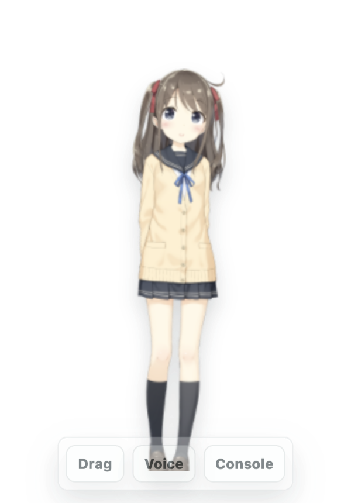

# AuraBot

AuraBot is a desktop-first companion AI MVP. The product shape is not a traditional always-open chat app: the default surface is a small Live2D desktop pet, and hovering the character reveals lightweight controls for drag, voice input, inline quick chat, and the full console conversation.

The current build validates the first useful loop:

1. A transparent always-on-top Live2D pet lives on the desktop.
2. Hovering the pet reveals semi-transparent drag, voice, console, and quick-chat controls.
3. The console handles chat, memory, and task control through the main thread.
4. Task status is visible through cards, with main-chat control plus quick cancel/delete buttons for common card actions.
5. Task completion, pet-voice replies, pet quick-chat input, and due follow-ups can surface through desktop-pet bubbles.

## Current Demo

Desktop pet:



Console window:


## What Works Now

| Area | Status |
| --- | --- |
| Desktop shell | Electron + Vue + TypeScript + Vite app boots locally from the `frontend/` directory. |
| Backend gateway | Python FastAPI gateway exposes local `/health`, `/services`, read-only debug endpoints, and backend-first main chat history/task list reads. |
| Live2D surface | Official Live2D Hiyori sample model renders in the pet window. |
| Two-window UX | Small pet window opens or focuses a normal console window from the hover control. |
| Pet behavior settings | Console settings can let clicks pass through the pet window. |
| Pet placement | Dragged pet window positions are persisted and clamped back into the visible work area. |
| Pet status behavior | Agent status is broadcast to the pet and mapped onto Hiyori's available motion groups; the pet also tracks the system cursor for eye focus even outside the pet window. |
| Pet quick chat | Hovering the Live2D model reveals a small `Chat` bubble that expands into an inline input and sends messages back to the main chat as `pet_text`. |
| Voice input MVP | Pet hover control can use browser SpeechRecognition when the runtime supports it. |
| Local storage | SQLite stores profiles, souls, sessions, messages, memory, tasks, and event logs. |
| Main chat thread | Console and pet quick-chat messages persist through typed IPC into the main process, with optimistic user messages and streaming assistant updates. |
| Model roles | `gateModel`, `chatModel`, and `memoryModel` are injectable and require API configuration in user-facing runs; tests can opt into deterministic doubles explicitly. |
| Gate logic | Fragmented messages can wait; complete chat, task requests, task controls, and topic endings are classified, with model-backed gate decisions when configured. |
| Memory v1/v2 | Preference, event, and follow-up memories can be written and recalled through relation edges; while the app is running, a background scheduler can surface due follow-ups through desktop-pet bubbles. |
| Task v1 | Tasks can be created, queried, interrupted, revised, started, and completed from main chat; task cards expose quick cancel/delete controls; opt-in Codex, Claude Code, or Hermes CLI runners can execute real delegated tasks by priority. |
| Verification | Unit, integration, build, and e2e checks are wired. |

## Quick Start

Requirements:

1. Node.js (v18+) with npm.
2. [uv](https://docs.astral.sh/uv/getting-started/installation/) for the local FastAPI backend gateway.
3. macOS is the primary development platform; Windows 10/11 x64 is supported for development and installable builds.

Platform status:

| Platform | Status | Packaging |
| --- | --- | --- |
| macOS | Primary and regression-protected | `npm run package:mac` |
| Windows 10/11 x64 | Supported installable build target | `npm run package:win` |

Install dependencies:

```bash
uv sync --project backend --locked
uv sync --project mcp_server --locked
cd frontend
npm install
```

uv reads `backend/.python-version`, installs Python 3.12 when necessary, and
maintains the backend environment in `backend/.venv`. Do not create or activate
a virtual environment manually. The backend continues to declare Python 3.11+
compatibility in `backend/pyproject.toml`; Python 3.12 is the shared development
version.

Before the first normal launch, create the Python runtime configuration from
`config.example.yaml` as `config.yaml` in the repository root and export the
referenced API-key environment variables. Do not commit `config.yaml`.

Run the desktop app in development mode:

```bash
cd frontend
npm run dev
```

`npm run dev` starts the Python backend gateway and the Electron/Vue desktop app together. During focused development you can also run individual processes from `frontend/`:

```bash
npm run dev:backend    # Python gateway only (port 6401)
npm run dev:frontend   # Vite renderer only (port 6400)
npm run dev:desktop    # Electron + renderer
```

Both backend launch paths use `uv run` and automatically keep
`backend/.venv` synchronized with `backend/pyproject.toml` and `backend/uv.lock`.
Set `UV_PYTHON` only when an explicit compatible interpreter override is
required.

Run the complete Python backend test suite from `frontend/` with:

```bash
npm run test:backend
```

The Python backend entry point is `backend/main.py`, loaded by Uvicorn as
`backend.main:app`.

The native MCP runtime is a separate process. For focused Plan runtime
development, start the backend and the aggregated FileSystem + Plan MCP server
in separate terminals from the repository root:

```bash
uv run --project backend uvicorn backend.main:app \
  --host 127.0.0.1 --port 6401 --app-dir .

uv run --project mcp_server python mcp_server/main.py
```

The MCP endpoint comes from `local_mcp_server` (normally
`http://127.0.0.1:6410/mcp`) and exposes 12 project-native tools: eight
FileSystem tools followed by four Plan tools. The backend does not launch or
stop the MCP process. Plan calls travel through the MCP protocol even though
their state is ultimately updated in the backend process.

Before importing the API routes, the entry point loads the repository-root
`config.yaml` into the process-wide `backend.config.config` singleton. Copy
`config.example.yaml` to `config.yaml` before starting the backend. Backend
classes can read the same in-memory object with
`from backend.config import config`. Set `AURABOT_CONFIG_PATH` only when a
different configuration path is required, such as in tests or deployments.

Model API keys in `config.yaml` use environment references such as
`${AURABOT_CHAT_MODEL_API_KEY}`. Export the variables before starting AuraBot:

```bash
export AURABOT_CHAT_MODEL_API_KEY="..."
export AURABOT_GATEWAY_MODEL_API_KEY="..."
export AURABOT_TASK_MODEL_API_KEY="..."
```

Configuration strings support required `${VARIABLE}` references and optional
`${VARIABLE:-fallback}` references. Missing required variables stop backend
startup before any API routes are imported, and secret values are never added
to the error message.

During the backend migration there are two explicit configuration scopes:
`config.yaml` configures the Python gateway, while the Electron user-data JSON
files described below configure the current TypeScript runtime. They do not
automatically synchronize. The ownership and eventual unification plan live in
[the backend runtime contract](docs/backend-runtime-contract.md).

The app should open a small transparent Live2D pet window. The bundled Hiyori model is loaded from:

```text
frontend/public/assets/live2d/hiyori/Hiyori.model3.json
```

Hover the character and click `Console` to open the console window. In the console composer:

1. `Enter` sends the message.
2. `Ctrl+Enter` inserts a line break.
3. The user message is added to the conversation immediately; gate/model work continues in the background and assistant/task output arrives later.

Run with clean temporary user data and a small Live2D debug badge:

```bash
npm run dev:clean
```

Clean launches create a temporary user data directory, set `AURABOT_DEBUG_PET=1`, and skip macOS system-level AuraBot config when applicable. Use this mode when checking whether the desktop pet and Live2D model can render without your local API config influencing the run; chat/model features need config before they can answer.

Run the production build with clean temporary user data:

```bash
npm run start:clean
```

## External Model API

AuraBot now has three separate model roles:

| Role | Intended model |
| --- | --- |
| `gateModel` | Lightweight, fast, low-cost model for reply timing, topic-ended judgment, chat/task classification, and task-control detection. |
| `chatModel` | Stronger reasoning model for final user-facing conversation. |
| `memoryModel` | Structured-output model for memory extraction, duplicate-memory merging, and candidate relation-edge planning. |

Without config, model calls fail visibly instead of using local deterministic text. To enable an OpenAI-compatible provider, create either file in the Electron user data directory:

```text
aurabot.config.json
config.json
```

On macOS, normal launches also read system-level config from:

```text
/Library/Application Support/AuraBot/aurabot.config.json
/Library/Application Support/AuraBot/config.json
```

For day-to-day local testing on macOS, the simplest normal path is:

```text
/Library/Application Support/AuraBot/config.json
```

Create or edit it with your preferred editor, for example:

```bash
sudo mkdir -p "/Library/Application Support/AuraBot"
sudo nano "/Library/Application Support/AuraBot/config.json"
```

On Windows, use the Electron user data directory. Normal installs use:

```text
%APPDATA%\AuraBot\config.json
```

The Settings window's config-file action creates or opens that user data config file on both macOS and Windows.

Example:

```json
{
  "gateModel": {
    "enabled": true,
    "provider": "openai-compatible",
    "baseUrl": "https://api.example.com/v1",
    "apiKey": "your-api-key",
    "model": "your-lightweight-model",
    "temperature": 0,
    "timeoutMs": 8000
  },
  "chatModel": {
    "enabled": true,
    "provider": "openai-compatible",
    "baseUrl": "https://api.example.com/v1",
    "apiKey": "your-api-key",
    "model": "your-strong-reasoning-model",
    "temperature": 0.7,
    "timeoutMs": 30000
  },
  "memoryModel": {
    "enabled": true,
    "provider": "openai-compatible",
    "baseUrl": "https://api.example.com/v1",
    "apiKey": "your-api-key",
    "model": "your-structured-memory-model",
    "temperature": 0,
    "timeoutMs": 12000
  },
  "taskRunner": {
    "provider": "cli",
    "runners": [
      {
        "id": "codex",
        "enabled": true,
        "priority": 1,
        "command": "/Applications/Codex.app/Contents/Resources/codex",
        "workingDirectory": "/path/to/AuraBot",
        "sandbox": "workspace-write",
        "approvalPolicy": "never",
        "timeoutMs": 300000
      },
      {
        "id": "claude",
        "enabled": false,
        "priority": 2,
        "command": "/opt/homebrew/bin/claude",
        "workingDirectory": "/path/to/AuraBot",
        "approvalPolicy": "never",
        "timeoutMs": 300000
      },
      {
        "id": "hermes",
        "enabled": false,
        "priority": 3,
        "command": "hermes",
        "workingDirectory": "/path/to/AuraBot",
        "timeoutMs": 300000
      }
    ],
    "sandbox": "workspace-write",
    "approvalPolicy": "never",
    "timeoutMs": 300000
  }
}
```

The `gateModel`, `chatModel`, and `memoryModel` roles also have small LangChain-backed proof-of-concept paths. Set any role's `provider` to `"langchain-openai"` to route that role through `@langchain/openai` while keeping the other roles on the existing provider path. The Settings window can switch each role between OpenAI-compatible and LangChain OpenAI, show whether the role is merely configured or actually connected, and run a per-role `Test connection`; API keys, base URLs, and model names still live in `config.json`. For `gateModel` and `memoryModel`, AuraBot uses LangChain structured output and then keeps the existing zod validation plus routing/memory logic without user-facing deterministic fallback.

For structured gate decisions through LangChain:

```json
{
  "gateModel": {
    "enabled": true,
    "provider": "langchain-openai",
    "baseUrl": "https://api.example.com/v1",
    "apiKey": "your-api-key",
    "model": "your-lightweight-gate-model",
    "temperature": 0,
    "timeoutMs": 8000
  }
}
```

```json
{
  "chatModel": {
    "enabled": true,
    "provider": "langchain-openai",
    "baseUrl": "https://api.example.com/v1",
    "apiKey": "your-api-key",
    "model": "your-strong-reasoning-model",
    "temperature": 0.7,
    "timeoutMs": 30000
  }
}
```

For structured memory extraction and recall planning through LangChain:

```json
{
  "memoryModel": {
    "enabled": true,
    "provider": "langchain-openai",
    "baseUrl": "https://api.example.com/v1",
    "apiKey": "your-api-key",
    "model": "your-structured-memory-model",
    "temperature": 0,
    "timeoutMs": 12000
  }
}
```

Use the provider API root as `baseUrl`, usually ending in `/v1`. Do not point `baseUrl` directly at `/chat/completions`; AuraBot appends the chat completions path itself.

For temporary development launches, environment variables can override the file:

```bash
AURABOT_MODEL_PROVIDER=openai-compatible \
AURABOT_MODEL_BASE_URL=https://api.example.com/v1 \
AURABOT_MODEL_API_KEY=your-api-key \
AURABOT_GATE_MODEL_ENABLED=1 \
AURABOT_GATE_MODEL_NAME=your-lightweight-model \
AURABOT_GATE_MODEL_TIMEOUT_MS=8000 \
AURABOT_CHAT_MODEL_ENABLED=1 \
AURABOT_CHAT_MODEL_NAME=your-strong-reasoning-model \
AURABOT_CHAT_MODEL_TIMEOUT_MS=30000 \
AURABOT_MEMORY_MODEL_ENABLED=1 \
AURABOT_MEMORY_MODEL_NAME=your-structured-memory-model \
AURABOT_MEMORY_MODEL_TIMEOUT_MS=12000 \
AURABOT_TASK_RUNNER=codex \
AURABOT_CODEX_COMMAND=/Applications/Codex.app/Contents/Resources/codex \
AURABOT_CODEX_WORKDIR=/path/to/AuraBot \
AURABOT_CODEX_SANDBOX=workspace-write \
AURABOT_CODEX_APPROVAL_POLICY=never \
npm run dev:clean
```

Keep API keys local and out of git. `npm run dev` reads the normal system-level config above; `npm run dev:clean` ignores it unless you pass env vars.

## Task CLI Runners

Task execution defaults to the deterministic runner used by tests and demos. To let AuraBot delegate a queued task to local CLI agents, open Settings and use the Task CLI section, or set `taskRunner.provider` to `cli` with `taskRunner.runners` in config. Lower `priority` values are tried first. If a higher-priority enabled command is unavailable, AuraBot skips it and starts the next enabled runner.

Legacy Codex-only config still works: setting `taskRunner.provider` to `codex` or `AURABOT_TASK_RUNNER=codex` enables the Codex runner and maps the old `codexCommand`, `workingDirectory`, `model`, `sandbox`, `approvalPolicy`, and `timeoutMs` fields into the new runner list.

Current main-chat flow:

1. Say something task-like, for example `帮我做一份 GitHub 周报。`
2. AuraBot creates a child task session and keeps the main chat as the control plane.
3. When any task CLI runner is enabled, AuraBot immediately starts the highest-priority available child runner in the background and the task status strip moves from `queued` to `running`.
4. Codex runs through `codex exec`; Claude Code runs through `claude --print`; Hermes runs as a configurable stdin/stdout CLI command.
5. While it runs, progress updates are stored on the task and broadcast to the console status strip; asking `这个任务做到哪了？` returns the status, latest progress, and latest task event.
6. AuraBot stores the final CLI output in task events and replies in the main console when the child task settles.

When the default deterministic runner is active, newly created tasks remain `queued` until the main chat says `开始做这个任务。`. This keeps local tests and demos predictable.

Default task CLI execution settings are intentionally conservative:

| Field | Default |
| --- | --- |
| `sandbox` | `workspace-write` |
| `approvalPolicy` | `never` |
| `timeoutMs` | `300000` |
| `workingDirectory` | current process working directory unless configured |

The runner records `task.agent.started`, `task.agent.progress`, `task.agent.completed`, and `task.agent.failed` events. Failed child runs are reported as failed in the main chat instead of being treated as completed work.

On Windows, AuraBot auto-discovers CLI commands from `PATH` using Windows command names such as `codex.cmd`, `codex.exe`, `claude.cmd`, and `hermes.cmd`. Explicit `taskRunner.runners[].command` values always take priority over auto-discovery.

## Documentation

Current product, architecture, migration, and module documentation is indexed
in [docs/README.md](docs/README.md). The current development baseline and
next runtime phase are tracked in [docs/aurabot-development-status.md](docs/aurabot-development-status.md).

## Verification Commands

All commands run from the `frontend/` directory:

```bash
cd frontend
```

Run all unit and integration tests:

```bash
npm test
```

Run type checking:

```bash
npm run typecheck
```

Build the Electron app:

```bash
npm run build
```

Package the macOS app:

```bash
npm run package:mac
```

Package the Windows installer on Windows:

```bash
npm run package:win
```

Run end-to-end tests:

```bash
npm run test:e2e
```

The last verified local run recorded:

| Check | Result |
| --- | --- |
| `npm test` | 23 test files, 74 tests passed |
| `npm run typecheck` | passed |
| `npm run build` | passed |
| `npm run test:e2e` | 11 tests passed |
| Live2D cold-start check | `dev:clean` renders the Hiyori model with `renderState=ready` and `motionGroup=Idle` |

## Project Layout

```text
frontend/                        # Electron + Vue desktop app (npm)
  package.json                   # single package, npm managed
  electron.vite.config.ts        # unified main/preload/renderer build
  tsconfig.json                  # unified TypeScript config
  index.html                     # Vite renderer entry
  public/assets/live2d/          # bundled Live2D sample model
  src/
    main/                        # Electron main process bootstrap, windows, IPC
    preload/                     # safe renderer API bridge
    core/                        # TS business core: chat, memory, tasks, storage
    shared/                      # IPC/backend contracts, constants, Zod schemas
    App.vue                      # pet/console/settings surface switch
    app/store.ts                 # Pinia state and preload API calls
    features/
      pet-vue/                   # desktop pet surface
      live2d/                    # Pixi + Live2D renderer
      console/                   # full conversation window
      chat/                      # composer and message list
      settings/                  # settings center and debug panels
      tasks/                     # task status strip
      status/                    # agent status indicator
  configs/                       # Vitest and Playwright configs
  scripts/                       # dev.mjs, package-macos.mjs, run-clean.mjs
  tests/
    unit/
    integration/
    e2e/

backend/                         # Python FastAPI backend runtime
  main.py                        # process entry and application composition root
  app/gateway/                   # HTTP routing and transport adapters
  agent/                         # task, harness, LLM, and tool runtime
  pyproject.toml                 # Python dependencies
  tests/

dev/                             # development docs, PRD, module specs
docs/                            # project documentation
```

## Live2D Model Loading

The current pet model is Hiyori from Live2D's official Cubism Web Samples. No extra download is needed for the current checkout.

Runtime model URL:

```text
assets/live2d/hiyori/Hiyori.model3.json
```

Renderer constant:

```text
frontend/src/features/pet-vue/
```

Current code:

```ts
const MODEL_PATH = "assets/live2d/hiyori/Hiyori.model3.json";
```

To replace the model:

1. Put the Cubism 4 model folder under `frontend/public/assets/live2d/<model-name>/`.
2. Keep the model's `*.model3.json`, textures, motions, physics, and expression files in the relative layout expected by that manifest.
3. Update `MODEL_PATH` in the Live2D renderer component.
4. Add or update a `SOURCE.md` in the model folder with source and license notes.
5. Start with `npm run dev:clean`; the debug badge should show `ready` when the model loads.

Source metadata is kept at:

```text
frontend/public/assets/live2d/hiyori/SOURCE.md
```

The Cubism Core runtime is bundled through `live2dcubismcore@1.0.2`; app startup does not fetch the runtime from a CDN.

## Current Boundaries

This is still an MVP skeleton, not a production companion:

1. Model roles default to an unconfigured API state; user-facing runs require local config or environment variables and no longer fall back to deterministic local text.
2. User messages render immediately and assistant messages can stream through update broadcasts, but user-message interruption of an in-flight generation is not implemented yet.
3. Memory can use `memoryModel` for structured extraction, duplicate-memory merging, candidate relation-edge planning, recall query-term generation, and seed-node reranking; embedding is not implemented yet.
4. The task runner can call local Codex, Claude Code, or Hermes when explicitly configured, broadcasts child progress, cancels the child process when interrupted, and marks orphaned running tasks failed on startup; true resume and richer artifact handling are not implemented yet.
5. Live2D status behavior uses the bundled Hiyori motion groups and global cursor focus; custom expressions and richer animation tuning are not implemented yet.
6. Voice input currently depends on Chromium's `SpeechRecognition`; a stable local or model-backed STT adapter is still needed.
7. Profile switching, scheduled jobs, desktop notifications, packaging, and auto-start are not implemented yet.

## Frontend/Backend Split Gap

Current backend-first reads cover gateway status, service discovery, main chat history, task lists, event logs, memory debug snapshots, and task debug snapshots. The target split is not complete yet:

1. Electron still assembles `getInitialState`; profile, settings, model health, pet/Live2D state, and notification settings still read from TypeScript services or local stores.
2. Chat sending, memory writes, task creation/control/execution, and proactive triggers still run through Electron + `src/core`.
3. The Python backend opens SQLite directly in read-only mode; it does not yet own repositories, migrations, write transactions, auth, or schema-version negotiation.
4. The service registry exists but has no real `6402+` feature services or lifecycle supervision.
5. Packaging/runtime supervision for the Python gateway is still pending; `npm run dev` starts it for development, but production restart/port-recovery behavior is not done.

## Next Recommended Work

The current priority order is:

1. Live2D desktop-pet behavior layer: tune status motions, add richer expression assets, keep hardening click-through hit testing, and add diagnostics for global cursor tracking.
2. Real model adapter layer v2: add in-flight interruption, retry/backoff, and a visible model connection status now that streaming replies are wired.
3. Memory v2: keep expanding realistic multi-turn evaluation fixtures; the app-running follow-up background scheduler plus desktop-pet bubble path is wired in, Memory Debug shows the latest recall trace, and `npm run eval:memory` runs the fixed recall fixture.
4. Task executor v2: add real task types, artifact handling, tool execution, and cancellation signals while keeping main chat as the primary control plane.
5. Main-thread task control v2: extend the current hint-based router with richer references like "第一个", "刚才那个", and task aliases.

See [AuraBot 当前开发状态](docs/aurabot-development-status.md) for the live status board.


## Future Work Further than MVP

- MCP Tool 原子全量同步

- MCP Client生命周期管理（当前：每次Tool Call都即时初始化一个MCPClient。每次call/list都探测一遍是否valid）。
