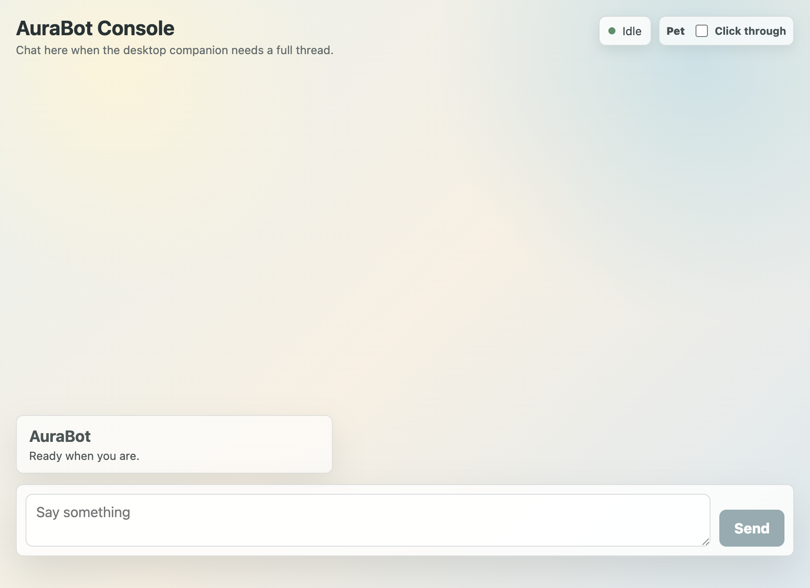

# AuraBot

[English README](README.md)

AuraBot 是一个桌面优先的陪伴型 AI MVP。它不是传统意义上常驻打开的聊天软件：默认形态是一个桌面 Live2D 小人，平时只显示小人本体，鼠标悬浮时才露出拖拽、语音输入、桌宠小气泡输入和控制台入口。

当前版本先验证一条最小可用闭环：

1. 一个透明、置顶的 Live2D 桌宠停在桌面上。
2. 鼠标悬浮小人时，下方浮现半透明的 `Drag / Voice / Console` 控制，并在侧边显示可展开的 `Chat` 小气泡。
3. 控制台承担完整主线程对话、记忆写入/召回和任务控制。
4. 任务状态可以通过任务卡看见，主要控制仍走主聊天，同时任务卡提供取消/删除快捷按钮。
5. 任务完成、桌宠语音回复、桌宠小气泡输入和到期 follow-up 可以通过临时桌面气泡浮现。

## 当前演示

桌面小人：


控制台视窗：



## 现在已经能做什么

| 模块 | 当前状态 |
| --- | --- |
| 桌面壳层 | Electron + React + TypeScript + Vite 应用可以本地启动。 |
| Live2D 表面 | 官方 Live2D Hiyori 样例模型可以在桌宠窗口渲染。 |
| 双窗口体验 | 小人窗口可以通过悬浮控制打开或聚焦普通控制台窗口。 |
| 桌宠行为设置 | 控制台设置可以让点击穿透小人窗口，便于点到后面的桌面内容。 |
| 桌宠位置 | 拖拽后的位置会持久化，并在启动时夹回可见工作区。 |
| 桌宠状态 | Agent 状态会广播到桌宠，并映射到 Hiyori 当前可用的 motion group；主进程也会追踪系统全局鼠标，让小人在窗口外也能看向指针。 |
| 桌宠小气泡输入 | 悬停 Live2D 模型会出现小型 `Chat` 气泡，点击后展开成输入框，并以 `pet_text` 来源发送到主对话。 |
| 语音输入 MVP | 运行时支持浏览器 `SpeechRecognition` 时，桌宠悬浮按钮可以语音输入。 |
| 本地存储 | SQLite 存储 profiles、souls、sessions、messages、memory、tasks 和 event logs。 |
| 主聊天线程 | 控制台和桌宠小气泡消息通过 typed IPC 进入主进程并持久化；用户消息即时上屏，助手回复可流式更新。 |
| 模型角色 | `gateModel`、`chatModel` 和 `memoryModel` 可注入；默认走本地 deterministic fallback，也可以接 OpenAI-compatible API。 |
| Gate 逻辑 | 可判断碎片输入等待、完整聊天、任务请求、任务控制和话题结束；配置模型后可使用 model-backed gate 判定。 |
| 记忆 v1/v2 | 支持 preference、event、follow-up 记忆写入，并可通过关系边召回；App 运行期间可用后台 scheduler 触发到期提醒桌宠气泡。 |
| 任务 v1 | 可以在主聊天里创建、查询、打断、修改、启动并完成任务；任务卡提供取消/删除快捷按钮；显式配置后可按优先级调用本机 Codex、Claude Code 或 Hermes CLI runner 执行真实委派任务。 |
| 验证 | Unit、integration、build 和 e2e 检查都已接入。 |

## 快速启动

要求：

1. Node.js 可用，并带 Corepack。
2. 当前开发目标是 macOS。

安装依赖：

```bash
corepack enable
corepack pnpm install
```

以开发模式启动桌面应用：

```bash
corepack pnpm dev
```

应用启动后应该会出现一个小型透明 Live2D 桌宠窗口。当前内置 Hiyori 模型，模型文件位于：

```text
src/renderer/public/assets/live2d/hiyori/Hiyori.model3.json
```

把鼠标放到小人身上，点击 `Console` 打开控制台。控制台输入规则：

1. `Enter` 直接发送。
2. `Ctrl+Enter` 换行。
3. 用户消息会立刻进入对话区；gate/模型继续在后台处理，稍后再追加助手回复或任务结果。

使用干净临时数据目录启动，并显示一个小 Live2D 调试标记：

```bash
corepack pnpm dev:clean
```

`dev:clean` 会创建临时 user data 目录，设置 `AURABOT_DEBUG_PET=1`，并跳过 macOS 系统级 AuraBot 配置文件。排查 Live2D 是否可见、模型是否 ready、是否被本机 API 配置影响时，优先用这个模式。

使用生产构建并配合干净临时数据目录启动：

```bash
corepack pnpm start:clean
```

## 外部模型 API

AuraBot 当前有三个独立模型角色：

| 角色 | 推荐模型 |
| --- | --- |
| `gateModel` | 轻量、快速、低成本模型，用于回复时机、话题结束判断、聊天/任务分类和任务控制检测。 |
| `chatModel` | 推理能力更强的模型，用于最终面向用户的对话回复。 |
| `memoryModel` | 结构化输出稳定的模型，用于记忆抽取、重复记忆合并和候选关系边判断。 |

没有配置时，这三个角色都会走本地 deterministic fallback。要启用 OpenAI-compatible provider，可以在 Electron user data 目录创建下面任意一个文件：

```text
aurabot.config.json
config.json
```

macOS 正常启动时也会读取系统级配置：

```text
/Library/Application Support/AuraBot/aurabot.config.json
/Library/Application Support/AuraBot/config.json
```

日常本地测试时，最简单的路径是：

```text
/Library/Application Support/AuraBot/config.json
```

可以用你习惯的编辑器创建或修改它，例如：

```bash
sudo mkdir -p "/Library/Application Support/AuraBot"
sudo nano "/Library/Application Support/AuraBot/config.json"
```

示例配置：

```json
{
  "gateModel": {
    "enabled": true,
    "provider": "openai-compatible",
    "baseUrl": "https://api.example.com/v1",
    "apiKey": "your-api-key",
    "model": "your-lightweight-model",
    "temperature": 0,
    "timeoutMs": 8000
  },
  "chatModel": {
    "enabled": true,
    "provider": "openai-compatible",
    "baseUrl": "https://api.example.com/v1",
    "apiKey": "your-api-key",
    "model": "your-strong-reasoning-model",
    "temperature": 0.7,
    "timeoutMs": 30000
  },
  "memoryModel": {
    "enabled": true,
    "provider": "openai-compatible",
    "baseUrl": "https://api.example.com/v1",
    "apiKey": "your-api-key",
    "model": "your-structured-memory-model",
    "temperature": 0,
    "timeoutMs": 12000
  },
  "taskRunner": {
    "provider": "cli",
    "runners": [
      {
        "id": "codex",
        "enabled": true,
        "priority": 1,
        "command": "/Applications/Codex.app/Contents/Resources/codex",
        "workingDirectory": "/path/to/AuraBot",
        "sandbox": "workspace-write",
        "approvalPolicy": "never",
        "timeoutMs": 300000
      },
      {
        "id": "claude",
        "enabled": false,
        "priority": 2,
        "command": "/opt/homebrew/bin/claude",
        "workingDirectory": "/path/to/AuraBot",
        "approvalPolicy": "never",
        "timeoutMs": 300000
      },
      {
        "id": "hermes",
        "enabled": false,
        "priority": 3,
        "command": "hermes",
        "workingDirectory": "/path/to/AuraBot",
        "timeoutMs": 300000
      }
    ],
    "sandbox": "workspace-write",
    "approvalPolicy": "never",
    "timeoutMs": 300000
  }
}
```

`gateModel`、`chatModel` 和 `memoryModel` 现在都有小型 LangChain POC 路径。把任意一个角色的 `provider` 设为 `"langchain-openai"`，这个角色就会走 `@langchain/openai`，其他角色仍可继续使用现有 provider 路径。设置窗口可以把每个角色切换为本地 fallback、OpenAI-compatible 或 LangChain OpenAI；API Key、Base URL 和模型名仍然在 `config.json` 里编辑。`gateModel` 和 `memoryModel` 会使用 LangChain structured output，然后继续复用现有 zod 校验、路由/记忆逻辑和 deterministic fallback。

如果要让结构化 gate 判断走 LangChain：

```json
{
  "gateModel": {
    "enabled": true,
    "provider": "langchain-openai",
    "baseUrl": "https://api.example.com/v1",
    "apiKey": "your-api-key",
    "model": "your-lightweight-gate-model",
    "temperature": 0,
    "timeoutMs": 8000
  }
}
```

```json
{
  "chatModel": {
    "enabled": true,
    "provider": "langchain-openai",
    "baseUrl": "https://api.example.com/v1",
    "apiKey": "your-api-key",
    "model": "your-strong-reasoning-model",
    "temperature": 0.7,
    "timeoutMs": 30000
  }
}
```

如果要让结构化记忆抽取和召回规划走 LangChain：

```json
{
  "memoryModel": {
    "enabled": true,
    "provider": "langchain-openai",
    "baseUrl": "https://api.example.com/v1",
    "apiKey": "your-api-key",
    "model": "your-structured-memory-model",
    "temperature": 0,
    "timeoutMs": 12000
  }
}
```

`baseUrl` 填 provider 的 API 根路径，通常以 `/v1` 结尾。不要直接填到 `/chat/completions`，AuraBot 会自己拼接 chat completions 路径。

临时开发启动也可以用环境变量覆盖文件配置：

```bash
AURABOT_MODEL_PROVIDER=openai-compatible \
AURABOT_MODEL_BASE_URL=https://api.example.com/v1 \
AURABOT_MODEL_API_KEY=your-api-key \
AURABOT_GATE_MODEL_ENABLED=1 \
AURABOT_GATE_MODEL_NAME=your-lightweight-model \
AURABOT_GATE_MODEL_TIMEOUT_MS=8000 \
AURABOT_CHAT_MODEL_ENABLED=1 \
AURABOT_CHAT_MODEL_NAME=your-strong-reasoning-model \
AURABOT_CHAT_MODEL_TIMEOUT_MS=30000 \
AURABOT_MEMORY_MODEL_ENABLED=1 \
AURABOT_MEMORY_MODEL_NAME=your-structured-memory-model \
AURABOT_MEMORY_MODEL_TIMEOUT_MS=12000 \
AURABOT_TASK_RUNNER=codex \
AURABOT_CODEX_COMMAND=/Applications/Codex.app/Contents/Resources/codex \
AURABOT_CODEX_WORKDIR=/path/to/AuraBot \
AURABOT_CODEX_SANDBOX=workspace-write \
AURABOT_CODEX_APPROVAL_POLICY=never \
corepack pnpm dev:clean
```

API key 只放本地，不要提交进 git。`corepack pnpm dev` 会读取正常系统级配置；`corepack pnpm dev:clean` 默认忽略系统级配置，除非你显式传入环境变量。

## 任务 CLI Runner

任务执行默认使用 deterministic runner，保证测试和 demo 稳定。如果要让 AuraBot 把排队任务委派给本机 CLI agent，可以在设置窗口的「任务 CLI」里开关 Codex、Claude Code、Hermes 并调整优先级，也可以在配置里把 `taskRunner.provider` 设成 `cli` 并写入 `taskRunner.runners`。`priority` 数字越小越先尝试；高优先级命令不可用时，会跳过并启动下一个已启用 runner。

旧的 Codex-only 配置仍然兼容：`taskRunner.provider` 为 `codex`，或环境变量 `AURABOT_TASK_RUNNER=codex`，都会启用 Codex runner，并把旧的 `codexCommand`、`workingDirectory`、`model`、`sandbox`、`approvalPolicy`、`timeoutMs` 映射进新的 runner 列表。

当前主聊天流程：

1. 说一个任务型请求，例如 `帮我做一份 GitHub 周报。`
2. AuraBot 创建一个子任务 session，主聊天仍作为控制面。
3. 当任意任务 CLI runner 已启用时，AuraBot 会立刻在后台启动当前最高优先级且可用的 child runner，任务条会从 `queued` 进入 `running`。
4. Codex 通过 `codex exec` 运行；Claude Code 通过 `claude --print` 运行；Hermes 作为可配置 stdin/stdout CLI 命令运行。
5. 执行过程中，进度会写入任务并广播到控制台任务条；你问 `这个任务做到哪了？`，主聊天会返回状态、最近进展和最近 task event。
6. AuraBot 把 CLI 最终输出写入 task events，并在子任务结束后回到主控制台里回复你。

默认 deterministic runner 仍会让新任务停在 `queued`，直到主聊天说 `开始做这个任务。`。这样测试和 demo 行为更稳定。

默认任务 CLI 执行设置偏保守：

| 字段 | 默认值 |
| --- | --- |
| `sandbox` | `workspace-write` |
| `approvalPolicy` | `never` |
| `timeoutMs` | `300000` |
| `workingDirectory` | 未配置时使用当前进程工作目录 |

runner 会记录 `task.agent.started`、`task.agent.progress`、`task.agent.completed` 和 `task.agent.failed` 事件。子任务失败时，主聊天会明确回复任务失败，不会假装已经完成。

## 验证命令

运行 unit 和 integration 测试：

```bash
corepack pnpm test
```

运行类型检查：

```bash
corepack pnpm typecheck
```

构建 Electron 应用：

```bash
corepack pnpm build
```

运行端到端测试：

```bash
corepack pnpm test:e2e
```

最近一次本地验证记录：

| 检查 | 结果 |
| --- | --- |
| `corepack pnpm test` | 23 个 test files、74 个 tests 通过 |
| `corepack pnpm typecheck` | 通过 |
| `corepack pnpm build` | 通过 |
| `corepack pnpm test:e2e` | 11 个 e2e tests 通过 |
| Live2D 冷启动检查 | `dev:clean` 可渲染 Hiyori，`renderState=ready`，`motionGroup=Idle` |

## 项目结构

```text
src/
  main/
    createWindow.ts          # 桌宠窗口和控制台窗口生命周期
    index.ts                 # Electron 应用启动入口
    petSettingsStore.ts      # 桌宠行为设置持久化
    petWindowStateStore.ts   # 桌宠窗口位置持久化
    registerIpc.ts           # typed IPC handlers
    windowPlacement.ts       # 控制台靠近桌宠的窗口定位
  preload/
    index.ts                 # 安全 renderer API bridge
  renderer/
    public/assets/live2d/    # 内置 Live2D 样例模型
    src/
      App.tsx                # 桌宠/控制台 route 切换
      app/store.ts           # renderer 状态和 IPC 调用
      features/
        pet/                 # 桌面小人表面
        live2d/              # Pixi + Live2D 渲染器
        console/             # 完整对话控制台
        chat/                # composer 和 message list
        settings/            # 紧凑桌宠行为设置
        tasks/               # 任务状态条
        status/              # agent 状态指示器
  core/
    bootstrap/               # service wiring
    orchestration/           # gate 和 chat pipeline
    llm/                     # 模型角色接口和 OpenAI-compatible adapters
    memory/                  # 记忆写入、召回和联想关系
    tasks/                   # 任务生命周期和 deterministic runner
    storage/                 # SQLite migrations 和 repositories
    profiles/                # 默认 profile 和 soul seed
    telemetry/               # event log service
  shared/
    contracts/               # IPC 和 chat DTOs
    schemas/                 # Zod schemas
tests/
  unit/
  integration/
  e2e/
docs/
  PRD-v1.md
  TODO.md
  TS.md
  aurabot-development-status.md
  memory/
    aurabot-memory-structure.md
    open-source-graph-memory-roadmap.md
    memory-system-and-roadmap.html
```

## Live2D 模型加载

当前桌宠模型是 Live2D 官方 Cubism Web Samples 里的 Hiyori。当前 checkout 不需要额外下载模型。

运行时模型 URL：

```text
assets/live2d/hiyori/Hiyori.model3.json
```

renderer 常量位置：

```text
src/renderer/src/features/pet/DesktopPet.tsx
```

当前代码：

```ts
const MODEL_PATH = "assets/live2d/hiyori/Hiyori.model3.json";
```

替换模型步骤：

1. 把 Cubism 4 模型文件夹放到 `src/renderer/public/assets/live2d/<model-name>/`。
2. 保持 `*.model3.json`、textures、motions、physics、expressions 等文件的相对路径和 manifest 期望一致。
3. 修改 `src/renderer/src/features/pet/DesktopPet.tsx` 里的 `MODEL_PATH`。
4. 在模型文件夹里新增或更新 `SOURCE.md`，记录来源和 license。
5. 用 `corepack pnpm dev:clean` 启动；调试标记显示 `ready` 时表示模型加载成功。

当前模型来源信息放在：

```text
src/renderer/public/assets/live2d/hiyori/SOURCE.md
```

Cubism Core runtime 通过 `live2dcubismcore@1.0.2` 本地打包，应用启动时不会从 CDN 拉取 runtime。

## 当前边界

这还是 MVP 骨架，不是生产级陪伴产品：

1. 模型角色默认走 deterministic local fallback；外部调用需要本地配置文件或环境变量。
2. 用户消息已经能即时显示，助手消息可以通过 update 广播流式更新；还没有支持用户新消息打断 in-flight generation。
3. 记忆层配置 `memoryModel` 后可用 API 做结构化抽取、重复记忆合并、候选关系边判断、召回语义检索词生成和 seed node 重排；还没有 embedding。
4. 任务 runner 显式配置后可以调用本机 Codex、Claude Code 或 Hermes，广播子任务进度，在主聊天打断时取消子进程，并在启动时把失联运行态任务标记为失败；真正 resume 和更完整的 artifact 管理还没有实现。
5. Live2D 状态行为复用 Hiyori 内置 motion group，并已接入全局鼠标追踪眼动；还没有定制表情资源或更细的动画状态机。
6. 语音输入依赖 Chromium 的 `SpeechRecognition`；还需要稳定的本地或模型 STT adapter。
7. Profile 切换、定时任务、桌面通知、打包发布和开机自启还没有实现。

## 下一步推荐

当前优先级：

1. Live2D 桌宠行为层：细化状态动作，补更丰富表情资源，继续打磨点击穿透 hit testing，并给全局鼠标追踪增加诊断显示。
2. 真实模型适配层 v2：在流式回复已接入的基础上继续补 in-flight 中断、retry/backoff 和可见模型连接状态。
3. Memory v2：继续扩展更真实的多轮评估语料；当前 App 运行期间的 follow-up 后台 scheduler + 桌宠气泡主动提醒已接入，Memory Debug 已能展示最近一次 recall trace，`corepack pnpm eval:memory` 已可跑固定 recall fixture。
4. Task executor v2：增加真实任务类型、artifact 处理、工具执行和取消信号，同时保持主聊天为主要控制面。
5. 主线程任务控制 v2：扩展当前 hint router，支持“第一个”“刚才那个”和任务别名等更自然的引用。

更多实时状态见 [AuraBot 当前开发状态](docs/aurabot-development-status.md)。
