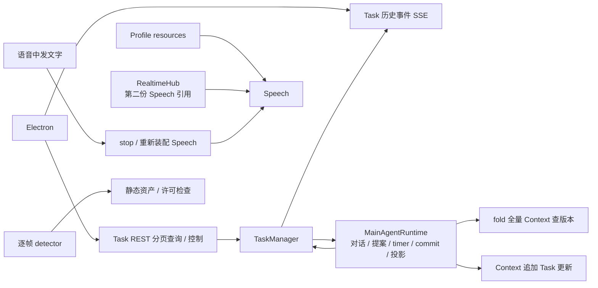
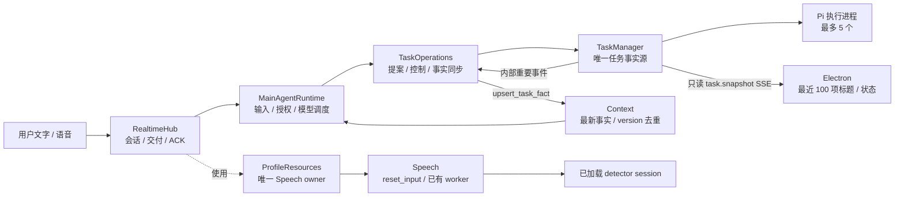

# AuraBot 黑盒测试前架构优化记录

日期：2026-09-06。实现基线：`2b504dc`；工作分支：`codex/architecture-optimization`。

已完成用户批准的五阶段优化及最终回归。Main Agent 保持 Task 业务唯一入口，TaskManager 保持唯一持久任务事实源，语音交付、授权和三秒可打断提案继续受行为测试保护。

## 架构前后

### 优化前



### 优化后



Task 查询、去重与恢复知识集中到所属 module；调用方通过较小的 interface 获得 leverage，问题定位与行为验证具有更好的 locality。真实 SQLite/vector adapter 保留；没有增加通用框架、测试专用 interface 或第三方依赖。

## 已实现变化

| 范围 | 实现与定位 |
| --- | --- |
| 退役路径 | 删除 Electron 旧 Chat/Gate/Memory/主动触发/Voice/bootstrap、旧配置与专属测试；删除 Python ShortTerm、JSON 导入和兼容重导出。当前 Profile、人格、Live2D、桌面历史与 Context→Memory 封存保留。 |
| Profile 存储 | `frontend/src/core/profiles/profileStorage.ts` 直接拥有当前身份与已应用人格两表，删除旧业务建表、迁移和启动目录清理。 |
| Task 存储 | `backend/task/store.py` 直接建立 schema 3；删除自研 SQL tokenizer、重复 DDL 契约、结构逐项鉴定和全库 FK 扫描。原生约束、事务、CAS、当前版本重开及未知版本拒绝保留。 |
| Task 外部输出 | `backend/app/gateway/task_routes.py` 只保留 Profile 必填的状态 SSE；SQL 直接筛选未删除最近 100 项，倒序。创建/状态/删除唤醒，输出不刷新。Electron 只有一个订阅、解析、重连与取消。 |
| Task 事实 | `backend/main_agent/context.py` 新增最新事实小表及 `upsert_task_fact`；真实 Task 按 ID/version 去重，提案按稳定 ID 更新。Runtime 不再缓存版本或 fold 查单条版本。 |
| 启动恢复 | `backend/main_agent/task_operations.py` 先取事件位置、分批对齐当前 Profile（含删除事实），随后消费新位置后的重要事件。重复事实不重复触发 CONTINUE。 |
| 语音所有权 | `backend/main_agent/lifecycle.py` 的 ProfileResources 唯一拥有 Speech；Hub 通过明确 seam 使用。删除临时 renderer 回填与重复 disconnect。 |
| 语音重置 | `SpeechService.reset_input()` 复用 worker/provider/detector；串行结清在途 VAD/EOU 与 STT，失效旧回调及已取出的旧 PCM，再提交文字；保留 voice mode。 |
| 热态推理 | `backend/main_agent/speech.py` 缓存命中直接使用 session，首次资产/许可证检查、加载/推理异常处理保留。原来已有进程 ONNX 缓存，本轮没有把它算作新增优化。 |
| 提案控制 | TaskOperations 集中单提案 worker、三秒计时、冻结/恢复、提交和控制归属；提交前允许取消，Manager 接管后由 owner 结清。投影失败报告一次，保留 Task 持久结果；无无限重试。 |
| Memory | 删除单调用方 seeds 转发及 invode 兼容入口；直接使用真实存储 adapter，预算打包只执行一次。 |

已核实并移除 `@langchain/openai`、`p-queue`、`@vueuse/core`、`ws`、`@types/ws` 的无调用者直接依赖，锁文件同步更新。新增、修改的源文件已补齐顶部职责/流程/module 关系注释。

## 保留的产品约束

- Task 并发为 5；提案可打断窗口仍为 3 秒，疑似说话冻结剩余时间、误报恢复、确认说话取消。
- VAD 候选暂停本地播放，误报恢复，确认撤销旧回复；EOU 完成/不完整/不可用分支与现有时序保留。
- PREPARE / RESPOND / CONTINUE、优先级、限流、单次模型调用、PREPARE settlement，以及 input/segment/revision/ResponseGrant 效果检查保留；仅删除无消费者的 `PendingTrigger.min_context_version`。
- 整句播放完成 → Electron 历史提交 → ACK；中断句不写对话。
- 语音中发送文字只重置采集回合并取消旧 TTS，语音模式继续。
- Task 持久化成功但 Context 投影失败时，沿现有错误通路报告并停止失败操作；下次正常启动重新对齐。Memory 原有封存失败保留重试边界的行为不受这项 Task 策略影响。

## 实际删减

基于 `git diff --numstat`，同时计入新建未跟踪文件的行数；基线为 `2b504dc`。生产源码只统计 Backend 与 Frontend 源文件，测试、文档、配置/锁文件分开。

| 类别 | 新增 | 删除 | 净减少 |
| --- | ---: | ---: | ---: |
| 生产源码 | 986 | 11,005 | **10,019** |
| 测试与测试数据 | 718 | 4,979 | 4,261 |
| package 配置与锁文件 | 2 | 319 | 317 |

这是 diff 规模，不是性能结论。新 module 中搬入的代码已通过新增量抵扣，测试删除不计入运行时收益。测试数量减少主要来自退役路径专属测试删除，现行产品行为测试保留并补充受影响行为。

## 临时数据测量

从 Git 基线源代码加载旧实现，与当前实现使用相同进程环境和独立临时 SQLite 数据比较。没有连接真实 Provider；detector 使用已加载 session 替身。以下为一次本机微测量，关注工作次数，耗时只用于局部参考，不能换算整体 CPU、内存或端到端延迟降幅。

| 场景 | 优化前工作量 | 优化后工作量 | 本次局部耗时：前 → 后 |
| --- | --- | --- | --- |
| 500 次热态 detector session 获取 | 500 次许可证读取 | 0 次读取 | 9.003 → 0.031 ms |
| 1,000 条 Observation 上处理 100 次重复 Task 事实 | 100 次完整 fold，100,100 次 JSON 解码 | 0 次完整 fold，0 次 JSON 解码；按 ID/version 判重 | 137.793 → 1.082 ms |
| 250 个 Task 取最近 100 项 | 2 次 SELECT，构造 250 项记录 | 1 次 SELECT，构造 100 项记录 | 2.089 → 0.192 ms |
| 空闲语音生命周期连续 10 次文字切入 | 共创建 11 个 Speech、22 个 mic/delivery worker | 共创建 1 个 Speech、2 个 worker（含首次创建） | 2.649 → 0.015 ms |

最后一项隔离执行旧 stop/start 与新 reset 路径，provider 为替身；它衡量资源装配与异步任务调度，不包含 STT/TTS 请求、声学推理或当前在途操作收口等待。正确性测试另外确认 reset 期间 worker 身份保持、旧回调/旧帧失效、在途推理结清。

本次临时复现文件：`/tmp/aurabot-architecture-benchmark.py`、`/tmp/aurabot-architecture-benchmark.json`、`/tmp/aurabot-resource-probe.py`、`/tmp/aurabot-resource-probe.json`。临时文件可能被系统清理，因此关键方法和结果保存在本文；它们未成为长期测试基础设施。

## 检查结果

| 检查 | 结果 |
| --- | --- |
| 优化前 Backend 基线 | 251 项通过；首次受限运行有本地端口绑定错误，允许本机端口后全部通过。 |
| 优化前 Frontend 基线 | typecheck；187 项测试 / 59 文件通过。 |
| 最终 Backend unittest | **219 项通过**，包含真实 pinned Pi 离线冒烟。 |
| 最终 Frontend | **typecheck、90 项测试 / 25 文件、build 通过**。 |
| Pi extension | **typecheck、5 项测试通过**。 |
| 真实桌面启动冒烟 | **4 项通过**：Hiyori/设置应用、真实 Python 文字交付与忙碌重启取消、已有监听端口保护、真实 Electron AudioWorklet 连续合成句。 |
| 交叉 review | Task/Memory、Frontend、语音/生命周期、TaskOperations/Context 已互审；发现的旧 PCM reset 竞争与事实提交因果顺序问题已修复并回归。 |

最终命令：

```sh
backend/.venv/bin/python -m unittest discover -s backend/tests -t .
# frontend/
npm run typecheck
npm test
npm run test:e2e # 含原生模块重建与 build
# pi-aurabot-task/
npm run typecheck
npm test
```

构建仍有既有 Pixi 静态/动态导入提示，不影响本轮构建或桌面测试。网关测试改用独立临时数据库，避免读入旧共享测试目录的 schema 2；产品 schema 版本检查没有为测试放宽。故障传播测试会产生预期错误日志，最终 suite 状态为通过。

## 已执行的数据重置

检查环境变量、设置文件及默认路径后，确认实际运行目录为：

`/Users/zytwd/Library/Application Support/AuraBot/desktop-v2`

检查时没有仍占用该目录的 AuraBot/Electron/Backend 进程。按用户授权，删除此目录内确认的旧运行数据：`settings.json`、`profile.sqlite3`、`conversation-history.sqlite3`、`pet-window-state.json`、`task`、`profiles`、`pi-agent` 的应用专属配置/运行数据。没有删除上层 Chromium 缓存、模型/许可证资产、共享第三方目录或用户工作区。桌面测试使用独立临时数据；下一次正常启动建立当前 schema 并使用全新配置。

## 后续黑盒验收范围

真实麦克风设备、STT/TTS Provider、噪声误报比例、实际播放打断与 EOU 体感、连续语音中穿插文字、CPU 发热/内存驻留以及设备端到端延迟，仍需黑盒与灰度环境实测。本轮未声称这些体验指标已经获得量化改善。

工作保留在当前分支和工作区，尚未提交或推送。系统模块、Task 契约、语音运行约束、配置生命周期与开发状态文档已同步。
