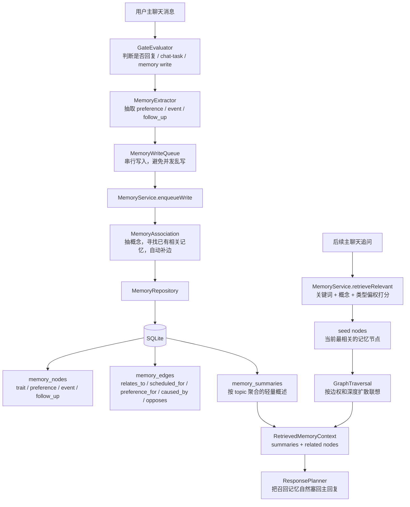
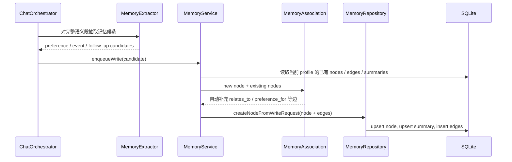

# AuraBot 当前记忆结构

更新时间：2026-05-04

这版记忆系统是一个受控的“分层摘要 + 图状联想”结构。它还不是向量库，也不是开放式知识图谱；当前目标是先让 AuraBot 在本地、可测试、可解释的范围内做到：写入稳定事实，识别时间事件，并在相关记忆之间自动连边，后续对话可以沿边联想召回。

## 结构图



## 当前数据层

| 层 | 表/对象 | 作用 |
| --- | --- | --- |
| 原子记忆 | `memory_nodes` | 存一条可独立召回的事实，例如“用户喜欢火锅”“用户明天要和阿杰去吃火锅”。 |
| 联想边 | `memory_edges` | 存两条记忆之间的关系和权重，例如事件指向偏好的 `preference_for`。 |
| 摘要层 | `memory_summaries` | 按 topic 保存轻量概述，检索时先带摘要，再展开相关节点。 |
| 写入队列 | `MemoryWriteQueue` | 串行化记忆写入，避免多条消息同时修改图结构。 |
| 运行日志 | `event_logs` | 记录 gate 决策、memory write、memory recall 等调试轨迹。 |

## 当前写入流程



## 当前联想例子

用户先说：

```text
我喜欢吃火锅。
```

系统写入：

```text
preference: 用户喜欢火锅
```

用户后来又说：

```text
我明天要和阿杰去吃火锅，提醒我别忘了。
```

系统会写入：

```text
event: 用户提到一个时间相关事件：我明天要和阿杰去吃火锅，提醒我别忘了。
follow_up: 需要跟进或提醒用户：我明天要和阿杰去吃火锅，提醒我别忘了。
```

同时自动补边：

```text
event --preference_for(0.90)--> preference
follow_up --scheduled_for(0.90)--> event
follow_up --preference_for(0.90)--> preference
```

所以之后用户即使只问：

```text
阿杰 那件事我该顺便注意什么？
```

检索入口会先命中“阿杰”相关事件，再沿 `preference_for` 联想到“用户喜欢火锅”，回复就不只复述事件本身，而会顺带带出稳定偏好。

## 当前检索策略

1. `retrieveRelevant(profileId, query)` 对所有 active memory nodes 打分。
2. 打分来源包括：
   - query token 与 node content 的直接命中
   - query concept 与 node concept 的命中
   - 类型偏权，例如“下周/安排/提醒”偏向 event，“喜欢/讨厌/吃什么”偏向 preference
3. 取前几个 seed nodes。
4. `GraphTraversal` 从 seed nodes 出发，按边权、深度和数量上限扩散。
5. 返回 `summaries + nodes`，由 `ResponsePlanner` 负责生成当前回复。

## 当前边界

1. 这版联想是 deterministic local logic，不依赖外部 LLM 或 embedding。
2. 概念抽取目前是轻量规则，适合 MVP 验证，不适合直接当最终语义理解层。
3. 图扩散有 `maxDepth` 和 `maxNodes` 上限，避免把所有记忆都拉进回复。
4. 后续如果接入 LLM/embedding，建议只替换概念抽取和候选边判断层，SQLite 表结构可以继续沿用。

## 下一步应做

1. **替换概念抽取层**：当前概念来自轻量规则，下一步应接入 LLM 或 embedding 生成更稳的概念、别名和语义标签。
2. **增加记忆合并策略**：同一事实重复出现时，应更新已有节点的权重、最近时间和摘要，而不是无限新增节点。
3. **增强时间驱动记忆**：`event` 和 `follow_up` 已能写入，但还没有真正的到期调度、提醒触发和完成态沉淀。
4. **补记忆调试视图**：需要能看到“本轮写入哪些节点、召回哪些节点、沿哪些边跳转”，否则后续很难调联想质量。
5. **建立评估语料**：用固定对话集比较关键词召回、概念召回、图扩散召回的回复差异，避免凭感觉调参。
