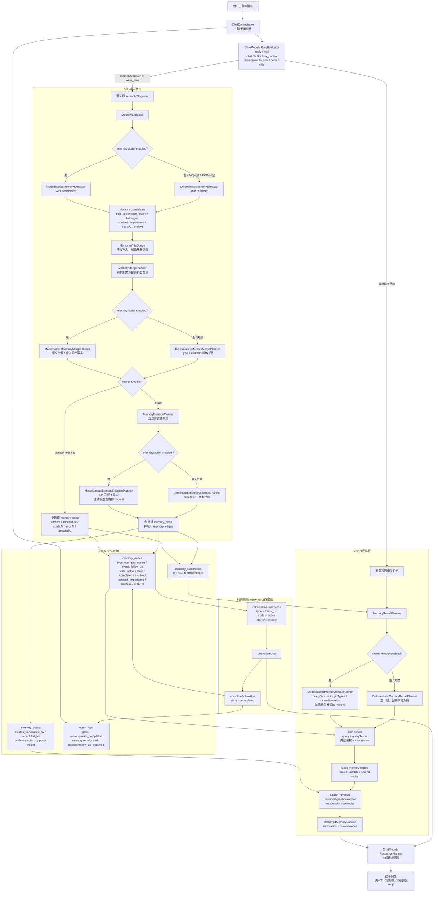
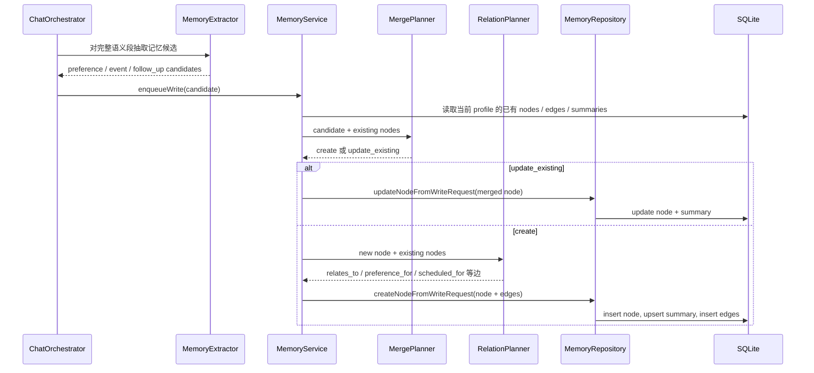

# AuraBot 当前记忆结构

更新时间：2026-05-05

这版记忆系统是一个受控的“分层摘要 + 图状联想 + memoryModel 语义增强”结构。它还不是向量库，也不是开放式知识图谱；当前目标是先让 AuraBot 在本地、可测试、可解释的范围内做到：写入稳定事实，识别时间事件，合并重复事实，在相关记忆之间自动连边，后续对话可以沿边联想召回，并能在下一次主聊天中触发到期 `follow_up`。

## 结构图



## 当前数据层

| 层 | 表/对象 | 作用 |
| --- | --- | --- |
| 原子记忆 | `memory_nodes` | 存一条可独立召回的事实，例如“用户喜欢火锅”“用户明天要和阿杰去吃火锅”。支持 `active / stale / completed / archived` 状态。 |
| 联想边 | `memory_edges` | 存两条记忆之间的关系和权重，例如事件指向偏好的 `preference_for`。 |
| 摘要层 | `memory_summaries` | 按 topic 保存轻量概述，检索时先带摘要，再展开相关节点。 |
| 写入队列 | `MemoryWriteQueue` | 串行化记忆写入，避免多条消息同时修改图结构。 |
| 运行日志 | `event_logs` | 记录 gate 决策、memory write、memory recall、follow-up triggered 等调试轨迹。 |

## 当前写入流程



## 当前联想例子

用户先说：

```text
我喜欢吃火锅。
```

系统写入：

```text
preference: 用户喜欢火锅
```

用户后来又说：

```text
我明天要和阿杰去吃火锅，提醒我别忘了。
```

系统会写入：

```text
event: 用户提到一个时间相关事件：我明天要和阿杰去吃火锅，提醒我别忘了。
follow_up: 需要跟进或提醒用户：我明天要和阿杰去吃火锅，提醒我别忘了。
```

同时自动补边：

```text
event --preference_for(0.90)--> preference
follow_up --scheduled_for(0.90)--> event
follow_up --preference_for(0.90)--> preference
```

所以之后用户即使只问：

```text
阿杰 那件事我该顺便注意什么？
```

检索入口会先命中“阿杰”相关事件，再沿 `preference_for` 联想到“用户喜欢火锅”，回复就不只复述事件本身，而会顺带带出稳定偏好。

## 当前检索策略

1. `retrieveRelevant(profileId, query)` 读取当前 profile 的 active memory context。
2. 若启用 `memoryModel`，`MemoryRecallPlanner` 会生成：
   - `queryTerms`：用于本地打分的语义词和别名
   - `targetTypes`：偏向召回的记忆类型
   - `rankedNodeIds`：模型认为最相关的 seed node，且必须来自已有节点
3. 本地 scorer 继续对所有 active memory nodes 打分，来源包括：
   - query / queryTerms 与 node content 的直接命中
   - query / queryTerms concept 与 node concept 的命中
   - 类型偏权，例如“下周/安排/提醒”偏向 event，“喜欢/讨厌/吃什么”偏向 preference
   - node importance
4. 合并 `rankedNodeIds + scored nodes`，取前几个 seed nodes。
5. `GraphTraversal` 从 seed nodes 出发，按边权、深度和数量上限扩散。
6. 返回 `summaries + nodes`，由 `ChatModel / ResponsePlanner` 负责生成当前回复。

## 当前 follow-up 触发策略

1. `retrieveDueFollowUps(profileId, nowIso)` 找出 `type = follow_up`、`state = active` 且 `startsAt <= now` 的节点。
2. 下一次主聊天回复会把这些 due follow-up 放进 `dueFollowUps`，生成“我提醒你一下...”这类回复。
3. 回复生成后调用 `completeFollowUps()`，把这些节点标记为 `completed`。
4. 同时写入 `memory.follow_up_triggered` 事件日志，便于后续调试视图展示。
5. 当前还不是后台 scheduler；如果用户没有唤醒主聊天，就不会主动弹桌宠气泡。

## 当前边界

1. 未配置 `memoryModel` 时，这版联想仍是 deterministic local logic，不依赖外部 LLM 或 embedding。
2. 显式配置 `memoryModel` 后，记忆写入层可以调用 OpenAI-compatible API 做结构化抽取、重复记忆合并和候选关系边判断；API 失败或输出不合法时回退本地规则。
3. 图扩散有 `maxDepth` 和 `maxNodes` 上限，避免把所有记忆都拉进回复。
4. 显式配置 `memoryModel` 后，召回入口可以调用 API 生成语义检索词、目标记忆类型和重排 node id；未配置或失败时仍走本地关键词/概念规则。
5. 已到期的 active `follow_up` 会在下一次主聊天回复中被带出，并在回复生成后标记为 `completed`，避免重复提醒。
6. 当前还没有后台 scheduler 或桌面主动气泡触发，到期提醒仍依赖主聊天被唤醒。
7. SQLite 表结构继续沿用；模型输出必须落到现有 `memory_nodes` 和 `memory_edges` 约束内。

## 下一步应做

1. **增强时间驱动记忆**：把当前主聊天触发式 follow-up 扩展为后台 scheduler + 桌宠气泡主动提醒。
2. **补记忆调试视图**：需要能看到“本轮写入哪些节点、召回哪些节点、沿哪些边跳转”，否则后续很难调联想质量。
3. **建立评估语料**：用固定对话集比较关键词召回、概念召回、图扩散召回的回复差异，避免凭感觉调参。
4. **后续可选 embedding**：如果固定评估集显示结构化 query analyzer 仍不够，再引入 embedding 和向量索引。
