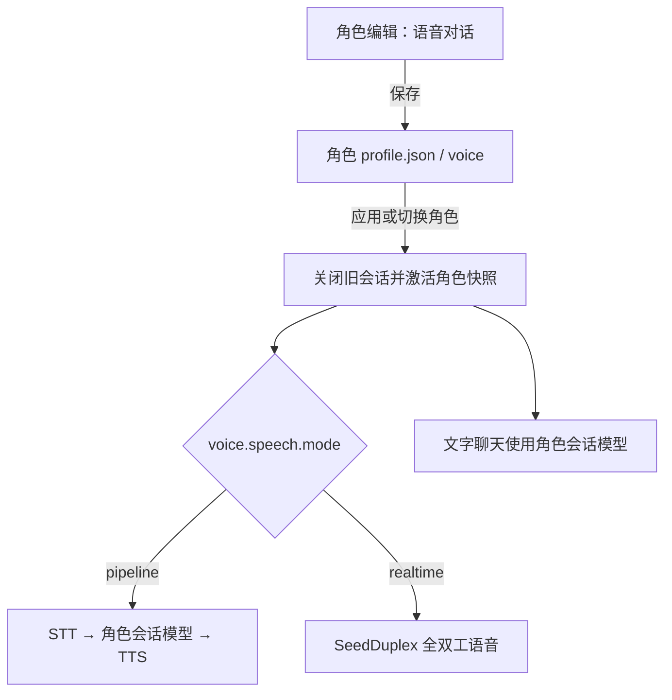

# 配置与 Backend 生命周期

## 配置事实源

当前产品尚未发行应用安装包，采用源码运行。用户通过 `AURABOT_USER_DATA_DIR` 指定安装目录；Electron Main 在该目录维护 `settings.json`。未指定时沿用 `<Electron userData>/desktop-v2`。安装目录用于运行依赖与持久化数据，源码仓库和开发环境可以位于别处。

从仓库根运行 `node frontend/scripts/install-runtime.mjs "$AURABOT_USER_DATA_DIR"`，将锁定的 Pi 依赖与 AuraBot 扩展安装到该目录；该命令不修改用户配置。首次启动默认登记 `default: 安装目录` 和 `home: 用户家目录`，Pi 路径默认为 `<安装目录>/pi-runtime`。重新启动不覆盖已有工作区或安装路径，不自动迁移旧安装。

~~~text
{
  version: 2,
  revision: 保存版本,
  backend: { app, chat_model, main_agent, memory, task },
  desktop: { pet, systemNotificationsEnabled }
}
~~~

上面是结构示意，不是可复制的完整配置。首次启动会生成符合 schema 的默认值，通过设置页修改即可。Renderer 获取脱敏配置与首尾四位、等长黑点的密钥预览。未编辑时保留；删除预览后保存时，前端通过原有清除列表表达清除意图；输入新密钥后保存则替换。

| 字段 | 用途 |
| --- | --- |
| Profile 配置 | 人格/SOUL、视觉和语音对话配置位于独立 Profile 目录。 |
| `profiles/<id>/profile.json` → `voice.chat_model` | 此角色的文字聊天、Pipeline 语音与内部 Memory 提炼使用的模型地址、名称、密钥、超时。 |
| `profiles/<id>/profile.json` → `voice.speech` | 此角色的 Pipeline / Realtime 二选一模式、独立密钥、音色、STT/TTS 型号及本地模型/许可证路径。 |
| `backend.main_agent.web` | 可选 Tavily 密钥；未配置则不开放 Web 工具。 |
| `backend.app.workspaces` | 用户提供的目录名称/ID 和绝对路径，直接进入 Main Agent 上下文，供理解项目与选择 Task 起始目录；不是 Pi 文件访问白名单。 |
| `backend.task` | Pi 模型、Node、默认超时及应用管理的数据/安装路径。 |
| `backend.memory.embedding` | 当前桌面配置使用本地 hash embedding、384 维。 |
| `desktop` | 共享桌宠与桌面偏好；模型和布局按 Profile 管理。 |

Electron 通过 `AURABOT_CONFIG_PATH` 把 JSON 路径交给 Backend；Python 只在启动时读取 `backend` 段与版本，不写文件、不热加载、不进行环境变量字符串插值。正常桌面启动不读取仓库 `config.yaml`、`config.example.yaml` 或旧 Electron `config.json`。

## 角色语音对话

设置侧栏不再包含“实时语音”。入口为 **角色配置 → 编辑 → 语音对话**，与“角色”“模型与动作”并列。每个角色保存独立的会话模型和两套语音参数，`mode` 只允许 `pipeline` 或 `realtime`；切换模式保留另一套参数，真实会话同时只使用一种引擎。Realtime 期间的文字输入互斥也读取当前已应用角色的模式。

旧 `settings.json` 中的 `backend.chat_model` 和 `backend.main_agent.speech` 仅保留文件兼容性，桌面激活角色时始终提交该角色自己的配置，不继承旧全局密钥。已有无语音字段的角色和新角色使用空密钥默认值，需要逐个配置；无需删除人格、模型或历史数据。

保存将 voice 与角色 revision 一起原子提交，已应用快照保持不变。应用或切换角色先关闭旧媒体会话；语音/会话模型发生变化时完整关闭旧角色运行资源并重新创建，只有 SOUL/动作变化时沿用原来的轻量更新。忙碌时沿用中断确认，后台进程无需重启。调试模式记录 `profile.voice.applied`，含模式与版本，不记录密钥。

密钥在 Main 保存，发给 Renderer 的 saved/applied 配置均脱敏；未编辑保留、输入替换、明确删除清空。资源下载缓存仍按安装目录共享，但下载完成只填入当前角色草稿中的资源路径。Backend 启动统一准备 speech 依赖，以便角色间随时切换引擎；VAD/断句模型加载及云端语音连接仍延迟到打开麦克风。

## 保存与应用

“保存”原子写入 JSON 和新 revision，当前运行不变。“应用”处理已保存版本：全局 Backend 配置变化需要重启；Profile 人格/视觉/语音变化走独立的会话激活通路，不重启 Python；只有桌面偏好变化时直接应用。启动/重启期间不能并发修改启动配置或再次启动 Backend。

~~~mermaid
sequenceDiagram
  participant S as Settings
  participant E as Electron Main
  participant B as Backend
  S->>E: 保存草稿
  E->>E: 原子写 settings.json
  S->>E: 应用
  E->>B: restart/prepare(force=false)
  alt 忙碌
    B-->>E: ready=false + busy
    E-->>S: 显示中断影响
    S->>E: 用户确认仍然应用
    E->>B: restart/prepare(force=true)
  end
  B->>B: 锁定 admission，阻止新工作
  B-->>E: ready=true
  E->>B: SIGTERM 并等待退出
  E->>B: 启动新实例，传 JSON 路径与实例标识
  E->>B: readiness
  B-->>E: ready + configRevision + instanceId
  E->>E: 匹配后才 markApplied
  E-->>S: 已应用状态
~~~

非强制忙碌检查不得改变运行状态。忙碌包含 queued/running/waiting Task、Memory 实际写入、Main Agent 调用/待提交操作与未完成交付；只有 Memory idle timer 不算写入。旧进程未退出时不启动第二个；新进程失败不标记应用成功，也不自动重启。

## 开发启动与资源激活

从 `frontend` 执行 `npm run dev`：Electron/Vite 启动后由 Electron 独占 Python 子进程。固定 Vite `127.0.0.1:6400`，Backend `127.0.0.1:6401`。不要并行另启 Backend；端口占用时只报告错误。

### 本次启动选项

`npm run dev -- --debug` 控制 Debug 窗口、诊断采集、JSONL 和 `speech-diagnostics.log`；`--lock-memory` 控制固定记忆与 Context 隔离。两个参数可组合，帮助入口为 `npm run dev -- --help`，未知参数在启动任何子进程前报错。启动脚本把公开参数转换为内部 `--aurabot-debug` / `--aurabot-lock-memory`，再通过应用参数分隔符传给 Electron，避开 Electron 和 electron-vite 自身的调试参数。

Electron Main 在启动时冻结 `{debug, lockMemory}`，通过只读设置状态返回，保存接口不接受它作为配置。原 `desktop.liveDebugEnabled` 字段被忽略，配置仍为 version 2。Electron 显式传递 `AURABOT_DEBUG`、`AURABOT_LOCK_MEMORY` 和锁定模式的 `AURABOT_SESSION_DATA_DIR` 给每个 Backend 子进程；这些是内部进程传递字段，日常使用 CLI 参数即可。Backend readiness 返回 `launchOptions` 和 `memoryFixture`，Main 确认模式与实例、配置版本均匹配后才标记已应用。

锁定模式的临时目录由 Electron 创建和持有；Backend 只在该目录下打开按 Profile 分区的 Memory/Context，不读取日常记忆。固定语料在首次激活时初始化，检索正常，禁止所有 Memory 业务修改及审计写入，不运行归档/提炼。应用配置重启 Backend 和 Profile 切换保留临时数据；退出时先等待 Backend 关闭，再清理目录。创建或初始化失败不会回退到正常存储；新启动不复用残留目录。Task、Profile/Soul 配置、语音资源与桌面可见历史维持原有存储路径。

Backend startup 只创建 Task 控制面、RealtimeHub 和 Profile owner。Main 通过显式 Profile activation 提交冻结 SOUL/adaptor/voice，才打开目标 Context、Memory 和文字 Runtime；Pet token 仅携带当前 `profileId` 与 `revision`，不隐式选择 Profile。连接默认文字；语音资源延迟到 `voice.start`。未配置模型或语音不阻止桌面/设置启动，调用不可用能力会明确拒绝。

`GET /health` 精确返回 `{"ok":true,"service":"backend"}`。`GET /api/v1/readiness` 返回生命周期、实例/配置版本和本地能力状态；不向 Provider 发健康探测。

## 数据布局与退出

~~~text
<安装目录>/
├── settings.json                 # Electron：共享保存设置
├── conversation-history.sqlite3  # Electron：分页的可见交付历史
├── profiles/<profile_id>/
│   ├── context.sqlite3           # Backend：对话 Context
│   ├── soul.json / profile.json / applied.json
│   ├── live2d/                   # adaptor 与自有版本模型包
│   └── memory/                   # Backend：Memory SQLite + qdrant
├── task/
│   ├── task-runtime.sqlite3      # Backend：Task 状态/事件
│   └── sessions/                 # Pi：执行会话
├── pi-agent/                     # Electron 生成 Pi provider 配置
├── pi-runtime/                   # 锁定的 Pi CLI 依赖
└── pi-aurabot-task/               # 配套 Pi 扩展与依赖
~~~

退出顺序为停止 realtime admission → 关闭活动 Profile 的 Runtime/Speech/Memory/存储 → 关闭 TaskManager/Pi → Electron 关闭自身数据库。Task 的恢复状态由 TaskManager 决定，不自动重跑。

启动执行可重入迁移，保留旧 Profile 身份、Soul、有效未应用编辑和数据归属。SQLite 使用一致性备份，Qdrant 在排他锁和关闭边界迁移；成功前不删除源数据。详细保存/应用/激活、删除保护与目录见 [Profile 与 Live2D](profile-live2d.md)。当前不提供 Node/Python/Pi 应用发行包；现阶段安装脚本依赖本机 Node/npm，Python 与前端仍从源码启动。

### 搜索接口

设置 → 模型接入 → 搜索接口中选择搜索服务商并填写 API Key。当前只接入 Tavily；
InfoQuest 标记为暂未支持。密钥为空时不注册 Main Agent 的 Web 工具，填写后仍需保存并应用。
密钥输入继续显示前四位、末四位和等长黑点，删除内容并保存即可清除。

配置使用 `backend.main_agent.web.provider`（当前为 `tavily`）与
`backend.main_agent.web.api_key`。旧 `tavily_api_key` 在 Electron 和后端读取时兼容，
新字段存在时优先，即使为空；之后正常写入只保留新字段，配置版本仍为 2。

后端 WebTools 管理搜索结果引用及内容边界，通过 search/read/aclose 接口使用 Tavily 适配器。
适配器共享一个延迟创建的 HTTP 客户端；搜索与正文提取均携带密钥。更换提供商不改变
Main Agent 的 web_search/web_read 参数和结果结构；本轮不支持多厂商并用或自动回退。
