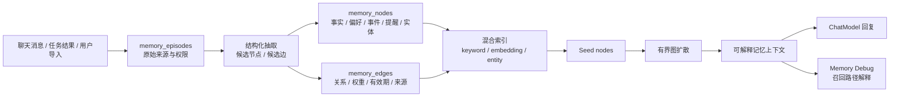

# AuraBot 开源图记忆路线调研

资料核对日期：2026-05-17

适用范围：AuraBot 当前本地记忆系统、开源图结构记忆项目调研、下一阶段 memory graph 设计。

## 1. 结论

AuraBot 不再接入 Supermemory。新的记忆方向是本地优先的图结构：

1. **节点存信息**：用户特质、偏好、事件、提醒、长期画像、对话 episode、实体等都落为可追溯节点。
2. **边存关联**：偏好与事件、提醒与事件、实体与事实、旧事实与新事实之间用边表达关系、权重、时间有效期和来源。
3. **召回走图扩散**：先从 query 命中少量 seed nodes，再沿高质量边做有界扩散，避免把整库塞进上下文。
4. **开源项目只作借鉴**：Graphiti、Cognee、Mem0、Letta 都提供了有价值的范式，但 AuraBot 已有本地 SQLite、Memory Debug、follow-up scheduler 和伴侣产品语境，不宜直接替换成外部框架。

当前最推荐的路线是：保留现有 `memory_nodes` / `memory_edges`，补 episode provenance、边级时序、实体层、混合检索和评估集，而不是引入闭源托管记忆服务。

## 2. 市面开源项目观察

### 2.1 Graphiti / Zep OSS core

参考：

- <https://github.com/getzep/graphiti>
- <https://arxiv.org/abs/2501.13956>

Graphiti 是 Zep 开源的 temporal context graph engine。它把记忆建模成：

| 组件 | 作用 | AuraBot 对应改进 |
| --- | --- | --- |
| Entities | 人、产品、地点、概念等实体节点，摘要会随时间演化 | 在 `memory_nodes` 之外增加实体节点或实体字段，避免所有内容只是一句自然语言事实 |
| Facts / Relationships | 实体之间的事实边，带 temporal validity window | 给 `memory_edges` 增加 `valid_from / valid_to / state / confidence` |
| Episodes | 原始输入流，作为所有派生事实的来源 | 增加 `memory_episodes`，保存源消息、任务、导入文档或系统事件 |
| Custom Types | 开发者定义的实体和边类型 | 继续保留 AuraBot 受控 schema，但支持可迁移的自定义类型 |

Graphiti 对 AuraBot 最大的启发不是“换数据库”，而是两个原则：

1. 事实变化时不应简单覆盖或删除，而应让旧事实失效，同时保留历史。
2. 每条派生记忆都应能追溯到原始 episode，方便调试、遗忘和用户解释。

### 2.2 Cognee

参考：

- <https://github.com/topoteretes/cognee>
- <https://www.cognee.ai/>

Cognee 更像 memory control plane，核心 API 抽象为 `remember / recall / forget / improve`。它支持把 session memory 作为快速缓存，再后台同步进永久知识图谱。

对 AuraBot 的启发：

1. 把聊天当下要用的轻量记忆与后台图谱整理拆开。
2. 让 `remember` 不等于“同步完成所有抽取、合并、连边和索引”，而是先保证当轮体验，再异步提升图谱质量。
3. `forget` 应成为一等能力，既能 archive 节点，也能处理 episode、边、摘要和派生事实。

### 2.3 Mem0

参考：

- <https://github.com/mem0ai/mem0>
- <https://docs.mem0.ai/migration/oss-v2-to-v3>
- <https://arxiv.org/abs/2504.19413>

Mem0 是通用 agent memory layer，强调 `add` / `search`、filters、hybrid search、embedding 和多运行时集成。其论文和文档都把 graph memory 作为提升多跳、时序和开放域召回的一种方向。

对 AuraBot 的启发：

1. 后续可以引入 embedding、BM25、实体 boosting 来改善 seed node 选择。
2. filter 必须稳定存在，例如 `profileId`、`sessionId`、`nodeType`、`state`、`source`，否则多 profile 和长期数据会很快混乱。
3. 图结构应负责语义关系和解释性，向量检索只负责找到更好的入口节点。

### 2.4 Letta / MemGPT

参考：

- <https://docs.letta.com/>

Letta 继承 MemGPT 的分层记忆思路：core memory 在上下文内，archival memory 在上下文外，agent 通过工具管理长期记忆。

对 AuraBot 的启发：

1. AuraBot 可以明确三层：当前会话上下文、长期图记忆、聚合摘要/画像。
2. 聊天模型不应直接任意改库；它可以提出写入意图，但最终仍由 `MemoryService`、schema 校验、merge/relation planner 控制。
3. Memory Debug 应继续保持白盒化，让用户和开发者知道“为什么它记住了、为什么它召回了”。

## 3. AuraBot 当前系统已经具备的基础

AuraBot 目前已经不是平面 key-value 或纯摘要记忆，而是一个轻量本地图结构：

| 层 | 当前实现 | 说明 |
| --- | --- | --- |
| 原子节点 | `memory_nodes` | `trait / preference / event / follow_up`，有 `active / stale / completed / archived` 状态 |
| 关系边 | `memory_edges` | `relates_to / caused_by / scheduled_for / preference_for / opposes`，带 `weight` |
| 摘要层 | `memory_summaries` | 按 topic 聚合轻量概述 |
| 写入控制 | `MemoryWriteQueue` | 串行化写入，避免并发改图 |
| 合并规划 | `MemoryMergePlanner` | 判断新建还是更新旧节点 |
| 关系规划 | `MemoryRelationPlanner` | 为新节点规划候选边 |
| 召回规划 | `MemoryRecallPlanner` + scorer | 生成 query terms、target types、seed nodes |
| 图扩散 | `GraphTraversal` | 从 seed nodes 沿边做深度和数量受限扩散 |
| 调试解释 | Memory Debug trace | 记录 query、plan、seed、expanded、returned、traversed edges |
| 主动提醒 | `MemoryFollowUpScheduler` | 到期 `follow_up` 推送桌宠气泡和系统通知 |

这套基础很适合继续演进为本地 graph memory：最小可用链路已经存在，下一步应补质量、可追溯和检索能力。

## 4. 目标架构

核心原则：

1. **episode 是真相源**：节点和边都是从 episode 派生的，不能失去来源。
2. **边是一等数据**：边不只是辅助关系，而是可评分、可失效、可解释的事实。
3. **召回可解释**：每次召回都能回答 seed 从哪里来、沿哪些边扩散、为什么返回这些节点。
4. **本地优先**：默认不依赖云端闭源服务；可选模型只做抽取、合并、重排和补边。
5. **评估驱动**：所有检索策略变更都必须先扩展 fixture，再看召回质量是否提升。

## 5. 推荐改进路线

### 阶段 A：巩固当前图结构

1. 给 `memory_edges` 增加 `state`、`confidence`、`updated_at`，让边可以被降权、失效或解释。
2. 增加 `source_episode_id`，先关联到消息或任务结果，后续再独立建 `memory_episodes`。
3. Memory Debug 增加“边为什么创建”的 planner 原始输出和失败原因。
4. 扩展 `tests/fixtures/memory/recall-evaluation.json`，覆盖反事实、偏好变化、多人关系和长期 follow-up。

### 阶段 B：引入 episode provenance

1. 新增 `memory_episodes` 表，记录来源类型、来源 id、原文摘要、时间、profile、权限和可删除状态。
2. 节点和边都关联 episode，支持从“用户要求删除某段对话”反查派生记忆。
3. 摘要层改为可重建：摘要来源于节点/episode，而不是只能不断 append。
4. 支持“旧事实被新事实替代”：旧节点或旧边进入 `stale`，新边用 `supersedes` 或 metadata 指向旧事实。

### 阶段 C：混合召回

1. 本地 keyword scorer 保留，用于中文短词、明确实体和提醒类 query。
2. 加入 embedding 或 BM25，只用于 seed node retrieval，不直接把大段文本塞给模型。
3. 引入实体候选，例如人名、地点、项目、食物、任务主题。
4. 使用边权、时间新鲜度、节点 importance 和 query intent 做综合排序。

### 阶段 D：图谱维护与用户控制

1. 增加重复边合并、低权重边清理、孤立节点复查。
2. 增加记忆审阅 UI：用户可以查看、编辑、归档、删除节点和边。
3. 增加 `forget` 工作流：删除 episode 时同步处理节点、边、摘要和索引。
4. 长期可考虑导出/导入本地图谱，支持跨设备迁移。

## 6. 不建议做的事

1. 不建议直接接入闭源托管记忆层作为主存储。
2. 不建议把所有记忆都变成 embedding chunk，图结构和可解释性会丢失。
3. 不建议让 LLM 自由生成 node id 或直接写 SQL。
4. 不建议在没有评估集的情况下调召回参数。
5. 不建议把“摘要”当成唯一长期记忆；摘要应是图谱的视图，不是真相源。

## 7. 与现有文档的关系

- `docs/memory/aurabot-memory-structure.md`：继续说明当前实现和短期改进点。
- `docs/memory/open-source-graph-memory-roadmap.md`：说明为什么放弃 Supermemory 接入，以及开源图记忆路线怎么借鉴。
- `docs/memory/memory-system-and-roadmap.html`：面向讨论和汇报的可视化 HTML 页面。
