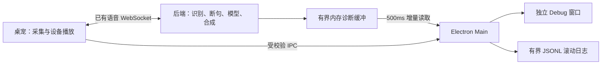
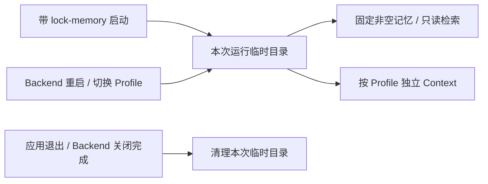
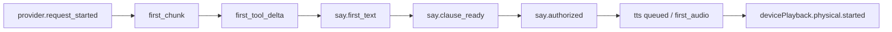
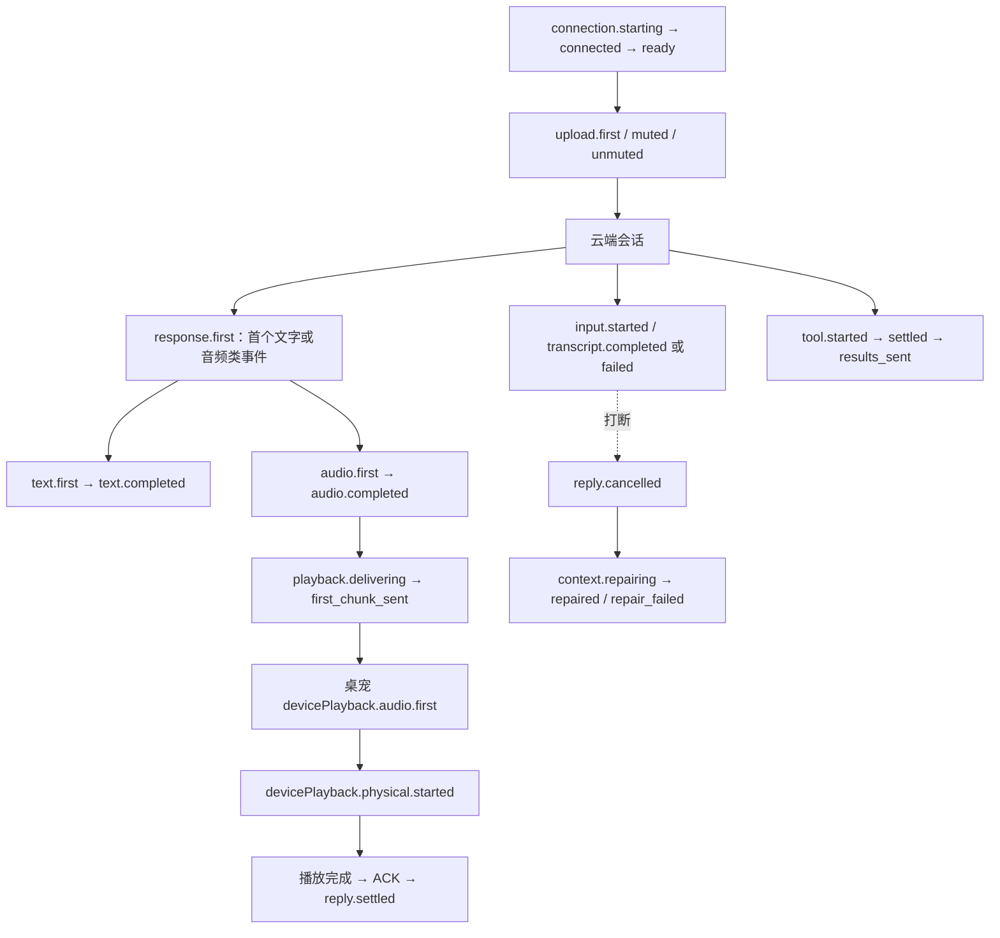

# Live 语音 Debug

从 `frontend` 执行 `npm run dev -- --debug`，启动时自动打开独立窗口并开始采集。启动参数只对本次运行生效，不写入设置，也不会自动开启麦克风。普通启动隐藏设置页的整个调试区域，不创建采集服务、不轮询 Debug 接口、不创建或追加两种调试日志。旧配置中的 `liveDebugEnabled` 被忽略并在后续保存时移除。

调试启动后，「设置 → 桌宠状态」显示“本次以调试模式启动”，仅保留打开窗口、清空日志、打开目录三个操作。页面不再提供启停采集开关；Backend Debug 接口也会拒绝普通模式下的请求。

默认窗口为 1120 × 760，受当前屏幕工作区限制。左侧事件列表占据主要阅读空间，按来源、阶段、级别及关键词筛选；点击事件在右侧查看完整详情。右侧有「当前状态」「对话文字」「事件详情」三个标签，字段和长文本使用整个侧栏滚动。宽度小于 900px 时通过「事件／检查面板」切换，两边保留各自的阅读位置。

「跟随最新」只在新事件到来时滚动。向上阅读、选择事件或翻到较早页会暂停跟随，后台继续采集；点击新事件提示或「最新」恢复。暂停时固定所读事件范围，避免新事件推动旧页漂移。较早记录移出内存会明确提示，已选事件的详情保留到重新选择或清除日志。

关闭窗口后继续采集和写日志；通过设置中的打开按钮重新查看。退出应用结束采集，保留已保存日志。下次是否开启调试只由启动参数决定；普通启动不会删除已有日志。



## 日志和清除

合并事件日志位于当前应用数据根目录的 `logs/live-debug/`；点击「打开日志目录」即可访问，无需手动寻找不同系统的数据目录。

- 每个文件最多 5 MiB，保留 `live-debug.jsonl`、`.1`、`.2`，总共最多三个文件。
- 窗口显示本次应用运行最近的记录；较早运行的记录在滚动文件中查看。
- 前后端缓存各限制为 1,000 条、2 MiB，单个事件最多 32 KiB；截断与丢弃有标记。
- 「清空 Debug 日志」清除本功能的三个文件和内存历史，继续当前采集；不会删除聊天历史、其他日志或中断 live 对话。
- 文件写入失败时提示错误，继续提供有界内存查看。异常崩溃可能丢失最后尚未读取或落盘的一小批记录。

日志包含识别文字和助手回复。诊断仅收集白名单标量字段，不记录原始音频、密钥、设备 ID、完整模型上下文或通用工具参数与返回正文。

Backend 的无内容语音诊断文件位于同一数据根目录的 `speech-diagnostics.log`，单文件 512,000 字节并保留一个备份，也仅在 `--debug` 启动时写入。“清空 Debug 日志”仍只清理 Live Debug 的三个 JSONL 文件及其内存记录。

## 固定记忆复测

```bash
npm run dev -- --debug --lock-memory
```

`--lock-memory` 可独立使用。Electron 为本次应用创建临时目录，Backend 按 Profile 初始化内置 `benchmark-memory-v1` 非空合成记忆，继续使用本地 hash embedding、SQLite 和 Qdrant 检索。固定记忆拒绝写入，跳过召回审计，也不启动空闲归档或模型提炼。

对话 Context 每次应用启动从空开始，本次运行内多轮对话正常累积。切换 Profile 再返回、应用配置重启 Backend 均保留该运行的 Context；退出后清理临时目录，下次启动不会复用异常退出的残留目录。初始化失败会明确失败，不回退到日常记忆。

调试事件 `launch.options` 和当前状态包含 `debug`、`lockMemory`、`memoryFixture`；`/api/v1/readiness` 同样返回启动选项和语料版本。Task 保持正常，已有 Task 状态仍会进入 Context；桌面可见历史继续正常保存且不会回灌 Context。复测应固定 Task 状态、人格、模型和输入顺序。该模式用于控制记忆基线，不承诺模型输出或网络延迟完全相同。



## 如何判断卡住的阶段

- 传输 `active` 仅代表会话建立；麦克风是否开启另看采集状态。
- RMS、噪声门限、VAD 概率和确认时长用于判断输入为什么未被认定为讲话。
- `partial` 与 `sentence_end` 是 STT 的中间／结束结果；EOU 另行决定是否结束话轮，fallback 也有事件记录。
- PREPARE、RESPOND、CONTINUE、准入原因、首片段和结算结果用于判断模型处理阶段。
- 后端的语音分句 offer／发送与前端 `devicePlayback.physical.started` 是不同事实。
- `devicePlayback.physical.completed`、`history.write.completed`、`renderer.ack.sent` 和后端 accepted 可用于定位交付问题。
- 记录仅从 debug 开启时开始；开启时补充当前快照，不补造过去的事件。缺失的观测不等于成功。

## 实现约束

### 首音延迟的细分事件

模型阶段新增以下事件，沿同一个 `inputId`、`invokeId`、`sayId` 关联：



`provider.request_started` 包含实际请求的 `modelName`；`first_chunk` 仍是已有的首个解析后 SSE 数据块。`say.first_text` 表示增量解析出首段非空 SAY 文本，尚不代表授权交付。`say.clause_ready` 表示该分句已满足工具身份与顺序要求、即将检查执行权限；`say.authorized` 位于权限检查之后、交付调用之前。多个事件可以来自同一个 SSE 数据块，不应据此推算服务端逐 token 时间。

分句事件记录原始字符数 `charCount`、加权计数字 `count` 和 `flushReason`：`first_sentence`（首个有效整句）、`sentence_target`（后续累计至少 45 字后到达句末）、`text_end`（文本结束立即交付尾段）。首段最低 4 个计数字；英文单词每个算 2 字，空格和标点不计，其余字符计 1 字。逗号等软标点不切分，也没有长度强制切分。SAY 事件的 `elapsedMs` 起点是本次 Harness 开始消费流；跨阶段比较优先使用同一调用内事件差值，不把首 SSE 到首分句的全部时间称作分句等待。

STT 正常收尾先停止接收新发送并等待在途发送，再等待最终回调；正常完成预算暂为 1 秒，取消清理仍为 250ms。`finish_ended.elapsedMs` 用于后续真机校准。收尾或提交期间新到的讲话会等待当前端点结算，再开始新 segment；现有麦克风队列保留最多 50 帧，复测时仍需检查 `droppedFrames`，尤其是极慢服务与连续插话场景。

STT 失败会使当前未确认输入失效，并通过现有错误通道提示重说；不拿 partial 执行操作。底层 SDK 阻塞线程不能被 Python 强制停止，超时后仍由唯一 stop 任务持有；迟到转写被隔离，不启动第二个并行 stop。

本轮模型提示词实验要求首句短、完整、带句末标点；耗时读取前在同一调用说明具体下一步，简单聊天优先利用现有上下文。它不保证模型必定遵循，也不代表已经测得首音改善。建议用相同模型配置复测问候、自我介绍、读取任务、拒绝恢复任务和连续插话，分别记录有效确认、实质答案及失败次数。TTS 预合成和模型配置调整留待新日志提供依据。

诊断是观测层，不修改 VAD/EOU 阈值、语音打断、TTS 背压或 ACK 次序。后端没有新增常驻采集任务，声学和音频计数最多每 500ms 汇总一次。Main 使用不重叠的 HTTP 请求，不占用语音 WebSocket 发送锁。采集持续到应用退出；关闭 Debug 窗口不改变采集状态。

Main 为合并时间线分配 `id`；事件保留来源进程、序号、采集批次、Profile、generation 和关联分句／调用身份。阶段耗时由同一进程的单调时钟计算，不跨进程相减。清除和会话替换会撤销旧身份，迟到数据不能恢复已清除历史。

## Realtime 模式诊断

Realtime 复用同一 `--debug` 启动入口、Debug 窗口和两个滚动日志。服务端内部的 VAD、断句、推理与合成状态不由本地模拟；只记录客户端实际观察到的事件、操作结果和本地等待。

`inputId` 在 Realtime 引擎事件中表示本次语音会话 scope；`segmentId` 统一为 `scope:item_id`。`connectionId` 连接适配器日志与引擎日志；`responseId`、`questionId`、`itemId`、`eventId`、`callId` 在提供方实际给出时保留在 details，`clauseId` 连接后端与桌宠播放事件。工具调用可以没有回复身份，此时不猜测它属于最近一条回复。身份缺失不等于事件失败。



图中的输入转写和回复输出没有固定先后关系；音频可以先于最终转写、最终回复文字。`response.first` 是客户端首次观察到某条回复的文字或音频类事件，不代表服务端开始推理。`audio_started` 没有回复 ID 时仍只作为协议提示处理，不创建虚构回复。

| 事件（省略 `realtime.` 前缀） | 主要用途 |
|---|---|
| `connection.starting / connected / ready / failed / closed` | 区分连接建立、创建会话、等待 `session.created`、关闭；失败包含 `operation` 与异常类型 |
| `upload.first / muted / unmuted` | 确认上行首帧发送成功和传输静音状态变化；mute 表示麦克风帧暂时缺失，不代表用户停嘴 |
| `send.failed / receive.failed / provider.failed` | 区分发送、JSON 解码、事件形状、协议转换和云端错误；仅保留数值型 providerCode，不记录原始错误正文 |
| `input.started / transcript.completed / transcript.failed` | 关联输入；完成事件以 `accepted=false, reason=empty_transcript` 表示空结果 |
| `response.first / text.first / text.completed / audio.first / audio.completed / response.completed` | 观察回复里程碑、字符数、音频字节数；`response.completed` 不等于播放完成 |
| `response.discarded` | 回复结束但未收到可播放音频，记录 `reason=no_audio` |
| `playback.delivering / first_chunk_sent / failed` | 记录本地等待、首音频块交付、失败的具体操作 |
| `reply.cancelled / reply.settled` | 记录取消原因和最终 ACK 结果；沿用 Hub 与桌宠现有背压、取消及物理播放事件 |
| `context.repairing / repaired / repair_failed / repair_cancelled` | 区分缺少 item ID、取消请求、替换上下文、等待确认；关闭中的取消不会报告成修复失败 |
| `tool.started / settled / results_sent / results_failed` | 区分工具执行与结果回传，保留调用身份、状态、受控错误码和耗时；不记录参数与结果正文 |
| `worker.failed / failed / stopped` | 关联失败任务和最终会话结局；停止摘要包含回复数量及 `droppedEvents` |

耗时口径：

- `connection.connected/ready.elapsedMs`：从适配器开始建立连接计时。`started.elapsedMs`：从引擎创建至语音启动完成，包括本地准备和历史初始化。
- 回复事件默认的 `elapsedMs`：从本地首次观察到该回复的文字或音频类事件计时。`audio.first.firstAudioMs` 使用相同起点，不代表完整云端推理或用户停嘴后的等待。
- `playback.delivering.elapsedMs`：从首音频到达到本地可以交付；`playbackWaitMs` 包括任务调度及等待前一条回复，`contextWaitMs` 为随后等待上下文修复的时长。
- `playback.first_chunk_sent.elapsedMs`：从首音频到达到该首块全部交给语音 WebSocket；可能包含背压等待，不代表设备已经起播。`playback.failed.elapsedMs` 同样从首音频到达计时，`operation` 区分 `text_ready`、`playback_ack`、`send_audio` 等阶段，保留已有播放器错误码。
- `context.repaired/repair_failed/repair_cancelled.elapsedMs`、`tool.settled.elapsedMs`、`tool.results_sent.elapsedMs` 分别从本次修复、工具执行、结果发送开始计时。
- 桌宠 `devicePlayback.physical.started.firstAudioMs`：从该进程收到首块 PCM 到观察到设备输出游标越过起播位置，包含观察定时器的调度开销。采集清空后不沿用旧计时，半途开始采集也不补造首包；此时省略该字段。
- `audio.completed.audioMs` 根据实际收到的 PCM16 / 24 kHz 字节数计算音频长度，不是生成耗时。

真正的“用户停嘴 → 首次可听声音”仍需统一录音或测试装置标注。后端和桌宠时钟不直接相减；没有可靠输入与回复对应关系时，不生成话轮级首句延迟。

音频块、文字 delta 不逐条写日志；每条回复只写首次和结束里程碑。被过滤的重复转写、退役问题、已结算回复和音频结束后的迟到块累计到会话停止摘要，不为每个丢弃事件写一行。普通 `speech-diagnostics.log` 只增加生命周期、结算摘要和异常；完整事件时间线仍在 `live-debug.jsonl`。新增诊断不保存文字正文、音频、工具参数/结果、凭据或完整云端消息，原有 Live Debug 的对话文字展示仍保留。
