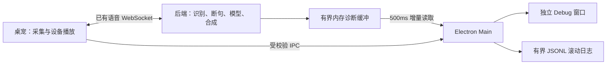

# Live 语音 Debug

在「设置 → 桌宠状态」勾选「Live 语音 Debug 模式」即可立即打开独立窗口。该开关独立保存，不应用设置页其他修改，不重启后端，也不会自动开启麦克风。

默认窗口为 1120 × 760，受当前屏幕工作区限制。左侧事件列表占据主要阅读空间，按来源、阶段、级别及关键词筛选；点击事件在右侧查看完整详情。右侧有「当前状态」「对话文字」「事件详情」三个标签，字段和长文本使用整个侧栏滚动。宽度小于 900px 时通过「事件／检查面板」切换，两边保留各自的阅读位置。

「跟随最新」只在新事件到来时滚动。向上阅读、选择事件或翻到较早页会暂停跟随，后台继续采集；点击新事件提示或「最新」恢复。暂停时固定所读事件范围，避免新事件推动旧页漂移。较早记录移出内存会明确提示，已选事件的详情保留到重新选择或清除日志。

关闭窗口后继续采集和写日志；通过设置中的打开按钮重新查看。取消勾选停止采集，保留已保存日志。应用重启恢复开关，但麦克风仍须显式开启。

## 日志和清除

日志位于当前应用数据根目录的 `logs/live-debug/`；点击「打开日志目录」即可访问，无需手动寻找不同系统的数据目录。

- 每个文件最多 5 MiB，保留 `live-debug.jsonl`、`.1`、`.2`，总共最多三个文件。
- 窗口显示本次应用运行最近的记录；较早运行的记录在滚动文件中查看。
- 前后端缓存各限制为 1,000 条、2 MiB，单个事件最多 32 KiB；截断与丢弃有标记。
- 「清空 Debug 日志」清除本功能的三个文件和内存历史，继续当前采集；不会删除聊天历史、其他日志或中断 live 对话。
- 文件写入失败时提示错误，继续提供有界内存查看。异常崩溃可能丢失最后尚未读取或落盘的一小批记录。

日志包含识别文字和助手回复。诊断仅收集白名单标量字段，不记录原始音频、密钥、设备 ID、完整模型上下文或通用工具参数与返回正文。

## 如何判断卡住的阶段

- 传输 `active` 仅代表会话建立；麦克风是否开启另看采集状态。
- RMS、噪声门限、VAD 概率和确认时长用于判断输入为什么未被认定为讲话。
- `partial` 与 `sentence_end` 是 STT 的中间／结束结果；EOU 另行决定是否结束话轮，fallback 也有事件记录。
- PREPARE、RESPOND、CONTINUE、准入原因、首片段和结算结果用于判断模型处理阶段。
- 后端的语音分句 offer／发送与前端 `devicePlayback.physical.started` 是不同事实。
- `devicePlayback.physical.completed`、`history.write.completed`、`renderer.ack.sent` 和后端 accepted 可用于定位交付问题。
- 记录仅从 debug 开启时开始；开启时补充当前快照，不补造过去的事件。缺失的观测不等于成功。

## 实现约束

诊断是观测层，不修改 VAD/EOU 阈值、语音打断、TTS 背压或 ACK 次序。后端没有新增常驻采集任务，声学和音频计数最多每 500ms 汇总一次。Main 使用不重叠的 HTTP 请求，不占用语音 WebSocket 发送锁。关闭采集后不读取事件；若停用控制请求暂时失败，只重试停用同步。

Main 为合并时间线分配 `id`；事件保留来源进程、序号、采集批次、Profile、generation 和关联分句／调用身份。阶段耗时由同一进程的单调时钟计算，不跨进程相减。清除和会话替换会撤销旧身份，迟到数据不能恢复已清除历史。
