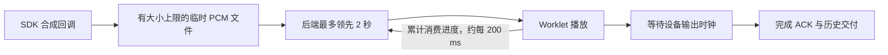

# Main Agent 语音资源准备

语音由 DashScope STT/TTS 与本地 Silero VAD、Smart Turn 断句模型共同完成。仅填写 API key 和音色并不足以开启语音；还需要模型、完整许可证和 Python speech 依赖。

## 设置页操作

1. 打开设置 → 实时语音，点击“一键准备”。下载期间显示总进度、已下载大小，可取消并重试。
2. 完成后四个资源路径写入当前设置草稿。填写 DashScope key、音色并开启语音能力，点击“保存”，再点击“应用”。
3. 等待角色激活完成，在桌宠侧点击“打开语音”。此时才申请麦克风并加载、验证本地模型。

下载不会修改密钥或自动保存/应用设置。设置窗口关闭后下载继续；重新打开可查看资源状态，再点击“一键准备”会复用已校验文件并填入草稿，不重复下载。退出应用会取消下载。取消或失败后保留已完成文件，清理当前临时文件；重试从未完成文件开头开始。

## 资源位置与固定来源

资源位于应用配置根目录下 `speech-assets/silero-6.2.1-smart-turn-3.2/`，与源码目录解耦。
`AURABOT_USER_DATA_DIR` 指定独立应用配置根目录。新安装默认指向此处；旧配置及自定义路径保持原值，直到用户主动准备资源并保存。

唯一资源清单为 `frontend/src/main/speechAssetManifest.ts`，同时记录固定 URL、大小及 SHA-256，并供默认路径与下载模块复用：

| 资源 | 固定上游版本 | 许可证 |
| --- | --- | --- |
| Silero VAD ONNX | snakers4/silero-vad v6.2.1，commit `7e30209a3e901f9842f81b225f3e93d8199902b1` | 对应 commit 完整 MIT LICENSE |
| Smart Turn v3.2 CPU ONNX | pipecat-ai/smart-turn-v3，commit `f766f81d3cfdf7737ac64aad813d91bbfd56bf93` | pipecat-ai/smart-turn commit `4786657e242dfe77dd138699ac564ee074a2a543` 完整 BSD-2-Clause LICENSE |

来源：[Silero v6.2.1](https://github.com/snakers4/silero-vad/releases/tag/v6.2.1)、[Smart Turn 模型库](https://huggingface.co/pipecat-ai/smart-turn-v3/tree/f766f81d3cfdf7737ac64aad813d91bbfd56bf93)、[Smart Turn 许可证](https://github.com/pipecat-ai/smart-turn/blob/4786657e242dfe77dd138699ac564ee074a2a543/LICENSE)。清单哈希来自 2026-09-14 获取的固定版本文件，总大小约 10.5 MiB。

Electron Main 使用系统网络栈，单任务顺序流式下载、流式哈希校验，校验成功后才原子替换目标文件。UI 不能指定下载 URL 或任意写入路径。没有后台自动更新。

## 依赖与推理契约

语音启用时，Electron 以 `uv run --project backend --extra speech …` 启动后端；关闭语音时维持基础启动。开发者也可预先执行：

```bash
uv sync --project backend --extra speech
```

- Silero：16 kHz 单声道 PCM；每次 512 个新样本，加 64 个上下文样本；state 为 float32 `[2, 1, 128]`。
- Smart Turn：最近 8 秒 16 kHz 单声道音频，经本地 Whisper feature extractor 得到 float32 `[1, 80, 800]`。不需要下载 Whisper 权重或安装 PyTorch。
- ONNX 使用 CPU、单线程、顺序执行；已加载会话在进程内复用。显式开启语音时先进行最小推理检查，成功后才确认开启。
- 下载资源不调用 DashScope；模型加载与依赖安装不代表云端凭据或麦克风已验证。

## 排查

语音未开启、密钥未填写、具体模型/许可证缺失、许可证无效、依赖缺失、模型加载失败及模型契约错误各有独立提示。资源问题请先“一键准备 → 保存 → 应用”。网络下载失败可检查系统代理后重试；文件写入失败检查空间与权限。

Profile 未激活时麦克风按钮不可用；激活失败可以在设置中重新应用，即使配置没有变化。语音准备失败不会关闭文字会话。未知初始化错误不会将供应商响应或密钥原样显示。

## 验证

普通 Python/Vitest 回归测试使用临时资源和本地 HTTP 服务，不调用云端。可选 Electron smoke 验证官方资源下载、设置保存应用及真实 ONNX 语音启动，使用静音模拟麦克风：

```bash
cd frontend
npm run build
npm run rebuild:native
AURABOT_SPEECH_DOWNLOAD_SMOKE=1 npx playwright test --config configs/playwright.config.ts speech-setup.spec.ts
```

真实 DashScope STT/TTS 与物理麦克风/扬声器的验收分别记录，模拟设备不能证明真实设备已通过。发行安装脚本自动准备资源的后续工作见 `TODO.md`。

### 本次验收记录（2026-09-14）

- 本地固定版本 VAD 与 Smart Turn 的真实 ONNX 推理通过。
- 使用已配置的 DashScope 模型/音色，对合成测试句完成 TTS→STT 检查：TTS 返回 162240 字节 PCM，STT 收到非空转写。没有记录或输出 API key。
- 物理麦克风与扬声器听感尚未验收；Electron 测试使用静音模拟麦克风。
- 最终回归：33 项前端相关测试、45 项后端相关测试通过；TypeScript 检查与构建通过。Electron 完整下载/保存应用/语音开关/重启资源复用验收通过（35.3 秒）。

## 聆听动作与静音状态

开启语音成功后显示“无音频”，复用 Profile 待机动作；麦克风仍持续采集。后端完成近讲确认后才进入“聆听中”。达到 300 ms 静音帧阈值后退出聆听，无需等待 Smart Turn 断句；仍在判断或回复时保留对应状态。

角色正在回复时，候选音频在后台确认，不暂停回复和动作。默认要求连续 300 ms 同时满足 VAD 概率 ≥ 0.6、PCM RMS ≥ 0.02 且 ≥ 当前背景估计的 3 倍；非阳性帧重置连续计数。确认后才取消原回复并启动 STT，400 ms 预卷保留开头。STT 非空文字不再绕过声学确认。前端不再依据本地单帧音量暂停播报。Profile 动作配置格式不变。

背景估计仅在未激活输入且 VAD 未识别人声时更新；重新开启语音会重置估计。麦克风请求回声消除、降噪及关闭自动增益，并记录实际生效设置。设备能力不一致，因此这些请求不等于对硬件效果的保证。使用电脑外放和耳麦都应验收；本版不保证识别远处轻声或区分相近音量的不同说话者。切换设备后重新开启语音以重新获取设备及背景估计。

## 播放缓存和取消



- `renderer.progress` 消息携带 `clause_id` 和累计 `consumed_samples`（24 kHz 源采样数）。它只释放缓存额度，不能确认历史交付；前后端随应用一起更新。
- 后端每块最多发送 4,800 个采样点，未消费上限 48,000 个。10 秒没有消费进展则取消当前句，保留会话。最终仍使用 `renderer.ack` 确认设备播放完成。
- SDK 回调使用临时文件暂存，单句上限 120 秒 PCM，约 5.76 MB；不是常驻内存缓存。完成、取消及错误都会关闭暂存文件，取消会等待合成迭代器清理。没有新增常驻线程或依赖。
- 取消标记之后不再发送旧 PCM；前端本地中止后丢弃在途旧音频，直到下一个有序 offer。迟到进度或 ACK 不会误结算下一句，也不会仅因此关闭连接。

## 内容无关的语音诊断

正式后端在桌面 `settings.json` 同目录写入 `speech-diagnostics.log`，单文件约 500 KB，最多保留一个滚动备份。记录实际音频处理设置、每约 5 秒的声学门槛快照、确认打断、播放取消/结算及超时；不记录语音数据、转写、设备 ID、API key 或供应商错误正文。语音设备设置为 `voice.start` 的可选 `audio_settings` 字段，后端只接受允许的数值和布尔字段。

现场验收时让 Aura 连续播报至少 10 秒，分别验证：保持安静时完整播放、室友远处轻声不打断、近处连续插话后停止旧回复、下一轮可以正常播报。电脑外放还需验证 Aura 自己的播报不会触发近讲确认。自动化覆盖传输/确认/取消，但不代替这两种物理设备的声学验收。

### 修复验证记录（2026-09-15）

- 后端完整测试 272 项通过，包含真实 WebSocket 协议下的 10 秒 PCM 突发、缓存进度及最终交付 ACK。
- 前端音频 Worklet、实时客户端、角色播放器缓存及语音资源相关 36 项通过；TypeScript 检查和 Electron/Vite 构建通过。
- 扩大前端 renderer 回归时，Profile 编辑页有 5 项既有失败；已在本轮修改前的代码副本中复现相同失败。
- 新增取消等待合成清理、短暂续接不丢整轮转写的回归测试。尚未进行本次修复后的物理麦克风/扬声器/耳麦验收。
