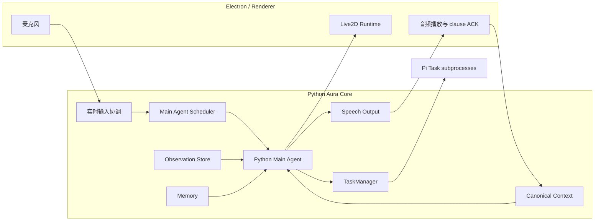
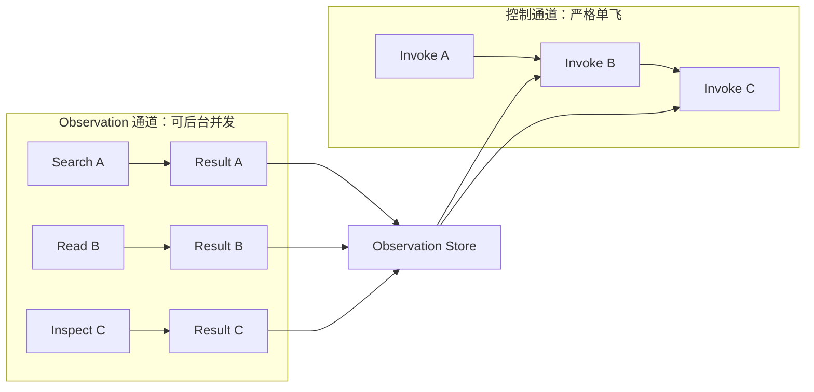
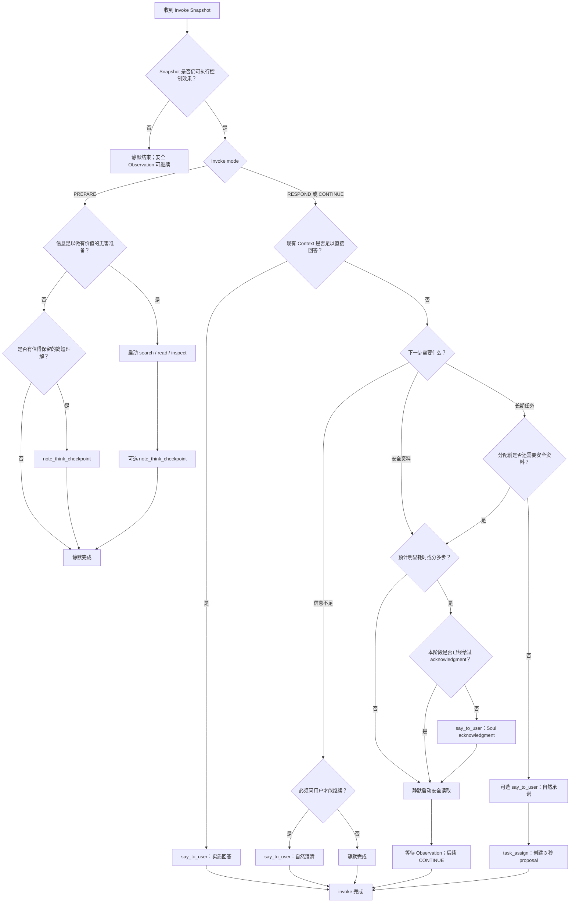
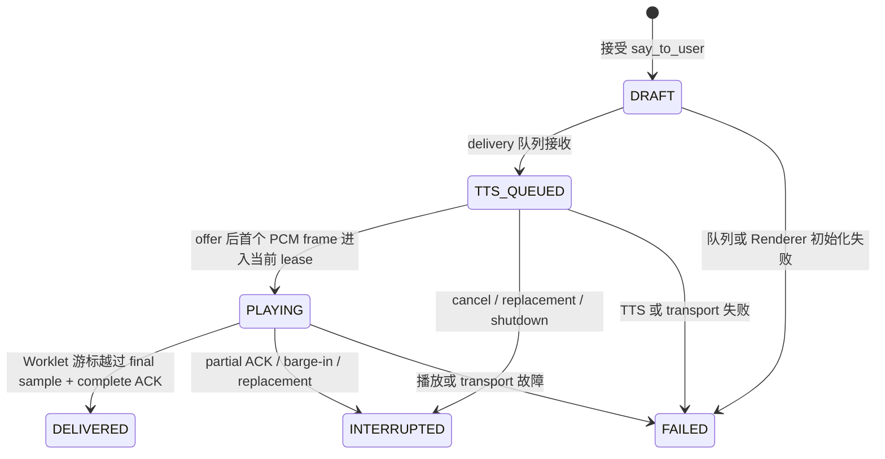
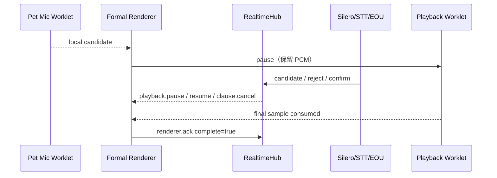

# Main Agent

> 实现状态：P0 与本轮 P1 契约已接入；Live2D motion/expression capability registration（P1-1）
> 仍明确延期，不应从保留的 token 字段推断为已实现。
>
> 本文是 AuraBot Main Agent、实时语音对话控制面和主对话上下文的架构事实源。
> 它定义产品语义、运行时契约、允许的效果和验收标准，不规定 Python 包目录、类拆分、
> 线程或进程数量、具体 WebSocket 形态以及语音服务是否独立进程。具体工程组织由实现阶段决定。
>
> Task 的状态、SQLite、Pi 子进程和恢复规则以 [Pi Task Runtime](task-agent.md) 为唯一事实源；
> 本文只定义 Main Agent 如何使用 TaskManager。若 `PRD-v2.md` 中旧的 Gate、外部渠道或语音描述
> 与本文冲突，Main Agent 范围内以本文为准，PRD 后续另行同步。

## 1. 产品定位与首期范围

AuraBot 是带 Live2D 角色、长期 Memory 和持久 Task 能力的桌面陪伴型 Agent。
Main Agent 也叫 Chat Agent，是用户长期感知到的唯一 Aura，也是实时对话和系统能力的调度中心。

首期范围固定为：

1. Main Agent 运行在 Python Backend 中，不运行在 Pi 子进程中。
2. Main Agent 直接处理实时聊天、Soul、Context、Memory、搜索和低风险本地读取。
3. 长时间、多步骤或需要持久执行的工作通过 Python `TaskManager` 分配给现有 Pi Task 子进程。
4. 桌面端支持文字和语音交互；第一版 MVP 不接入微信、QQ 等外部聊天渠道。
5. Chat Agent 可以通过稳定语义 token 控制当前 Live2D 模型的动作和表情。
6. 语音主路径采用本地 VAD、流式 STT、流式 LLM、流式 TTS 的流水线，不要求原生端到端 S2S。
7. 产品以 GPT-Live 的实时自然度为交互参照，以 AIRI、Open-LLM-VTuber 等桌面角色项目为竞品，
   并允许从其他实时语音项目吸收端点判断、打断、播放确认和测试方法。

AuraBot 不采用固定的“先说一句，再搜索，再回答”模板，而采用**弹性深度对话**：

- 能凭 Soul、Memory 和当前 Context 直接回答时，立即自然回答，不说填充语。
- 需要慢搜索、文档调查或多阶段读取时，可以先用符合 Soul 的短句接住用户，然后安静工作约
  5 到 15 秒，再给出实质回答。
- 搜索足够快或用户仍在说话时，可以完全静默地准备。
- 一次 LLM invoke 可以从未调用 `say_to_user`，静默完成是合法结果。

例如：

```text
用户：你爱我吗？
Aura：哼，不爱！
```

不应经过搜索、任务分配或统一的“让我想想”。

```text
用户：帮我查一下这两家实时语音服务最近的协议差异。
Aura：这个得看最新资料，我查一下。
<允许自然静默若干秒>
Aura：我查到的关键差别是……
```

## 2. 逻辑架构与所有权

下图只表达逻辑所有权，不要求按图物理拆分进程：



所有权固定如下：

- Python Main Agent 是 Soul 和实时语义决策的 owner。
- Canonical Context 是主对话事实的 owner。
- Renderer 是实际播放进度和本地立即停播的 owner。
- Observation Store 是搜索、读取和检查结果的 owner。
- Memory 系统是长期记忆的 owner。
- TaskManager 是 Task 状态和 Pi 子进程生命周期的 owner。
- Live2D Runtime 是模型能力验证和动作实际执行的 owner。

Main Agent 不复制 TaskManager 的状态机，不直接持有 Pi 进程，也不通过本机 HTTP 或 SSE 回环调用
TaskManager。两者在 Python Backend 内通过稳定业务接口直接协作。

## 3. 不可破坏的运行时约束

以下规则优先于模型提示词：

1. `user_speaking = true` 时，不允许开始或继续播放新的 Agent 音频。
2. 用户可见语言只能由 `say_to_user` 产生。
3. 普通 assistant final text 不进入 TTS，也不进入用户可见历史。
4. 一次 invoke 可以静默结束，Harness 不得因此生成统一兜底回复。
5. 模型生成的文字不等于用户听到的文字。
6. 只有播放器确认完整播放的 clause 才进入 Canonical Context。
7. 被打断、未开始播放或只播放一部分的 clause 不算 delivered。
8. 同一时刻只能有一个控制型 LLM invoke。
9. 旧输入版本产生的安全知识可以回收，旧版本的说话和有影响操作必须被拒绝。
10. 搜索、读取和检查可以作为后台 Observation 工作跨 invoke 存活。
11. 长期 Task 一经 TaskManager 接受，就成为持久事实，不能因用户随后说话而假装未发生。
12. Main Agent 不预测用户将要说什么，也不基于猜测提前生成回答或执行副作用。
13. 不使用独立 Gate Agent 判断回复时机、意图或话题结束。
14. 话题变化、搜索结果是否仍相关等语义问题交给 Main Agent；音频播放、取消、版本和副作用合法性由确定性 Runtime 决定。
15. Provider 的 `is_final`、`sentence_end` 等私有字段不能成为 AuraBot Core 的必需契约。

## 4. 音频输入、VAD、STT 与 EOU

### 4.1 VAD-gated Streaming STT

首期采用本地 VAD 和远端或本地流式 STT：

1. 麦克风持续产生短 PCM frame。
2. Runtime 保留一段很短的音频 pre-roll，避免 VAD 检测稍晚而吞掉开头。
3. VAD 检测到 `VAD_START` 后，创建或激活流式 STT，并先补发 pre-roll。
4. 用户继续讲话期间，音频持续送入 STT，不等待 `VAD_STOP` 后再做整段识别。
5. `VAD_STOP` 只表示声学静音候选，不直接等于用户已经结束表达。

是否常驻 STT 连接、何时复用连接、pre-roll 精确长度和音频 frame 大小属于实现与性能调优范围。

### 4.2 Provider 适配与标准事件

“OpenAI compatible”不能假设所有 Provider 都支持同一种实时转写协议。AuraBot 应通过
`StreamingSttProvider` 一类逻辑适配层支持：

- OpenAI Realtime 风格协议；
- 仅兼容音频转写 HTTP 的 Provider；
- 阿里云、火山引擎等专有实时 WebSocket 协议；
- 本地流式 ASR。

Provider Adapter 只报告客观转写事实，例如：

```text
TranscriptUpdate
- full_text
- stable_prefix
- mutable_suffix
- provider_event_kind
- provider_stability（可选）
```

Core 不直接依赖名为 `is_final` 的布尔字段。不同 Provider 的 delta、segment、sentence end、
completed 或 stable word 都应先映射为统一转写更新。

### 4.3 本地 Turn Detection 与 EOU

AuraBot 可以接入一个本地轻量 Turn Detection 服务，对外至少提供：

```text
VAD_START
VAD_STOP_CANDIDATE
EOU_DECISION
```

`EOU_DECISION` 表达当前静音处的用户表达更像：

```text
complete
incomplete
```

可附带置信度。内部究竟由一个模型完成，还是由轻量 VAD 与独立 EOU 模型组合完成，属于实现细节。

启用 EOU 后：

```text
VAD_STOP_CANDIDATE
→ 运行本地 EOU
→ complete   → 强停顿
→ incomplete → 弱停顿
```

- `complete` 允许进入回答和执行路径。
- `incomplete` 表示用户大概率只是在换气或组织语言，只允许准备，不允许说话和持久操作。
- EOU 超时、不可用或不支持当前语言时，使用固定 continuation delay 后降级为强停顿。

EOU 独立于 STT Provider，因此可以与 OpenAI、阿里云、火山引擎或本地 STT 组合。

### 4.4 Provider 缺少稳定 transcript 的降级

弱停顿是延迟优化，不是正确性的必要条件。

- Provider 能报告稳定 transcript 前缀时，AuraBot 可以根据这些更新合成弱 checkpoint。
- Provider 不能报告稳定 transcript 时，弱停顿只依赖本地 `EOU_INCOMPLETE`。
- Provider 和本地 EOU 都不可用时，不运行弱停顿 PREPARE，只在 VAD fallback 强停顿后调用 Main Agent。

这种降级会损失预搜索和预思考时间，但不能改变最终回答的正确性。

## 5. ActiveInput，而不是重量级 User Turn 状态机

AuraBot 不显式维护一套 `Collecting / Preparing / Engaged / Closed` 的 User Turn 状态机。
Runtime 只维护一个轻量因果作用域 `ActiveInput`：

```text
ActiveInput
- input_id
- revision
- segments（按首次出现顺序保存稳定 segment_id 与该 utterance 最新文本）
- latest_transcript
```

每个 STT session 创建一个稳定 `segment_id`；partial、stable 与 final 更新复用同一 ID 并原位覆盖。
同一 ActiveInput 中后续新 utterance 使用新 ID 并追加。手工文本同样生成独立 ID。Context 写入开放事件
`user_segment {segment_id, input_id, text}`，因此同一 utterance 不会因 revision 重复进入历史。

每当当前输入的稳定内容发生可见变化，`revision` 和 Context 版本按需前进。
所有异步产物必须能追溯到其 `input_id`、来源 revision 和来源 invoke。

是否已经与外部世界产生不可撤销交互，不使用 `Engaged` 枚举，而由事实推导：

```text
has_external_commit =
    至少一个 assistant clause 已 delivered
    或至少一个 Task 已被 TaskManager 接受
```

用户再次开口时：

- 若 `has_external_commit = false`，新的语音视为当前 `ActiveInput` 的继续，revision 增加。
- 若 `has_external_commit = true`，新的语音创建下一个 `ActiveInput`。
- 未播放的 `say_to_user` 草稿不构成 external commit。
- 尚在三秒 grace period 内的 Task proposal 不构成 external commit。
- 已完成或仍在运行的安全 Observation 不构成 external commit。

该规则让“用户在 Agent 开口前补充一句”自然合并，又不需要维护复杂状态图。

## 6. Transcript Checkpoint Admission Controller

Provider 每确定一两个字就发送稳定更新时，不能逐条触发 LLM。
Provider 更新只覆盖最新 transcript snapshot，由 AuraBot 自己决定何时合成弱 checkpoint。

弱 checkpoint admission 采用以下组合护栏，不使用会被连续更新无限重置的纯 debounce：

1. **最短时间间隔**：两次普通 PREPARE 之间必须超过可配置间隔。
2. **最小稳定内容增长**：新增稳定文本必须达到可配置的中文字符数或英文单词数。
3. **最大等待上限**：用户持续讲话且内容不断增长时，即使没有漂亮标点，也不能无限饿死 PREPARE。
4. **语义或标点奖励**：稳定句号、问号、明显 sentence end 可以降低内容增长门槛。
5. **EOU_INCOMPLETE 优先**：真实声学停顿且 EOU 判断未结束时，可以绕过普通内容增长门槛，
   并在需要时绕过普通最短间隔，高优先级请求一次 PREPARE，但仍服从严格单飞和单输入预算。
6. **单个 ActiveInput 预算**：限制普通 PREPARE invoke 数量，避免长篇讲话产生模型调用风暴。
7. **只保留最新快照**：checkpoint 不进入逐项队列，中间更新自然折叠。

所有阈值必须可配置并通过真实数据校准。架构只要求存在上述护栏，不把某组毫秒数或字符数写死为永久协议。

## 7. Main Agent Scheduler 与严格单飞

### 7.1 最小调度状态

调度器至少维护：

```text
latest_context_version
active_invoke | null
pending_trigger | null
latest_think_note | null
observation_store
```

不维护额外的 `dirty` 布尔字段。当前 invoke 是否落后，可以由 Context 版本直接推导；是否真的需要
再次调用模型，由 `pending_trigger` 明确表达。

`pending_trigger` 至少包含：

```text
input_id
mode: PREPARE | RESPOND | CONTINUE
reason
min_context_version
```

多个触发不排队，而是合并成一个最强触发：

```text
RESPOND > CONTINUE > PREPARE
```

例如 PREPARE 运行时先出现新 checkpoint，随后搜索完成，最后 EOU complete，最终只保留
RESPOND。下一次 invoke 的最新 Snapshot 已经包含新 transcript、搜索结果、think note 和状态占位，
不需要依次重放三个 invoke。Trigger 合并只在同一个 `input_id` 的因果作用域内进行；创建新的
ActiveInput 时，旧输入的 pending control trigger 不得凭优先级压过新输入。

普通弱 checkpoint 在 PREPARE 运行期间不会启动第二个 invoke，也不会仅因 transcript 增长就取消当前
PREPARE。它只更新最新 Context 和 pending PREPARE。强停顿、用户 barge-in 或运行时关闭等更高优先级
事实才可以取消当前控制 invoke。

### 7.2 严格单飞的边界

“单飞”不是仅指同一时刻只有一个 HTTP 请求，而是一个控制型 invoke 的完整生命周期：

```text
冻结不可变 Snapshot
→ 启动流式 LLM
→ 实时解析模型输出
→ 执行或接收控制型 Tool
→ 控制效果被 Runtime 接受并取得所有权，或被拒绝、取消
→ invoke settled
```

只有旧 invoke 完全 settled，下一次控制型 invoke 才能开始。

控制型能力包括：

- `say_to_user`；
- `note_think_checkpoint`；
- `task_assign` proposal；
- 对下一步行动的决定。

搜索、文档读取和无害检查属于 Observation 通道。它们可以在被接受后脱离控制型 invoke，后台继续运行，
并在完成时追加 Observation。



### 7.3 Mutable Latest Context 与 Immutable Invoke Snapshot

转写、播放确认、Observation、Memory 和 Task 事件不断更新一份可变的最新 Context。
它可以逻辑投影为一个“最新内容元组”：

```text
LatestContext
- active_input 与最新 transcript
- user_speaking、VAD 和 EOU 状态
- delivered assistant clauses
- 按 observation_id 折叠后的 running / completed / failed 状态
- latest_think_note
- pending / cancelled / committed Task 事实
- 相关 Memory 和 Soul
```

Observation 事实追加式写入，think note 覆盖式写入。每次 invoke 开始时从该最新内容冻结一份
不可变 Snapshot。正在流式生成的普通 LLM 请求不接受中途动态注入。

Invoke 运行期间的新结果只更新最新 Context，并按需设置 `pending_trigger`。下一次 invoke 才读取这些结果。

Think note 写入本身不设置新的 trigger，避免：

```text
invoke 写 note
→ note 更新 Context
→ 自动触发新 invoke
→ 新 invoke 再写 note
```

这种自激循环。

## 8. 三种 Invoke 模式

### 8.1 PREPARE

由弱 checkpoint 或 `EOU_INCOMPLETE` 触发。用户仍可能继续讲话。

PREPARE 的问题只有一个：

> 当前已知内容是否足以进行有价值、无害的准备？

允许：

- 静默结束；
- `note_think_checkpoint`；
- 搜索；
- 文档读取；
- 无害本地检查；
- 查询既有状态。

禁止：

- `say_to_user`；
- `task_assign`；
- 任何写操作、删除、批准或不可逆动作；
- 根据对用户未来发言的猜测采取行动。

### 8.2 RESPOND

由强停顿、桌面文字提交或等价的显式提交触发。用户当前没有在说话。

RESPOND 可以：

- 立即直接回答；
- 保持静默；
- 自然澄清；
- 发出 acknowledgment 后启动慢搜索；
- 静默启动足够快的安全读取；
- 基于已有 Observation 回答；
- 创建待提交的 Task proposal。

### 8.3 CONTINUE

由搜索、文档读取、检查或 Task 事实更新后，需要 Main Agent继续整合时触发。
CONTINUE 使用最新 Snapshot，决定：

- 给出实质回答；
- 继续一轮安全读取；
- 发出必要的进度说明；
- 在信息充分时提出 Task；
- 静默完成。

Observation 的普通 progress 不应默认触发 CONTINUE；完成、失败或语义上重要的状态变化才有资格请求。

## 9. Main Agent 控制流

生产 Provider 的消息顺序固定为：Main Agent control `system`、effective Soul `system`、不可变
Snapshot JSON `user`。Snapshot 不重复 Soul，也不再分别重复 transcript 与 delivered assistant 文本。
新 Profile 写入默认陪伴型 Soul；已有空 `SOUL.md` 只做运行时 fallback，不覆写用户文件。

Main Agent 的系统提示必须呈现类似程序控制流图的决策顺序，而不是一句模糊的“先理解，再回答”。



直接回答路径必须足够短。诸如“我喜欢你”“你爱我吗”“我今天好累”等 micro-turn，不应为了展示架构
而调用搜索、写 note 或说统一 filler。

## 10. 单调效果阶梯与 Tool 组合

Main Agent 的效果按风险单调增加：

```text
S0  SILENT
S1  SAY
S2  SAFE READ
S3  DURABLE ACTION
```

约束如下：

1. 同一次 invoke 中若存在 `say_to_user` 和其他 Tool，Harness 必须先处理 say。
2. 安全读取可以不经过 say，尤其是读取足够快、用户仍在说话或本阶段已经 acknowledgment 时。
3. `say_to_user` 不是所有搜索的强制前置动作。
4. 安全读取与 durable action 不能出现在同一次 invoke 中。
5. 多个互不依赖的安全读取可以并行启动。
6. `task_assign` 前若模型还需要搜索结果，必须先完成安全读取，再由后续 CONTINUE invoke 决定任务参数。
7. acknowledgment 后允许约 5 到 15 秒自然静默，不得每隔数秒机械重复“还在查”。
8. 只有真正有用的阶段变化或等待显著超出预期时，才考虑再次进度说明。
9. ToolSurface 只能暴露真实注册的执行器：未配置 Tavily key 时 `web_search` 与 `web_read` 同时消失；
   配置后两者共享同一 `SourceRegistry`，`web_read` 只接受该 registry 产生的 opaque `source_id`。
10. Workspace observation tools 同样只按已配置 workspace 暴露，不能出现“模型看得到、生产执行不了”的工具。

允许的典型组合：

```text
SILENT
SAY
SAFE READ
SAY + SAFE READ
DURABLE ACTION
SAY + DURABLE ACTION
```

禁止的典型组合：

```text
SAFE READ + DURABLE ACTION
SAY + SAFE READ + DURABLE ACTION
多个 durable assignment
```

## 11. `note_think_checkpoint`

`note_think_checkpoint` 用于把弱停顿期间形成的工作性理解压缩为下一次强停顿可消费的简短 checkpoint。
它不是完整 chain-of-thought，也不是自由日记。

推荐语义字段：

```text
current_understanding
unresolved_questions
useful_known_facts
recommended_next_step
```

固定约束：

1. 只在 PREPARE 模式可用。
2. 每个 invoke 最多调用一次。
3. 内容必须短、结论化，不记录逐步隐藏推理。
4. 最新 note 覆盖上一份 note。
5. 因控制型 invoke 严格单飞，不需要 note 专用的 revision CAS。
6. Note 保留 `based_on_context_version`，只用于说明它基于哪版输入形成，不用于并发防护。
7. Note 写入不触发新 invoke。

通用 Harness 仍应拒绝不属于当前 active invoke 的控制效果，但这是一致的 effect fencing，不是
`note_think_checkpoint` 的特殊并发算法。

## 12. Observation Store

搜索、文档读取和无害检查使用追加式事实账本。

底层可以记录：

```text
observation.started
observation.completed
observation.failed
```

每条 Observation 至少能表达：

```text
observation_id
kind
request summary
status
origin_input_id
origin_revision
result summary（完成时）
```

存储是 append-only，Prompt 投影按 `observation_id` 折叠成最新状态：

```yaml
observations:
  - id: search_17
    status: running
    query: "..."
  - id: inspect_4
    status: completed
    result: "..."
```

不把重复 progress、网络日志或原始调试事件全部注入 Prompt。

旧 revision 启动的安全工作可以继续：

- 完成后结果追加到 Observation Store；
- 新 Snapshot 可以基于语义决定是否复用；
- 旧 revision 不能借此继续说话或发起 durable action；
- 完全重复的查询应通过稳定请求标识或参数摘要复用，避免重复搜索。

这条原则概括为：

> 旧 revision 的知识可以回收，旧 revision 的嘴和手必须被封住。

## 13. 强停顿 Snapshot Barrier

强停顿到达时，Runtime 执行逻辑屏障：

1. 将下一触发升级为 RESPOND。
2. 取消正在运行的 PREPARE LLM 控制流。
3. 停止接收旧 PREPARE 的新控制型 Tool。
4. 已经接受的安全 Observation 工作继续后台运行。
5. 可以给极短的 drain window，让恰好完成的安全结果进入最新 Context，但不得等待慢搜索。
6. 旧控制 invoke 完全 settled 后，冻结最新 RESPOND Snapshot。

RESPOND Snapshot 至少投影：

- 当前最新 transcript；
- 当前 EOU、用户说话和提交状态；
- Soul；
- 相关 Memory；
- 已 delivered 的 assistant clauses；
- 折叠后的 Observation，包括 running 占位；
- 最新 think note 及其来源 Context 版本；
- 已提交 Task 事实；
- 待提交或已取消的 Task proposal；
- 本次允许的 Tool surface。

不投影：

- 未播放的 `say_to_user` 草稿正文；
- 被取消 invoke 的普通 assistant text；
- 模型隐藏推理；
- 原始 STT Provider 事件；
- 原始搜索日志和遥测；
- 已被 fencing 拒绝的副作用。

未播放的 say 可以留在审计事实中，并用 `cancelled_before_delivery=true` 表达，但默认不把草稿文本交给下一次模型，
避免模型假装用户听过它。

## 14. `say_to_user`、流式输出与静默

### 14.1 唯一用户语言出口

Main Agent 给用户的所有语言必须通过：

```text
say_to_user
- text
- motion_token（可选）
- expression_token（可选）
```

Harness 应实时解析流式模型输出，并尽早把 `say_to_user.text` 中已经形成的完整 clause 送入 TTS，
而不是等待整个 invoke 的 final response。Speech Output 接受并拥有这些 clause 后，`say_to_user` 即可
向控制 invoke 返回 accepted；invoke 不等待音频全部播放，实际 delivery 由独立账本确认。

普通 assistant text：

- 不进入 TTS；
- 不进入用户可见消息；
- 可以记录协议诊断；
- 不得自动转成统一的用户回复。

模型可以从未调用 `say_to_user` 并正常结束。

### 14.2 Soul acknowledgment

Acknowledgment 只在慢搜索、多阶段读取或明显等待时使用，并且必须由 Main Agent 根据 Soul 和关系语境生成。
Runtime 不合成统一的“正在查询”。

一次 acknowledgment 播放后，Main Agent 可以安静工作若干秒。指标必须区分：

```text
time_to_first_audio
time_to_first_substantive_answer
```

不能让“呃”“嗯”“让我想想”掩盖真正回答的延迟。

## 15. Clause 级 Delivery Ledger

首期只实现 clause 级 delivered/not delivered，不实现 token、单词或 sample 对齐。

一段 `say_to_user.text` 被切成较短 clause，典型状态为：

```text
draft
tts_queued
playing
delivered
interrupted
failed
```

固定规则：

1. Renderer 在完整播放一个 clause 后发送 ACK。
2. 只有 ACK 后，clause 才成为 `already_delivered_to_user` 的一部分。
3. 播放一半被打断的 clause 标记为 interrupted，不算 delivered。
4. TTS 已生成但未播放的 clause 不算 delivered。
5. 已进入播放队列但尚未开始的 clause 不算 delivered。
6. 下一次 Snapshot 只注入 delivered clauses。
7. Clause 应足够短，使被打断时最多重说很短内容；具体分句算法由实现阶段调优。

物理状态绑定如下，不允许 Runtime 在接受文本时提前伪造播放状态：



Token 或 word 级 delivered 需要 TTS timestamps、forced alignment、sample cursor 和中文分词适配，首期明确延期。

## 16. Barge-in 与新语音

Renderer 检测到用户开口后，必须在本地立即暂停当前音频，不等待后端、LLM 或 TTS 返回。
随后将 VAD 和播放状态报告给 Python Runtime。

正式 Pet Renderer 使用两层播放门：`localCandidatePaused` 来自 20ms PCM 的轻量 RMS 门，
`serverPlaybackBlocked` 来自后端 Silero 与会话状态；只有两者都为 false 时 Worklet 游标才移动。
本地门初始 noise floor 为 0.005，非 candidate 时以 alpha 0.05 更新；attack 为
`max(0.020, noiseFloor × 3.0)`，单帧触发暂停；release 为
`max(0.012, noiseFloor × 1.8)`，连续 10 帧（200ms）安静才释放。本地误报只恢复队列，
不修改 Context；Silero reject 才解除服务端门，confirm 才 flush/cancel。



`clause.offer` 文本在播放期间显示于 Pet 气泡；Worklet 真实消费 final source sample 后只发送一次
complete ACK。pause 不清队列；cancel、stop、overrun、连接关闭或用户关闭才 flush，客户端主动终止
最多发送一次 partial ACK。Electron packaged 模式只为 Pet `webContentsId` 且只对
`http/ws://127.0.0.1:6401/*` 将 Origin 规范化为 `http://127.0.0.1:6400`；后端不接受 null、file 或通配 Origin。

正式确认用户语音后：

1. 当前可见回复停止继续播放。
2. 未 delivered clauses 被丢弃出 Canonical Context。
3. 已 delivered clauses 保留。
4. 当前控制 invoke 被取消或进入 cancelling。
5. 旧 invoke 之后到达的 say、Task 或写操作被 effect fencing 拒绝。
6. 已启动的安全 Observation 可以继续。
7. ActiveInput 按 `has_external_commit` 规则继续 revision 或创建新输入。

Runtime 不要求 LLM 判断用户是否正在说话，也不允许 LLM 覆盖播放事实。

## 17. Live2D 能力注册

> 当前实现说明：本节仍是目标契约，本轮明确不实现 capability registration。协议可保留
> `motion_token` / `expression_token`，但正式 Renderer 不解释、不注册、也不驱动 Live2D。

AuraBot 必须读取当前 Live2D 模型 manifest，并注册实际可用的动作和表情能力。

模型能力应投影成稳定语义 token，而不是把无意义的原始 motion index 全部暴露给 LLM：

```text
greeting
thinking
happy
shy
confused
turn_away
```

推荐规则：

1. 模型加载时解析 motion group、index 和 expression。
2. 可使用模型目录中的 AuraBot sidecar 将语义 token 映射到真实能力。
3. Alias 必须在注册时验证，不能指向不存在的 motion 或 expression。
4. 未知 token 在前端无操作降级，不能阻断 speech。
5. Runtime 自动控制 `listening / thinking / speaking / idle` 等交互状态。
6. Main Agent 只选择有语义的表情和 gesture。
7. Lip sync 由实际音频振幅或 viseme 驱动，不由 LLM 高频调用嘴型动作。
8. Motion 或 expression 可以在第一帧 TTS 前开始，增强短情感对话的即时反馈。

## 18. Task 分配

### 18.1 适用范围

Main Agent 直接处理：

- 即时对话；
- 搜索和只读资料获取；
- 简单本地查询；
- 既有 Task 状态查询；
- 不需要持久执行的短操作。

以下工作交给 Task Runtime：

- 长时间运行；
- 多步骤研究、开发或文件工作；
- 需要持久状态和重启恢复；
- 有明显副作用；
- 需要独立 Pi Agent Loop。

### 18.2 三秒 PendingTaskProposal

`task_assign` 不立即调用 `TaskManager.create_task()`，而先创建：

```text
PendingTaskProposal
- proposal_id
- status: pending
- commit_after_ms: 3000
```

Proposal 被 Runtime 接受后，`task_assign` Tool 即可返回 `pending_commit`，控制 invoke 不等待三秒计时结束。

三秒 grace period 内：

- 新的 VAD start 先冻结 proposal timer；
- 确认是真实用户语音后取消 proposal；
- 确认可以来自足够持续的语音或首个非空 STT 内容，不能被瞬时噪声轻易取消；
- 下一次 Main Agent Snapshot 明确看到“该 Task 尚未启动”。

三秒到期且没有确认用户继续说话时，proposal 原子转换为 committing，并调用 TaskManager。
`pending → committing` 与 `pending → cancelled` 必须是互斥转换。

模型在 TaskManager 接受前不得声称“任务已经启动”。它可以在需要时说自然承诺，例如：

```text
行，这个我来做。
```

TaskManager 接受后：

- Task id 和状态成为持久事实；
- 后续用户说话不能回滚该 Task；
- question、completed、failed、cancelled 等已提交 Task 事实进入 Main Agent Context；
- Main Agent 通过 TaskManager 的稳定业务接口回答问题、查询或控制 Task；
- 不暴露 Pi raw event、进程句柄、RPC id 或内部 session 细节给模型和用户。

安全读取和 `task_assign` 不得在同一次 invoke 中出现。若分配参数依赖搜索，必须先获得 Observation，
再由后续 CONTINUE invoke 创建 proposal。

## 19. Context 与 Memory

### 19.1 Canonical Context

Canonical Context 是主对话唯一事实源。每次 Prompt 使用确定性 projector 构建，不把数据库或日志全文直接倾倒给模型。

Projector 将 `user_segment` 与只来自完整 Renderer ACK 的 `assistant_clause` 按因果顺序折叠成
`conversation_turns`。相同 segment ID 更新其第一次出现的位置；旧 `transcript` 事件兼容折叠为一个
用户 turn。未播放、部分播放、interrupted 或 failed clause 永不进入 conversation。只读
`transcript` / `delivered_clauses` 继续兼容内部检查，但 Provider JSON 只发送 conversation，
总字符预算仍为 12,000。

应保留：

- 当前用户输入和稳定 transcript；
- 已 delivered assistant clauses；
- Soul 和 active profile 的必要配置；
- 相关 Memory；
- 折叠后的当前 Observation；
- 最新 think note；
- 已提交 Task 事实；
- 当前允许的 Tool 与运行时状态。

应排除：

- 未 delivered 的 assistant 草稿；
- Gateway 决策，因为首期没有 Gate Agent；
- 模型内部推理；
- 原始 STT、TTS 和搜索日志；
- 纯遥测；
- 对当前对话无价值的 Task 过程噪声。

### 19.2 Memory Recall

长期 Memory retrieve 是 Runtime 自动能力，不要求 Main Agent 显式调用 Memory Tool。
Memory 检索足够快时，应在 invoke Snapshot 构建阶段完成，并作为只读事实注入。
检索失败不能阻断普通对话。

### 19.3 五分钟用户静默 Seal

旧的“新对话开始、判断话题结束、结束后写 Memory”机制删除。

新的规则：

1. 用户的原始对话事实立即进入 Context。
2. 每次确认用户输入重置五分钟 idle timer。
3. 用户连续五分钟没有真实输入后，冻结当前 Memory episode 的不可变 snapshot。
4. 后台使用慢 LLM 进行总结、抽取和长期写入。
5. Task 事件、Aura 主动消息、TTS 播放、搜索完成和 Memory worker 完成不重置用户 idle timer。
6. Memory 写入期间用户可以继续对话；新输入开启新的 active episode，旧 snapshot 继续后台处理。
7. Memory 结果应保留来源 segment 标识，避免原始 Context 尚在时又重复注入同源长期记忆。
8. Memory 写入失败或变慢不能阻塞实时 Main Agent。

五分钟是 Memory episode 的 seal 边界，不是 Context 可见性的延迟，也不是话题结束判断。

生产 Memory 提取复用 `chat_model` 配置，以短生命周期 OpenAI-compatible HTTP client 请求严格 JSON；
响应必须经 `json.loads` 与既有 schema parser，不接受 Markdown fence 或宽松修复，也不静默回退规则提取器。
模型不可用或 JSON 非法沿用 job retry/failure 语义。每个确认稳定的 utterance 只用其 `segment_id`
作为幂等坐标写入 episode，慢提取运行在 MemoryWorker 后台，不阻塞新对话。

## 20. 短情感对话的零负担路径

对于：

```text
我喜欢你。
你爱我吗？
我今天好累。
我考试没考好。
```

强停顿后应走最短路径：

```text
最新 transcript
+ Soul
+ 当前 Context
+ 相关 Memory
→ say_to_user
→ Live2D expression / motion
→ TTS
```

不得因为系统拥有搜索、Observation、Task 和 Note，就强行使用它们。
短情感对话的竞争力主要来自：

- Soul 一致性；
- 长期关系和 Memory；
- Live2D 非语言反馈；
- 极低的不必要 Tool 调用率；
- 不支付复杂 Agent 架构税。

原生 S2S 模型在纯单句盲测中可能具有更自然的音色和韵律优势，AuraBot 不假装这一点不存在。
AuraBot 的目标是让简单对话不变慢，让复杂对话获得更强搜索、Memory 和持久 Task 红利。

## 21. 延迟目标与指标

在服务健康、模型已配置且正常负载下：

- 直接回答或必要 acknowledgment 的首个可听 clause，P95 目标不超过 2 秒。
- 搜索型回答允许 acknowledgment 后安静工作约 5 到 15 秒。
- 必须分别衡量首个音频和首个实质答案。

建议记录：

```text
VAD/EOU complete → RESPOND admitted
RESPOND admitted → LLM request
LLM request → first say clause
first say clause → first TTS PCM
first PCM → playback started
user speech start → playback paused
barge-in → control invoke cancelled

time_to_first_audio
time_to_first_substantive_answer
false_endpoint_rate
false_interruption_rate
prepare_invoke_rate
checkpoint_coalescing_ratio
unnecessary_tool_call_rate
filler_rate
safe_observation_reuse_rate
stale_effect_rejection_count
unheard_text_leakage_rate
task_proposal_cancel_rate
task_assignment_duplicate_rate
```

在 clause 级定义下，`unheard_text_leakage_rate` 应为零：未完整播放的 clause 不能被当作用户已经听见。

## 22. 关键验收场景

### 22.1 简短情感句

```text
用户：我喜欢你！
```

验收：

- 无搜索、无 note、无 Task、无统一 filler；
- 使用 Soul 和 Memory；
- 直接 `say_to_user`；
- Live2D 动作或表情可先于音频开始；
- 首个可听 clause 满足延迟目标。

### 22.2 长语音与高频稳定更新

用户持续讲话二十秒，Provider 每一两个字给一次稳定更新。

验收：

- 所有更新只覆盖最新 transcript；
- Admission Controller 合并 checkpoint；
- 不产生 invoke 队列或模型调用风暴；
- 同时只有一个 PREPARE；
- 安全 Observation 可以后台继续。

### 22.3 VAD stop 但 EOU incomplete

验收：

- 不允许 `say_to_user` 和 `task_assign`；
- 可以高优先级 PREPARE；
- 可以搜索、读取、检查或写一次 think note；
- 用户继续讲话后使用最新 Context。

### 22.4 强停顿到达时 PREPARE 正在运行

验收：

- pending trigger 升级为 RESPOND；
- PREPARE 控制流取消并 fully settled；
- 旧 PREPARE 不再发起新 Tool；
- 已接受的安全 Observation 继续；
- RESPOND Snapshot 包含 completed Observation 和 running 占位。

### 22.5 Agent 播放前用户补充一句

验收：

- 未 delivered say 不进入 Context；
- 若没有 committed Task，继续同一 ActiveInput 并增加 revision；
- 旧安全结果仍可回收；
- 新 invoke 基于两段合并后的最新 transcript。

### 22.6 用户在第二个 clause 中打断

验收：

- Renderer 本地立即停播；
- 第一个已完整播放 clause 保留；
- 第二个半句标记 interrupted，不算 delivered；
- 下一 Snapshot 只看到第一个 clause；
- 旧说话效果被 fencing。

### 22.7 旧 revision 的搜索晚返回

验收：

- 结果追加 Observation Store；
- 不直接说话、不直接创建 Task；
- 新 Snapshot 可判断是否仍相关；
- 不覆盖 think note。

### 22.8 三秒 Task proposal 被用户打断

验收：

- 用户真实开口后 proposal 取消；
- TaskManager 未创建记录；
- 下一次 Snapshot 明确看到 task not started；
- 噪声或瞬时 VAD 不应轻易误取消。

### 22.9 Provider 不支持稳定 checkpoint

验收：

- 若有本地 EOU，弱停顿仅由 `EOU_INCOMPLETE` 触发；
- 若无 EOU，直接降级为强停顿后 RESPOND；
- 最终回答正确性不受影响。

### 22.10 静默 invoke

验收：

- PREPARE 或 RESPOND 可以没有 `say_to_user`；
- Harness 正常 settled；
- 客户端不会永久停留在 thinking；
- Runtime 不合成固定回复。

### 22.11 五分钟 Memory seal

验收：

- 原始对话立即可用于后续 Context；
- 五分钟仅触发异步 episode seal；
- Memory 慢写不阻塞新对话；
- 非用户事件不重置 idle timer。

## 23. 明确延期与非目标

本文首期明确不要求：

- 微信、QQ 等外部聊天接入；
- Token、单词或 sample 级播放对齐；
- 原生端到端 S2S 主路径；
- 根据用户未来发言进行 speculative generation；
- 重量级 User Turn 状态机；
- 独立 Gate Agent、intent classifier 或 topic-end classifier；
- Provider 统一提供 `is_final`；
- 让 LLM 决定物理播放事实、版本合法性或副作用是否已提交；
- 把 Main Agent 改为常驻 Pi Agent；
- 在本文确定 Python 目录树、类数量、线程模型或语音独立进程；
- 用完整模型推理文本替代简短 `note_think_checkpoint`；
- 把所有 Observation progress 和原始日志注入 Prompt。

实现可以在不破坏本文契约的前提下调整模块边界、并发原语、数据库 schema、进程形态和 Provider SDK。

## 24. 最终架构摘要

```text
Python Main Agent 是唯一实时人格和语义调度中心。
Pi 只执行持久 Task。

本地 VAD + 可选本地 EOU 决定弱停顿和强停顿候选。
Provider 原始稳定事件先经过 Admission Controller，不能按字触发 LLM。

LLM 控制通道严格单飞：PREPARE、RESPOND、CONTINUE。
搜索和读取作为 Observation 后台存活。
不使用 dirty；使用 Context 版本和合并后的 pending trigger。

Think Note 覆盖式、每 invoke 最多一次，不需要并发 CAS。
Observation 存储追加式，Prompt 投影折叠式。

旧 revision 的知识可以回收，旧 revision 的嘴和手必须被封住。

say_to_user 是唯一用户语言出口。
用户说话时绝对静默。
只有完整播放并 ACK 的 clause 进入 Canonical Context。

Task 先经过三秒 PendingTaskProposal，再交给 TaskManager。
五分钟用户静默只负责 Memory episode seal，不负责话题判断。

简单问题直接回答，慢工具问题允许 Soul acknowledgment 后安静工作。
```
