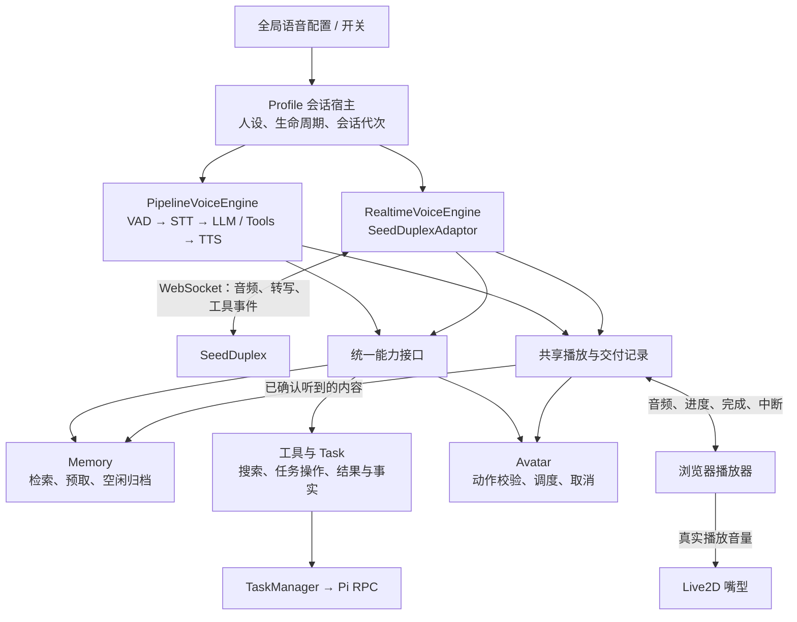
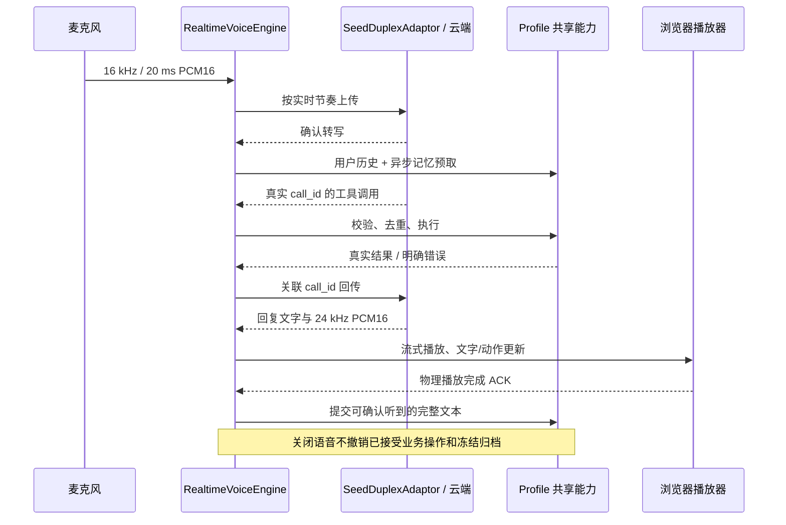

# SeedDuplex Realtime 接入设计

## 1. 结论与产品行为

**接入可行。采用两种语音引擎，共享记忆、工具与 Task、Live2D 动作调度能力。** Realtime 不应嵌进现有 STT→LLM→TTS 流水线，而应作为独立的语音会话实现，通过统一的能力接口接入项目。

首版确定以下行为：

| 项目 | 确定的行为 |
|---|---|
| 模式选择 | 全局配置选择 Pipeline 或 Realtime；原配置默认 Pipeline |
| 切换模式 | 结束当前语音后切换；允许通过重启后端应用配置 |
| Profile | 人设、长期记忆、Task 归属、可用动作继续按 Profile 隔离 |
| 打断 | 优先验证模型语义打断；若事件不足以可靠实现，允许转写开始即停止旧播放，接受附和也打断 |
| 快速回复 | 同一语音模型在慢工具执行前先给出简短、具体的回应，再结合工具结果继续回答 |
| Task 完成通知 | UI 立即更新；下一次用户发言时，由原 Realtime 会话结合最新任务事实自然告知 |
| 文字输入 | Realtime 开启期间禁用文字发送；关闭语音后恢复现有文字聊天 |
| 意外断线 | 停止播放和本次收音，提示用户手动重新开启，不重放麦克风音频或工具请求 |
| 验收方式 | 同设备、同网络、同语料对比现有流水线，统计首次可听声音和打断延迟的 P50/P95 |

文本模型配置仍然保留，用于普通文字聊天和现有长期记忆提取。Realtime 语音回复本身不需要再串接一个独立的文本 LLM。

## 2. SeedDuplex 与现有流水线的区别

以目前核对到的[火山引擎双向流式 Realtime 官方接口文档](https://docs.volcengine.com/docs/DoubaoVoice/endtoend-realtime-voice-full-duplex-version?lang=zh)为准：

| 能力 | 当前流水线 | SeedDuplex 接入方式 |
|---|---|---|
| 输入处理 | 本地 VAD、STT、EOU 等共同控制轮次 | 持续上传音频，由服务端处理识别及轮次；无需强制加载本地 VAD、SmartTurn |
| 回复生成 | 项目调度 LLM，再驱动 TTS | 模型会话返回文字、音频和工具调用 |
| 麦克风音频 | 已有 16 kHz、20 ms 帧 | 可复用，使用单声道 PCM16，640 bytes/帧 |
| 输出音频 | 现有播放器接收 PCM16 | 选择官方支持的 `pcm_s16le`、24 kHz，复用播放器基础能力 |
| 工具调用 | 本地 Harness 调用执行器 | 将共享工具转为服务端 schema，根据真实 `call_id` 回传结果 |
| 上下文更新 | 每次调用前构建本地上下文 | 通过会话配置、历史条目和工具结果更新；不能假定每轮生成前都有同步注入窗口 |
| 快速回应 | 可以由本地调度器控制 | 依赖同一模型的回应与工具调用行为，需要实测 |
| 播放完成 | 已有浏览器播放确认 | 服务端音频生成结束仍不等于用户听完，必须保留客户端播放确认 |

适配器使用官方 WebSocket 地址 `/api/v3/duplex/realtime/dialogue`，凭据采用当前接口的 `X-Api-Key`。模型标识使用当前文档支持的 `1.2.6.1`，作为提供商配置维护。

另有几个明确限制：

- `speech_text_buffer.commit` 是指定文本合成语音，不能当作普通文字提问。
- 当前公开接口没有明确给出可用于主动任务通知的通用 `response.create`；首版不依赖这种能力。
- `response.canceled` 是客户端取消请求的确认，不能当作服务端主动判断打断的证据。
- 当前文档没有明确承诺可直接使用的字词级播放对齐，因此不能按音频时长推算已经听到的文本。
- 禁用本地 VAD 不代表禁用回声消除；浏览器 AEC、设备处理和播放隔离仍然保留。

## 3. 代码架构与共享接口



**Profile 会话宿主拥有共享能力，语音引擎使用这些能力。** 关闭语音不会顺带销毁长期记忆服务、已接受的 Task 或正在进行的记忆归档。后端重启则遵循项目现有的关闭与恢复语义。

现有 `backend/main_agent/realtime.py` 是浏览器语音传输层，并非模型适配器。新增 SeedDuplex 实现应有明确命名，避免将两者混为一体。

统一边界分成四组，不建立通用插件框架：

| 接口边界 | 职责 |
|---|---|
| `VoiceEngine` | 启停会话、接收麦克风帧、处理播放反馈、输出会话事件；Pipeline 和 Realtime 分别实现 |
| `RealtimeVoiceAdaptor` | 封装鉴权、编码、提供商事件解析、工具结果回传和上下文操作，不持有业务记忆或 Pi 调度逻辑 |
| `ConversationCapabilities` | 提供同一套记忆、工具与 Task、动作操作；显式携带 Profile、会话代次和调用归属 |
| 播放与交付接口 | 记录音频开始、实际消费、完成、中断；把服务端生成状态与客户端听到状态分开 |

流水线原有的 `ResponseGrant`、抢答状态和本地 EOU 不进入共享接口。Realtime 同时维护输入状态与输出状态，允许“用户正在说、助手仍在播”同时成立。

### 记忆

- 复用现有 Profile 专属存储、检索和提取能力，不建立第二套长期记忆。
- Pipeline 保留回复前检索；Realtime 根据转写异步预取，并向模型提供 `memory_recall` 工具。
- 预取结果按 Profile 和查询版本隔离。模型调用工具时优先使用有效结果，否则即时检索；旧转写的迟到结果不能覆盖新查询。
- 不让预取阻塞上传音频，也不承诺预取一定赶在模型开口前完成。
- 保留当前空闲归档阈值，默认 300 秒。归档边界必须等待相关播放记录结算，不能在用户刚停嘴、助手仍在播放时截断对话。
- 新输入取消空闲计时；已经冻结的归档批次继续执行。成功后只清理该批次覆盖的内容，失败重试沿用相同幂等标识。
- 归档使用用户确认转写、可靠的助手播放记录和真实任务事实；不记录未播放的完整生成文本。

### 工具与 Task

- 搜索继续调用项目现有 `web_search`、`web_read` 执行器；任务继续通过 TaskManager 和 Pi RPC 管理。
- 两种模式共用工具业务定义、参数校验、Profile 权限、执行结果和错误表示；各自负责转换模型协议。
- Realtime 按官方要求回传与调用关联的工具结果；同批调用分别记录执行状态，再按协议提交结果。
- 工具调用以会话作用域和 `call_id` 去重。同一个调用重复到达，只返回已有结果，不重复创建任务。
- 语音打断只取消旧回复及其播放，不撤销已经接受的业务操作。
- Pipeline 保留确认新语音后自动取消待提交提案的行为；Realtime 不因新语音自动取消提案，只执行模型明确的取消工具。
- 共享取消操作能够处理提案 ID 和任务 ID：待提交时取消提案，已提交时转交 TaskManager；提交中的竞态等待任务创建结果后再取消，并返回真实状态。
- Task 最新状态保存在共享事实中。Realtime 通过 `session.update` 更新有界的任务事实摘要，保留完整人设指令；详细信息仍由任务查询工具提供。该更新不被当作主动开口指令。
- 工具结果不能伪造成用户输入，也不能伪造不存在的工具调用 ID。

### Live2D 动作

- 状态动作继续由输入、思考、实际播放等状态驱动；嘴型继续读取真实播放音量。
- Pipeline 的 `say_to_user` 动作信息与 Realtime 的动作工具调用，最终进入同一个动作调度接口。
- Realtime 暴露动作工具，模型只能选择当前 Profile 实际支持的动作与表情。
- 音频优先，不等待动作工具到达。动作晚到但所属回复仍在播放时可以执行；回复结束或被取消后丢弃。
- 动作归属由适配器根据真实调用和回复关系绑定，不让模型自行填写可信会话 ID。工具调用之后才生成音频时，绑定同一工具续答的播放作用域。
- 断线、切换 Profile、取消回复时清理对应作用域，迟到动作不能影响下一次回复。

### 播放、打断与上下文

- 复用已有音频工作线程、播放流控和设备播放完成确认。
- 增加流式文字更新能力，不再要求收到完整句子后才能开始播放。
- 首版采用可验证的转写开始事件停止旧播放；只有实测获得可靠的语义打断事件或行为后，才启用保留附和的策略。无需额外本地 VAD。
- 停止旧播放时清空对应队列，并过滤属于旧回复的迟到音频、文字和动作。
- 服务端 `response.done` 或音频生成结束不能直接提交“用户已经听到”的历史。
- 只提交能够同时确认文本对应关系和实际播放完成的片段。如果只有整条回复能够对应，被打断的回复不猜测保留前缀。
- 云端上下文也要与打断后的交付结果协调：能够定位助手条目时用官方更新接口修正；不能可靠修正时结束该语音会话并提示重新开启，不能默默继续使用含未听到内容的错误上下文。不能通过删除单侧条目误删整组问答。
- 手动重连创建新会话，从本地已确认历史与当前事实恢复，不盲目沿用旧连接的服务端历史。

## 4. 边界测试与验收

测试分为共享能力契约测试、SeedDuplex 协议事件测试、真实设备验收。模拟事件可以证明本地状态正确，不能替代真实语音对模型行为的验证。

| 范围 | 必须覆盖的场景 | 通过条件 |
|---|---|---|
| 打断 | 长回复中插话、连续插话、附和、背景人声 | 旧播放及时停止；没有旧音频回流；首版明确记录附和也打断的限制 |
| 事件关联 | 文字晚于音频、结束事件重复、取消后仍有音频 | 不串回复、不重复结算、不触发旧动作 |
| 播放记录 | 已生成未播放、播放中断、设备暂停或关闭 | 历史与记忆不出现未经确认听到的完整回答 |
| 工具 | 参数错误、未知工具、超时、同批多个调用 | 有明确结果；不伪造成功；按真实调用关系回传 |
| 去重 | 重复工具事件、重连前后迟到结果 | 同一已识别调用最多产生一次业务效果 |
| Task 取消 | 3 秒提案窗口前后、提交中、提交后取消 | 返回真实状态；不漏取消、不误报未执行 |
| 两种模式差异 | 用户新发言发生在待提交提案期间 | Pipeline 自动取消；Realtime 保留，直到明确取消工具到达 |
| Task 通知 | 用户说话中、助手播放中、静音时完成 | UI 更新；不自行抢话；下一次交流可获取最新事实 |
| 检索 | 转写修订、预取迟到、Profile 切换 | 不串用户、不使用过期结果，不阻塞音频上传 |
| 归档 | 计时中来新输入、归档中来新输入、失败重试 | 只取消计时；冻结批次继续；不清除新对话、不重复写入 |
| 动作 | 先音频后动作、取消后动作、无效动作名 | 音频不等待；过期动作丢弃；只执行有效能力 |
| 生命周期 | 关闭语音、切模式、切 Profile、后端重启 | 无旧回调污染；关闭语音不取消已接受的 Task 或归档 |
| 网络 | 建连失败、连接中断、工具执行中断线 | 停止本次播放与收音；提示手动恢复；不重复执行任务 |
| 配置 | 旧配置迁移、缺少密钥、Realtime 模式启动 | 默认仍为 Pipeline；Realtime 不要求 Pipeline STT/TTS 或本地 VAD 模型资产 |

真实语音验收还必须验证：

- 麦克风采集与扬声器播放同时进行时的回声、音频积压和中断尾音。
- 模型能否在慢工具前给出具体的简短回应，并在工具完成后自然继续。
- 搜索、记忆检索、Task 委派和动作工具同时可用时的选择可靠性。
- 会话事实更新是否被模型正确使用；不能把“配置更新成功”当作“模型必然记住并使用”。
- Realtime 与 Pipeline 使用同一语料测量首次可听声音、工具前回应、工具结果后续答、打断后静音的延迟分布。

日志延续项目现有调试机制，关联 Profile、会话代次、回复、工具调用与播放作用域。记录输入事件、首个音频到达、实际起播、取消、播放结算和工具耗时；不记录密钥，普通日志不直接倾倒完整音频。

## 5. 工程量、前提与文档状态

基于现有音频传输、播放器、记忆服务和 TaskManager 可以复用，**完整首版预估 18–28 人日**。这包含两种模式的回归验证，而不只是连接成功和播放声音。

| 工作范围 | 估算 |
|---|---:|
| 官方协议实测，确认打断、工具和事件关联 | 2–3 人日 |
| SeedDuplex 适配器、配置和会话生命周期 | 4–6 人日 |
| 共享记忆、工具与 Task、动作能力接口 | 5–7 人日 |
| 播放、流式文字、交付记录和打断适配 | 4–6 人日 |
| 边界测试、真实设备验收与流水线回归 | 3–6 人日 |

按一名熟悉项目的工程师投入，约为 **4–6 周**；厂商权限开通、接口确认和服务端问题等待时间另计。仅打通麦克风到模型再到扬声器的演示约 2–3 人日，但不代表上述共享能力与边界已完成。

主要不确定性集中在提供商事件与实际模型行为：语义打断、工具前回应、文本和音频关联。首版已经允许更敏感的打断方式，并通过手动重连、下一轮任务通知和结束会话后切换模式控制工程范围。

本文件记录已确认的设计与验收要求。以下记录本地实现状态；协议模拟测试不代表真实设备或厂商服务验收已完成。

## 6. 实现记录与接入操作

开发分支：`realtime-adaption`。全局语音设置新增 Pipeline / Realtime 选择，旧配置自动保持 Pipeline。 配置页不再提供“启用语音能力”总开关，旧 `speech.enabled` 字段被忽略；语音会话与收音仅由桌宠麦克风按钮开启和关闭。Realtime 填写独立的 SeedDuplex API Key 和当前账号可用的音色 ID，保存并应用后重新开启语音。密钥沿用现有脱敏、保留与显式清除机制。切换模式通过现有后端配置应用流程完成，语音运行期间应先关闭语音。

| 边界 | 当前代码落点 | 行为 |
|---|---|---|
| 配置及资源创建 | `settings.py`、`main.py`、前端语音设置 | Realtime 不检查文本模型、Pipeline STT/TTS 或本地 VAD/SmartTurn 资产；文本模型仍供文字聊天、记忆提取使用 |
| 模型协议适配 | `backend/main_agent/seeduplex.py` | WebSocket 鉴权、JSON 音频、静音保活、扁平工具 schema、真实 call_id 结果回传、会话配置和历史更新 |
| Realtime 引擎 | `backend/main_agent/realtime_voice.py` | 独立输入与输出、流式文本、回复/问题隔离、播放排队、打断及云端上下文修正、断线清理 |
| 共享能力 | `backend/main_agent/capabilities.py` | Pipeline 与 Realtime 共用检索、预取、空闲归档、工具校验、调用去重及 Task 操作；业务操作不随语音等待者取消 |
| Profile 宿主 | `lifecycle.py`、`runtime.py` | Profile 拥有共享能力；语音仅拥有连接和播放；关闭语音保留已接受提案、Task、冻结归档 |
| 动作与交付 | 现有 `AvatarCapabilities`、前端 `PerformanceDirector`、Hub/Context | 两种模式使用同一 Profile 动作目录、同一播放作用域和调度器；Realtime 可更新当前播放中的动作；只有实际播放完成才提交助手历史 |
| UI 状态 | Pet → Main → Console | Realtime 开启时禁用文字发送，关闭后恢复；服务端同步拒绝违规文字发送 |



### 官方协议确认与保守降级

公开文档及官方 Python 示例已核对，尚未使用真实账号运行语音会话：

- 官方 `response.output_audio.started` 示例允许空 `response_id`。实现将其作为提示，等有身份的输出事件后才创建交付记录。
- 输出示例包含 `question_id` 和 `response_id`，没有保证可用于 `conversation.item.update` 的助手 `item_id`。实现不把回复 ID 猜成历史条目 ID，也不按文本相似度猜测条目。
- **如果实际服务不返回可靠的助手条目 ID，打断会停止播放并结束本次语音，用户须重新开启。** 这意味着当前公共示例对应的打断路径可能经常要求重开；可持续打断的体验仍是厂商联调验收项。
- 已有可靠助手条目 ID 时，发送更新并等待对应条目的确认；超时或无法确认则同样结束会话。绝不通过删除一侧条目冒险删除整组问答。
- 已知旧 `response_id`、已退役 `question_id` 的迟到文字、音频和动作会被过滤。公开工具事件示例可能不带回复 ID，工具前动作仅在同一输入代次内暂存；工具续答关联及事件缺字段的实际顺序仍需真实服务验证。
- 历史 API 只恢复完整问答对；已确认但未获回答的用户输入以有界事实数据保留在会话指令中，不伪造助手回答补齐问答。
- 模型工具前的简短回应通过同一语音模型指令约束，不能由本地模拟测试保证模型遵循；不额外合成固定应答音频。

### 自动测试与真实验收边界

新增测试使用真实 Profile Runtime、Hub、SQLite Context 与脚本化提供商连接，覆盖：音频先于最终文字、物理播放确认、旧音频隔离、重复工具去重、参数/未知工具/超时错误、Task 提案跨语音关闭保留、任务事实更新不触发文本模型、归档跨语音关闭继续、旧转写预取隔离、动作晚到/无效/过期、无上下文身份时终止会话、关闭竞态、旧配置与密钥迁移。

运行本地回归：

```sh
backend/.venv/bin/python -m unittest discover -s backend/tests -t .
npm --prefix frontend test
npm --prefix frontend run build
```

真实验收仍须在已开通 SeedDuplex 权限的账号和实际设备上执行第 4 节矩阵。至少保存两种模式、同设备/网络/语料的以下原始样本及 P50/P95，不能用模拟事件时间代替：

| 指标 | 起点 | 终点 |
|---|---|---|
| 首次可听声音 | 相同语料的实际用户语音结束 | 播放设备实际开始输出 |
| 工具前回应 | 实际用户语音结束 | 简短具体回应的实际起播 |
| 工具结果后续答 | 本地工具返回结果 | 续答实际起播 |
| 打断延迟 | 用户插话实际开始 | 旧回复实际静音 |

沿用 debug 启动与现有诊断面板。Realtime 增加 `realtime.started`、`realtime.input.started`、`realtime.transcript.completed`、`realtime.audio.first`、`realtime.tool.settled`，与现有 `devicePlayback.physical.started`、播放取消和 ACK 事件关联。语音日志记录 Profile、generation、会话 scope、回复/工具身份和耗时。实际语音起止应通过统一录音或测试装置标注；服务端转写完成时间不等于真实用户停嘴时间。

这些日志不记录密钥或完整音频。当前尚无真实语音延迟、回声、语义打断或模型工具选择可靠性的验收数据，因此此实现应先用于联调验证。

