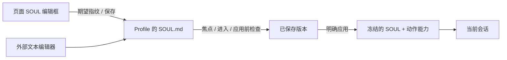
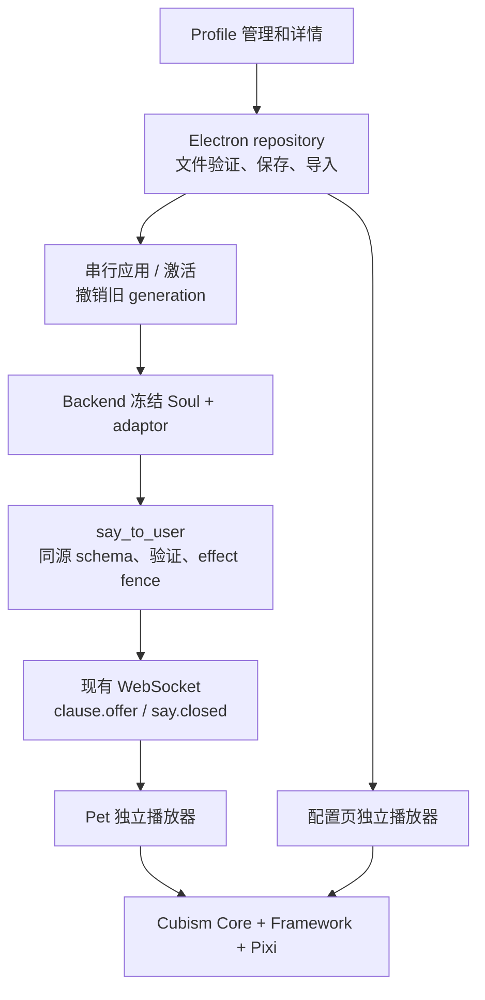

# Profile 与 Live2D 表演系统

本页描述截至 2026-09-10 的角色编辑与表演生产路径。旧 motion queue、状态 watcher 选片和全参数 smoothing 已移除。Profile 配置不再由全局 persona 与 Soul SQLite 同时维护。

## 使用入口

设置窗口 → **角色配置**。当前角色在列表顶部用浅绿色底色标记；通过“切换到此角色”明确切换，查看或预览其他角色不会改变当前会话。

- 顶部箭头返回列表，标题显示角色名称。“角色”页签只有统一名称和一个 SOUL 编辑框；Memory 与 ID 放在折叠信息中。
- “模型与动作”页签自动打开独立预览。左侧人偶、右侧可滚动资源列表与就地编辑区；窄窗口上下排列，资源区独立滚动。
- 导入完整模型文件夹，有多个 `.model3.json` 时选择入口。复制自有资源包，保留目录和许可文件。逐项预览后填写自然语言名称与用途，开启“允许角色在对话中使用”或设为默认待机。
- 右侧“常驻”页签独占待机、聆听、思考和说话的多选候选池配置，动作与表情混合随机；动作／表情条目的高级设置仅保留 fade 与资源文件。组合预览入口已移除。没有表情素材时显示“无预设表情”；Hiyori 的动作编号不被自动翻译成语义。
- **保存**只保存文件，**应用**在会话边界生效。离开脏页面时选择保存、放弃或继续编辑。切换页签保留草稿，离开模型页签立即释放预览实例。
- 界面文字支持中文、英文、日文。用户的 SOUL、名称和动作说明不会随界面语言翻译；新角色使用创建时界面语言的 SOUL 模板。

## 数据与所有权

```text
<配置解析所得 profiles_root>/
  index.json                       # 选中 ID；不包含人格/记忆
  <stable_profile_id>/
    profile.json                           # 身份、统一 revision、模型版本
    SOUL.md                                # 唯一可编辑的人格正文
    .soul-v1-backup/                        # 旧结构化配置和应用快照备份
    applied.json                           # 最近应用的冻结恢复快照
    context.sqlite3                        # Backend 独占
    memory/
      memory.sqlite3                       # Backend 独占
      qdrant/                              # Backend 独占
    live2d/
      adaptor.json
      packages/<sha256>/model/...           # 自有完整包，内容版本不可变
```

目录根沿 `settings.json → backend.app.data_dir → backend.main_agent.profile_dir` 解析，Electron 和 Python 使用同一规则。`AURABOT_USER_DATA_DIR` 只用于选择整套应用数据根。显示名不会改变 ID 或 Memory 归属；布局按 Profile ID 保存。

Electron 只读写配置、资源及已交付历史，不修改 Memory SQLite/Qdrant。Backend 只为活动 Profile 打开 Runtime、Context 和检索资源；休眠 Profile 详情只检查目录存在性。TaskManager 保持独立任务所有权。

保存使用临时文件和可重放 journal；同内容不递增 revision。Soul 与 adaptor 共用 revision，保存不改变正在进行的 invoke。模型包保留已保存/已应用版本，以免替换或预览释放影响旧实例；当前实现保守保留历史包，尚不自动垃圾回收。

首次迁移在旧全局设置回写之前进行：使用 SQLite backup 保留 WAL；保留原 Profile ID/Soul、有效未应用 persona 编辑和原 Context。Memory 迁移在取得与 Qdrant 相同的排他锁后复制到 `memory/`，验证后原子提交。原存储、备份和完成标记保留；重复启动不会重复导入。未知归属历史留在 legacy 分区，不复制给新 Profile。迁移失败不会删除来源。

## SOUL 文件与外部编辑

`SOUL.md` 是 UTF-8 Markdown 原文；页面、“打开 SOUL.md”及“在文件夹中显示”均指向同一 Profile 文件。IPC 只接受 Profile ID，不暴露任意文件读写。当前已应用的正文保存在冻结恢复快照中，外部保存不会立即改变对话。

进入详情、窗口重新获得焦点及应用前读取文件指纹，没有后台轮询。外部变更产生一个新的保存 revision。无页面草稿时自动载入并提示待应用；有草稿时展示双方文本，选择载入磁盘或保留草稿后继续。保存携带期望指纹，过期写入被拒绝。

新格式迁移备份 `profile.json`、`soul.json`、`applied.json` 和旧 journal，完整转换所有旧人格字段；已有 `SOUL.md` 优先保留。保存和应用版本分别转换，不触碰 Context/Memory。旧文件仅用于备份，不再写回。原人格名称和显示名的差异保留在 Markdown 中供用户整理。

SOUL 可保存为空草稿，但应用要求非空且 UTF-8 正文不超过 32 KiB。外部超限文件可读取、缩短；迁移不截断它。后端完整保留正文，取消原 2000 字符截断。身份名称作为受控元数据添加，传递上限另预留 2 KiB 的名称包络；上下文 JSON 的 12000 字符预算独立于 SOUL 系统消息。显式设置过小 SOUL 预算时报告 `soul_budget_exceeded`。



## 三层与生命周期



应用先检查忙碌并按产品确认中断，停止旧连接与交付，Backend 释放原 Profile 资源后绑定目标快照，再让 Pet 接入。模型准备有界，视觉失败显示不可用，不阻止合法文字/语音。应用失败保持旧有效状态或明确离线，不向错误 Profile 写入。取得 token 只允许当前 Profile/revision，并更新 transport generation、取消旧连接，保留当前 Memory/Soul runtime。

删除拒绝当前活动 Profile、最后一个 Profile、有未完成 Task/归档 Context/资源清理的 Profile。Backend 离线而无法确认删除所有权时拒绝删除。UI 明确二次确认自有数据范围。

历史回执含原 Profile 和 generation，由 Main 验证后存储；分页按 Profile 查询。历史是实际交付事实，不回灌 Agent Context。旧 generation 的音频、回执及视觉事件直接丢弃。

## 常驻候选池与连续播放（v2）

- 每个状态的 ID 数组混合 `loop motion` 和 `hold expression`，每轮等概率选一个，允许连续重复。动作一轮结束再抽；表情淡入完成后保持 5 秒。重复状态通知不重抽。
- 抽到表情时，身体继续有效待机 motion；没有待机 motion 则平滑回到模型基线。对话实际交付开始后暂停重抽，身体、呼吸、物理继续；SAY 完成／取消平滑释放覆盖层并恢复常驻目标。迟到加载由配置代际拒绝。
- 身体通道先采样末端，再从实际姿态过渡到下一轮；同一 clip 再抽也处理首尾衔接，原生逐参数淡入累计时间保持单调。常驻过渡至少 250 ms，采用更长的有效资源 fade（上限 5000 ms）。这不能消除素材曲线内部故意绘制的瞬变。
- 一个 Pixi ticker 用有界小步长推进所有层，不增加定时器、队列或每帧 UI 更新。配置预热最多 64 个资源，临时预览 LRU 最多 16 个额外资源；失败候选在该配置版本内排除。
- 旧 v1 的单 ID 转为单元素数组，`null` 转空数组。保存配置和 applied 快照各自升级，原文件留作 `.v1-backup`，不递增内容 revision、不改变 SOUL 或 Memory。旧保存日志也保留备份后恢复。
- 用途说明仅在启用对话使用时显示，允许空字符串；关闭开关保留已写说明。删除对话标记保留素材的常驻归属。新接口仍使用稳定内部 ID，常驻池不进入工具枚举。
- 三语“常驻”页有四个状态的分组多选、选中计数和正式播放器预览。状态资源验证失败保留旧选择；预览名称通过低频播放器事件同步。

## Adaptor 与资源协议

`adaptor.json` 的结构为 `schema_version:2`、`revision`、`model.manifest`、`entries`、`states`、`validated_resources`。entry 使用相对文件引用，包含 kind、display_name、description、agent_enabled、playback；验证凭据绑定不可变模型包版本。

| 约束 | 值 |
| --- | --- |
| entry 数量 / Agent 开放数量 | 128 / 32 |
| 内部 ID / 显示名称 / 描述 | 稳定 ASCII ID 最多 64 字符 / 自然语言名称 128 字符 / 用途 256 字符 |
| motion | once 或 loop；Agent 只能调用 once |
| expression | hold，可用于 SAY 或常驻；对话表情临时覆盖常驻目标 |
| 运行状态 | idle/listening/thinking/speaking；ID 数组，每状态最多 8 项、合计最多 32 项；允许 loop motion / hold expression；未绑定回退 idle |
| 保留控制值 | motion `none`；expression `neutral` |
| fade 覆盖 | `fade_in_ms` / `fade_out_ms`，有限 0–5000 毫秒 |
| 文件夹导入 | 最多 1 GiB / 10000 文件；不接受 symlink |
| 动画读取 | 单资源最多 4 MiB；SDK 分配前验证结构与计数 |

新标记的内部 ID 自动生成，显示名称修改不会破坏调用或状态绑定；旧 ID 保留，旧配置无 display_name 时展示原 ID。同一资源可有独立 once 与 loop entry，Agent 只接收一次性动作与表情。

配置不自动裁剪；超限直接拒绝。未被清单引用的文件列为待验证，真实 SDK 验证后才可开放。`aurabot-model://profile/<id>/<version>/...` 协议只提供该 Profile 已保存/应用包的资源；拒绝路径穿越、编码绕过、绝对路径和 symlink。无需 file://、关闭 webSecurity 或降低 context isolation。

## SAY 与播放时钟

```json
{"avatar":{"motion":"verified_gesture","expression":"neutral"},"text":"这是用户实际标记过的动作。"}
```

名称仅为契约示例。后端从同一冻结能力表生成工具说明、合法集合及查找表。纯 text 仍合法；合法 envelope 中错误 avatar 局部降级，不丢正文。整个 JSON 语法错误、重复键、未知顶层字段和身份冲突仍拒绝。描述只是有界数据，不作为系统指令。

流式扫描支持任意字段顺序和 chunk 切分。首个通过 effect fence 的 clause 冻结 avatar；尚未完整解析则冻结为空，迟到字段不补演。`say_id` 派生自 invoke/call，和 Profile/revision/generation 一起传递；视觉元数据不进 TTS 或 Memory。

`clause.offer` 只准备作用域。文字实际展示或 AudioWorklet 实际消费首批 PCM 才触发一次手势。Worklet 以最多 30 Hz 报告输出包络和音频时钟，client 对齐设备输出时间；麦克风 RMS 不驱动嘴部。`say.closed` 给出最终 clause 数量，结合实际完成集合退出 voice expression，不等待无关慢工具。文字保持 `clamp(字符数×50ms,1500ms,4000ms)`，ACK 不等动画。

暂停关闭嘴部并保留 SAY 表情和动画时钟；恢复不重播手势。取消撤销未执行 cue，新 SAY 可再次调用同名资源。视觉异常与音频 ACK 隔离。

## SDK 与参数合成

保持 `pixi-live2d-display 0.4.0`、Pixi 6.5.10 和当前 Core。使用包导出的 CubismMotion / CubismExpressionMotion 求值，不修改依赖或自行解析贝塞尔。高层随机 Idle 和 motion scheduler 不参与生产播放。

每实例只有一个 Pixi ticker；关闭 model autoUpdate，应用统一毫秒时间，Framework/physics 转换为秒。异常帧最多推进 100ms，physics 子步长不超过 1/60 秒。主体通道持续采样基线与一个手势，从当前姿态按时间权重进入目标并退出到持续基线；没有全参数低通或积压队列。普通 resize/hover/state/clauses 不重建模型。

合成顺序：主体 → 眨眼 → expression → 有限视线 → 单一呼吸 → TTS 开口 → physics/pose → 表情闭眼/TTS 最终约束 → Core。表情保留嘴形，但说话时开口幅度归实际输出所有；暂停/缓冲空白仍维持闭口控制。中性是退出表情层。纹理 URL 使用实例标识，预览与 Pet 销毁互不破坏。

不同素材自身的端点、幅度和物理响应可能不连续，预览用于人工确认；不能承诺任意资源组合自然过渡。Windows 安装包、真实麦克风/扬声器及外部付费 Provider 需要各自实机验收。

## 验证

```bash
uv run --project backend python -m unittest discover -s backend/tests -t .
cd frontend
npm run typecheck
npm test
npm run build
npm run test:e2e
```

`package.json.allowScripts` 仅允许已有 better-sqlite3 构建，兼容 npm 12 的脚本策略。`npm test` 与 E2E 分别 rebuild Node / Electron 原生 SQLite ABI，应顺序执行。E2E 固定单 worker，使用临时 `AURABOT_USER_DATA_DIR` 和本地 Provider fixture，避免多个应用竞争 Backend 端口。真实 Core 单元测试读取内置合法 Hiyori；Electron E2E 额外检查真实页面、WebGL 像素与 Worklet。自动化结果不代表真实声卡/麦克风或付费 Provider 已验收。

## 本次验收证据（2026-09-08）

| 检查 | 实际结果与对应范围 |
| --- | --- |
| Backend unittest discover | 240/240；流式协议、冻结能力、授权回归、归档/关闭失败恢复、WAL/Qdrant 锁迁移与删除保护 |
| `npm run typecheck` | 通过；包括 `.vue` 脚本和实际模板构建 |
| `npm test` | 32 文件、138/138；目录事务/路径、实际 Vue 挂载、历史身份、真实 Core 参数轨迹、播放器时钟与 Worklet |
| `npm run build` | 通过；保留既有 Pixi 静态/动态导入提示，不影响构建 |
| `npm run test:e2e` | 6/6；串行真实 Electron/WebGL、设置/重启、合成 PCM Worklet、实际 Profile 页面和本地 Provider→Pet |
| Git | 仍在 main；`git diff --check` 通过；未 commit/push，未加入模型包、运行数据库、密钥或构建输出 |

关键测试入口：`backend/tests/test_main_agent_avatar.py`、`test_main_agent_lifecycle.py`；`frontend/tests/unit/core/profileRepository.spec.ts`；`avatarModelLifecycle.spec.ts`、`avatarPlayerCache.spec.ts`、`cubismSamplerSafety.spec.ts`、`avatarPerformance.spec.ts`；`frontend/tests/e2e/profile-management.spec.ts` 与 `avatar-delivery.spec.ts`。

真实 Electron 场景包括：A 激活时创建/编辑/预览 B；实际导入中文空格目录和 manifest，删除来源后继续播放；临时合法表情与动作组合；多次开关预览后活动实例回到 1；多 clause 的一次 SAY 动作计数保持 1，后续同名 SAY 增至 2；拒绝旧 A 回执；切回 A 后历史保留；同一临时数据根重启后 B、Soul、applied adaptor 和模型恢复。

真实 Core 测试用已安装运行库和 Hiyori 模型，断言 30/60/120 Hz 循环、逐参数 fade、旧专属参数/部件透明度回归、闭眼/眨眼、退出期间控制权、TTS/表情嘴部冲突，以及只更改 Soul 不重置基线时间。它们与 GPU E2E 互补，不能推导出所有第三方素材都自然流畅。

未执行真实麦克风/扬声器、STT/TTS 云服务或付费 Provider 验收；没有制作或签名发布 macOS/Windows 安装包。测试从构建产物启动 Electron，不等价于发布安装包实机验收。

## 角色编辑页验收（2026-09-10）

| 检查 | 结果 |
| --- | --- |
| Backend 全量 unittest | 246/246，通过；新增完整 SOUL 与自然语言能力名称检查 |
| 前端 typecheck | 通过 |
| 前端全量单元／集成 | 34 文件、160/160，通过；包括 SOUL 外部修改冲突、迁移、真实 Vue 两页签及三语 |
| 构建 | 通过；保留现有 Pixi 静态／动态导入警告 |
| Electron 全量 E2E | 7/7，通过；真实 Core/WebGL、合成 PCM Worklet、三语页面与窄窗口、长 SOUL 实际进入本地 Provider、独立预览释放与重启恢复 |

首轮回归发现旧 E2E 仍使用“模型”导航名和常驻任务栏假设，现已更新为“模型接入”及等待实际折叠／展开视图；同时修正组合选择框无障碍名称与窄窗口布局。最终完整 E2E 一轮通过，不以单项复跑代替全量结果。

这些测试全部使用临时数据；未调用付费服务，未使用真实麦克风、扬声器或云 STT/TTS，未构建签名安装包。真实 Core/WebGL 与合成输出时钟的通过，不等同于外部音频设备验收。

### 常驻 v2 验证记录（2026-09-11）

本轮后端完整 unittest 为 248/248，前端完整 unit 为 177/177（35 文件）；typecheck 与构建通过。真实 Cubism/Core 测试覆盖 30/60/120 Hz、原生逐参数 fade 单调性、同项首尾交接、参数/部件退出、常驻表情恢复、暂停后取消、迟到预加载，以及同 ID 换绑同时间参数的资源。页面测试覆盖三语、用途说明可空和隐藏保留、多选失败恢复、常驻归属保留；迁移测试使用临时目录并核对旧文件备份与 applied 差异。

Electron 曾完整通过 7/7。最终构建的最新完整运行是 6/7：Profile 管理/常驻多轮随机预览/重启、真实模型渲染、SAY 指令和陈旧回执隔离均通过；合成 AudioWorklet 场景出现 `capture timeout`，独立复测三次同样失败。进一步用不加载 AuraBot 或 Live2D 的独立静音 Electron 探针复现：AudioContext 为 running，2.5 秒后 currentTime 仅约 0.0053 秒，输出 contextTime 为 0，无 Worklet 帧。说明本机音频时钟当时未正常推进，具体系统原因未定位；没有重启音频服务、改设备或将失败记为通过。此前另有一次端口占用导致启动失败，占用消失后完整复跑通过，未终止未知进程。

本机临时诊断记录：`/private/tmp/aurabot-resident-{unit,backend,typecheck,e2e}.log`、`/private/tmp/aurabot-resident-e2e-port-conflict.log`、`/private/tmp/aurabot-resident-e2e-audio-timeout.log`、`/private/tmp/aurabot-resident-audio-repeat.log`、`/private/tmp/aurabot-audio-probe.log`。系统音频恢复后，在 frontend 目录运行 `npm run test:e2e` 重新验收；真实麦克风/扬声器、付费 Provider 和签名安装包仍未实机验证。测试和探针均未使用真实用户数据。


### 查看方向灵敏度

“模型与动作”预览下方提供 `0–16×` 滑块，默认 `1×`；`0×` 关闭鼠标视线贡献。
数值保存在该角色 `adaptor.json` 的可选字段 `gaze_sensitivity`，旧配置缺省按 `1` 处理。
Main 与 Backend 均拒绝非有限数值和越界值。它不进入 Agent 工具能力。
拖动滑块立即更新独立预览，鼠标在预览内移动即可观察；保存、应用后才影响桌宠。
调节不会重建模型或重新开始动作。系数同时缩放眼球与头部的鼠标贡献，保留手势期间降低头部跟随权重的规则，最终受模型自身参数范围限制。


### 说话口型灵敏度

预览下方的独立 `0–16×` 滑块设置 `lip_sensitivity`，默认 `1`，`0` 关闭语音口型。
设置按角色保存并在应用后生效；不修改音量、鼠标视线、表情嘴型或 TTS 交付时钟。
播放器把实际输出音量包络乘以该系数并限制到 `0–1`，再沿用开口/闭口平滑；最后由 Core 限制到模型参数范围。
暂停、取消、结束继续闭口，调节草稿不重建模型或重启播放。倍数过高会更容易饱和为最大张嘴。


### 显示完整模型

预览下方的“显示完整模型”复选框按角色保存在 `show_full_model`，旧配置默认 `true`。
勾选时保留原有默认缩放，并在缩放/偏移后约束模型画布完整位于显示框内；取消后按模型画布上部约 55% 取景，允许下半身和两侧裁切，并继续支持原有聚焦缩放。
预览即时调整，桌宠保存并应用后生效；仅重算位置和比例，不重建播放器或重播动作。
取景依据模型画布尺寸，不做人脸或身体识别；留白较多或非人形素材的实际裁切效果取决于素材布局。
