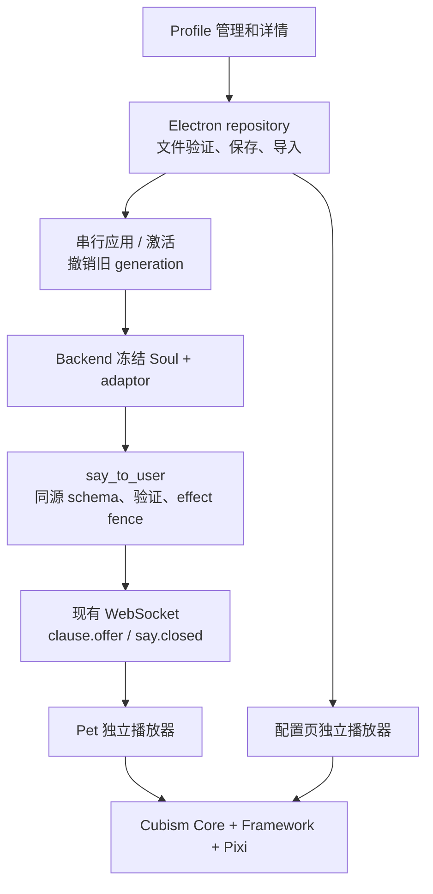

# Profile 与 Live2D 表演系统

本页描述 2026-09-08 重构后的生产路径。旧 motion queue、状态 watcher 选片和全参数 smoothing 已移除。Profile 配置不再由全局 persona 与 Soul SQLite 同时维护。

## 使用入口

设置窗口 → **Profile 管理**。可以创建、打开详情、重命名、显式激活和删除 Profile。详情页独立编辑结构化 Soul、查看 Memory 归属、导入模型、预览及标记资源。查看 B 不会激活 B。

1. 导入完整模型文件夹；有多个 `.model3.json` 时选择入口。资源复制到 Profile 自有包，保留原目录和许可文件。
2. 打开预览，逐项播放真实 motion/expression。没有表情的模型显示“无预设表情”。内置 Hiyori 有 10 个动作，没有预设表情；系统不猜测文件语义。
3. 为预览验证通过的资源设置稳定语义名称、说明、播放类型及 Agent 开关。可配置待机和 listening/thinking/speaking 基线，预览单项、组合、循环及状态切换。
4. **保存**提交当前编辑；**应用**在会话边界更新当前 Profile。未激活 Profile 需要显式激活。离开未保存页面时选择保存、放弃或继续编辑。
5. “读取播放诊断”按需展示当前预览实例和更新计数，不逐帧更新 Vue。关闭预览或离开详情即释放该实例。

## 数据与所有权

```text
<配置解析所得 profiles_root>/
  index.json                       # 选中 ID；不包含人格/记忆
  <stable_profile_id>/
    profile.json                           # 身份、统一 revision、模型版本
    soul.json                              # 完整结构化 Soul
    applied.json                           # 最近应用的冻结恢复快照
    context.sqlite3                        # Backend 独占
    memory/
      memory.sqlite3                       # Backend 独占
      qdrant/                              # Backend 独占
    live2d/
      adaptor.json
      packages/<sha256>/model/...           # 自有完整包，内容版本不可变
```

目录根沿 `settings.json → backend.app.data_dir → backend.main_agent.profile_dir` 解析，Electron 和 Python 使用同一规则。`AURABOT_USER_DATA_DIR` 只用于选择整套应用数据根。显示名不会改变 ID 或 Memory 归属；布局按 Profile ID 保存。

Electron 只读写配置、资源及已交付历史，不修改 Memory SQLite/Qdrant。Backend 只为活动 Profile 打开 Runtime、Context 和检索资源；休眠 Profile 详情只检查目录存在性。TaskManager 保持独立任务所有权。

保存使用临时文件和可重放 journal；同内容不递增 revision。Soul 与 adaptor 共用 revision，保存不改变正在进行的 invoke。模型包保留已保存/已应用版本，以免替换或预览释放影响旧实例；当前实现保守保留历史包，尚不自动垃圾回收。

首次迁移在旧全局设置回写之前进行：使用 SQLite backup 保留 WAL；保留原 Profile ID/Soul、有效未应用 persona 编辑和原 Context。Memory 迁移在取得与 Qdrant 相同的排他锁后复制到 `memory/`，验证后原子提交。原存储、备份和完成标记保留；重复启动不会重复导入。未知归属历史留在 legacy 分区，不复制给新 Profile。迁移失败不会删除来源。

## 三层与生命周期



应用先检查忙碌并按产品确认中断，停止旧连接与交付，Backend 释放原 Profile 资源后绑定目标快照，再让 Pet 接入。模型准备有界，视觉失败显示不可用，不阻止合法文字/语音。应用失败保持旧有效状态或明确离线，不向错误 Profile 写入。取得 token 只允许当前 Profile/revision，并更新 transport generation、取消旧连接，保留当前 Memory/Soul runtime。

删除拒绝当前活动 Profile、最后一个 Profile、有未完成 Task/归档 Context/资源清理的 Profile。Backend 离线而无法确认删除所有权时拒绝删除。UI 明确二次确认自有数据范围。

历史回执含原 Profile 和 generation，由 Main 验证后存储；分页按 Profile 查询。历史是实际交付事实，不回灌 Agent Context。旧 generation 的音频、回执及视觉事件直接丢弃。

## Adaptor 与资源协议

`adaptor.json` 的结构为 `schema_version:1`、`revision`、`model.manifest`、`entries`、`states`、`validated_resources`。entry 使用相对文件引用，包含 kind、description、agent_enabled、playback；验证凭据绑定不可变模型包版本。

| 约束 | 值 |
| --- | --- |
| entry 数量 / Agent 开放数量 | 128 / 32 |
| 名称 / 描述 | ASCII 标识符最多 64 字符 / 256 字符 |
| motion | once 或 loop；Agent 只能调用 once |
| expression | hold，作用域为一次 SAY |
| 运行状态 | idle/listening/thinking/speaking；仅 loop motion，未绑定回退 idle |
| 保留控制值 | motion `none`；expression `neutral` |
| fade 覆盖 | `fade_in_ms` / `fade_out_ms`，有限 0–5000 毫秒 |
| 文件夹导入 | 最多 1 GiB / 10000 文件；不接受 symlink |
| 动画读取 | 单资源最多 4 MiB；SDK 分配前验证结构与计数 |

配置不自动裁剪；超限直接拒绝。未被清单引用的文件列为待验证，真实 SDK 验证后才可开放。`aurabot-model://profile/<id>/<version>/...` 协议只提供该 Profile 已保存/应用包的资源；拒绝路径穿越、编码绕过、绝对路径和 symlink。无需 file://、关闭 webSecurity 或降低 context isolation。

## SAY 与播放时钟

```json
{"avatar":{"motion":"verified_gesture","expression":"neutral"},"text":"这是用户实际标记过的动作。"}
```

名称仅为契约示例。后端从同一冻结能力表生成工具说明、合法集合及查找表。纯 text 仍合法；合法 envelope 中错误 avatar 局部降级，不丢正文。整个 JSON 语法错误、重复键、未知顶层字段和身份冲突仍拒绝。描述只是有界数据，不作为系统指令。

流式扫描支持任意字段顺序和 chunk 切分。首个通过 effect fence 的 clause 冻结 avatar；尚未完整解析则冻结为空，迟到字段不补演。`say_id` 派生自 invoke/call，和 Profile/revision/generation 一起传递；视觉元数据不进 TTS 或 Memory。

`clause.offer` 只准备作用域。文字实际展示或 AudioWorklet 实际消费首批 PCM 才触发一次手势。Worklet 以最多 30 Hz 报告输出包络和音频时钟，client 对齐设备输出时间；麦克风 RMS 不驱动嘴部。`say.closed` 给出最终 clause 数量，结合实际完成集合退出 voice expression，不等待无关慢工具。文字保持 `clamp(字符数×50ms,1500ms,4000ms)`，ACK 不等动画。

暂停关闭嘴部并保留 SAY 表情和动画时钟；恢复不重播手势。取消撤销未执行 cue，新 SAY 可再次调用同名资源。视觉异常与音频 ACK 隔离。

## SDK 与参数合成

保持 `pixi-live2d-display 0.4.0`、Pixi 6.5.10 和当前 Core。使用包导出的 CubismMotion / CubismExpressionMotion 求值，不修改依赖或自行解析贝塞尔。高层随机 Idle 和 motion scheduler 不参与生产播放。

每实例只有一个 Pixi ticker；关闭 model autoUpdate，应用统一毫秒时间，Framework/physics 转换为秒。异常帧最多推进 100ms，physics 子步长不超过 1/60 秒。主体通道持续采样基线与一个手势，从当前姿态按时间权重进入目标并退出到持续基线；没有全参数低通或积压队列。普通 resize/hover/state/clauses 不重建模型。

合成顺序：主体 → 眨眼 → expression → 有限视线 → 单一呼吸 → TTS 开口 → physics/pose → 表情闭眼/TTS 最终约束 → Core。表情保留嘴形，但说话时开口幅度归实际输出所有；暂停/缓冲空白仍维持闭口控制。中性是退出表情层。纹理 URL 使用实例标识，预览与 Pet 销毁互不破坏。

不同素材自身的端点、幅度和物理响应可能不连续，预览用于人工确认；不能承诺任意资源组合自然过渡。Windows 安装包、真实麦克风/扬声器及外部付费 Provider 需要各自实机验收。

## 验证

```bash
uv run --project backend python -m unittest discover -s backend/tests -t .
cd frontend
npm run typecheck
npm test
npm run build
npm run test:e2e
```

`npm test` 与 E2E 分别 rebuild Node / Electron 原生 SQLite ABI，应顺序执行。E2E 固定单 worker，使用临时 `AURABOT_USER_DATA_DIR` 和本地 Provider fixture，避免多个应用竞争 Backend 端口。真实 Core 单元测试读取内置合法 Hiyori；Electron E2E 额外检查真实页面、WebGL 像素与 Worklet。自动化结果不代表真实声卡/麦克风或付费 Provider 已验收。

## 本次验收证据（2026-09-08）

| 检查 | 实际结果与对应范围 |
| --- | --- |
| Backend unittest discover | 240/240；流式协议、冻结能力、授权回归、归档/关闭失败恢复、WAL/Qdrant 锁迁移与删除保护 |
| `npm run typecheck` | 通过；包括 `.vue` 脚本和实际模板构建 |
| `npm test` | 32 文件、138/138；目录事务/路径、实际 Vue 挂载、历史身份、真实 Core 参数轨迹、播放器时钟与 Worklet |
| `npm run build` | 通过；保留既有 Pixi 静态/动态导入提示，不影响构建 |
| `npm run test:e2e` | 6/6；串行真实 Electron/WebGL、设置/重启、合成 PCM Worklet、实际 Profile 页面和本地 Provider→Pet |
| Git | 仍在 main；`git diff --check` 通过；未 commit/push，未加入模型包、运行数据库、密钥或构建输出 |

关键测试入口：`backend/tests/test_main_agent_avatar.py`、`test_main_agent_lifecycle.py`；`frontend/tests/unit/core/profileRepository.spec.ts`；`avatarModelLifecycle.spec.ts`、`avatarPlayerCache.spec.ts`、`cubismSamplerSafety.spec.ts`、`avatarPerformance.spec.ts`；`frontend/tests/e2e/profile-management.spec.ts` 与 `avatar-delivery.spec.ts`。

真实 Electron 场景包括：A 激活时创建/编辑/预览 B；实际导入中文空格目录和 manifest，删除来源后继续播放；临时合法表情与动作组合；多次开关预览后活动实例回到 1；多 clause 的一次 SAY 动作计数保持 1，后续同名 SAY 增至 2；拒绝旧 A 回执；切回 A 后历史保留；同一临时数据根重启后 B、Soul、applied adaptor 和模型恢复。

真实 Core 测试用已安装运行库和 Hiyori 模型，断言 30/60/120 Hz 循环、逐参数 fade、旧专属参数/部件透明度回归、闭眼/眨眼、退出期间控制权、TTS/表情嘴部冲突，以及只更改 Soul 不重置基线时间。它们与 GPU E2E 互补，不能推导出所有第三方素材都自然流畅。

未执行真实麦克风/扬声器、STT/TTS 云服务或付费 Provider 验收；没有制作或签名发布 macOS/Windows 安装包。测试从构建产物启动 Electron，不等价于发布安装包实机验收。
