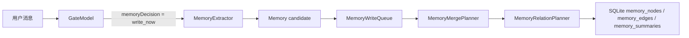
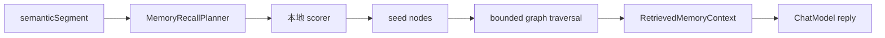
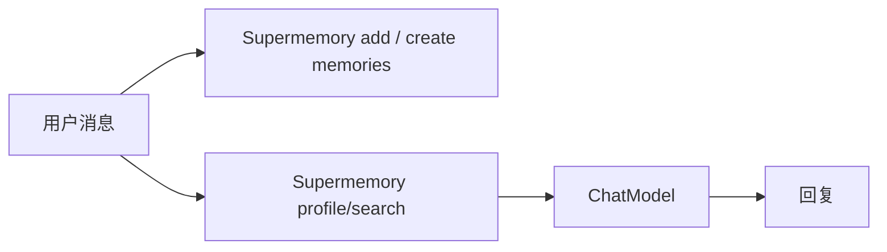
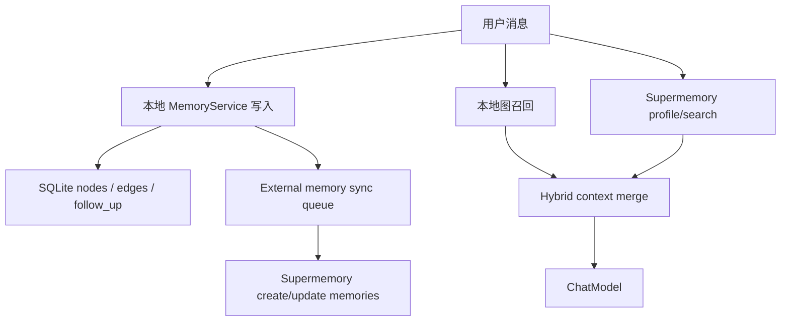

# Supermemory 接入 AuraBot 说明文档

资料核对日期：2026-05-16
适用范围：AuraBot 当前本地记忆系统、Supermemory v4 Memory API、Supermemory TypeScript SDK 4.21.1

## 1. 结论

Supermemory 可以接入 AuraBot，但不建议第一步就把 AuraBot 当前记忆系统全盘替换掉。

AuraBot 现在的记忆系统已经承担了几类 Supermemory 不直接覆盖的产品职责：

1. 本地 SQLite 记忆节点、关系边、摘要和事件日志。
2. `follow_up` 到期扫描、桌宠气泡和系统通知触发。
3. Memory Debug 中的可解释召回 trace。
4. 无网络或 Supermemory 不可用时的本地可用性。
5. 受控的 `trait / preference / event / follow_up` 类型和状态机。

Supermemory 更适合作为外部长期语义记忆层接入：负责语义搜索、自动画像、跨轮记忆更新、版本化记忆、原始对话 ingestion 和更强的 cloud memory graph。推荐路线是“本地记忆为主，Supermemory 增强召回和画像”的 hybrid 方案。

## 2. Supermemory 的机制

Supermemory 的核心不是单纯的向量库，而是 documents 到 memories 的处理管线。

### 2.1 Documents 与 Memories

Supermemory 把输入分成两层：

| 层 | 含义 | AuraBot 中的对应物 |
| --- | --- | --- |
| Documents | 用户传入的原始内容，例如对话片段、文档、URL、文件 | 原始聊天轮次、任务记录、用户导入文件 |
| Memories | Supermemory 从原始内容中抽取出的语义记忆单元 | AuraBot 的 `memory_nodes`，但 Supermemory 的 memory 更偏语义图和搜索单元 |

官方机制是：原始内容先作为 document 进入处理队列，然后经过抽取、chunking、embedding、indexing，最终形成可搜索、可关联、可更新的 memories。

### 2.2 处理管线

Supermemory 文档描述的 pipeline 大致是：


这意味着 `client.add(...)` 或 `/v3/documents` 不是同步写入一条立即稳定的事实，而是把 raw context 交给 Supermemory 处理。对于 AuraBot，原始对话 ingestion 适合做后台增强，不适合替代本地即时记忆写入。

### 2.3 关系与时序

Supermemory 的知识图会处理几类关系：

| 关系 | 含义 | AuraBot 中的接近概念 |
| --- | --- | --- |
| update | 新事实替代旧事实，例如“用户现在不喜欢 Adidas 了” | `update_existing`、状态更新、旧节点 stale/archive |
| extends | 新事实补充旧事实，例如在职业事实上补充工作内容 | `relates_to`、同 topic 摘要扩展 |
| derives | 从多个事实推导出的新洞察 | 当前 AuraBot 尚未做开放式推理派生 |

Supermemory 也会处理当前事实与过时事实的区别，例如通过版本和 latest 状态避免旧偏好压过新偏好。这是它相对普通 RAG 的价值点。

### 2.4 用户画像

Supermemory 的 `profile` 接口会返回两类 profile：

| 字段 | 含义 | AuraBot 用法 |
| --- | --- | --- |
| `profile.static` | 长期稳定事实，例如身份、长期偏好、背景 | 适合注入 `ChatModel` 的长期用户画像 |
| `profile.dynamic` | 最近上下文、当前状态、近期事件 | 适合注入当前回复，补充“最近用户在忙什么” |

`profile` 可以带 `q`，一次取用户画像和当前 query 相关的 memories。

### 2.5 搜索

Supermemory v4 搜索入口是 `/v4/search`，TypeScript SDK 中对应 `client.search.memories(...)`。

关键参数：

| 参数 | 含义 | 建议 |
| --- | --- | --- |
| `q` | 搜索 query | 使用当前 `semanticSegment` |
| `containerTag` | 用户或项目隔离空间 | 用 AuraBot profile 映射生成 |
| `searchMode` | `memories` 或 `hybrid` | 默认先用 `memories`，需要 raw chunks 时再用 `hybrid` |
| `limit` | 返回数量 | MVP 取 5 到 8 |
| `threshold` | 相似度门槛 | MVP 取 0.55 到 0.7，后续用 eval 调整 |
| `rerank` | 是否重排 | 默认关闭，质量不足再开启 |
| `filters` | metadata 过滤 | 用于筛 `nodeType`、`source`、`state`、`profileId` |

`hybrid` 会同时搜索 memories 和 document chunks，召回更宽；`memories` 只查抽取后的 facts，噪音更少。

### 2.6 隔离与权限

Supermemory 用 `containerTag` 做隔离。v4 接口使用单个 `containerTag` 字段；v3 部分 documents/search 接口仍有 `containerTags` 数组字段，接入时必须在 adapter 内封装差异，不能把字段差异散落到业务代码里。

认证使用 Bearer API key。官方也支持 container-scoped key，可以把 key 限制到单个 `containerTag`，适合 AuraBot 未来做多 profile、多设备或用户自带 key。

### 2.7 定制抽取

Supermemory 支持两类定制：

1. `filterPrompt`：组织级配置，告诉 Supermemory ingestion 时哪些内容值得索引，哪些应该跳过。
2. `entityContext`：按 container 或当前 add 请求提供实体上下文，指导某个用户/会话的 memory extraction。

AuraBot 适合用 `entityContext` 写清楚：这是桌面伴侣与用户的长期聊天，优先保留用户偏好、稳定事实、人际关系、任务、提醒、近期状态，跳过寒暄、重复语气词和一次性闲聊。

## 3. Supermemory 主要接口

### 3.1 原始上下文写入：`client.add(...)`

用途：把对话、文件、URL、长文本交给 Supermemory 自动抽取和索引。

TypeScript SDK 示例形态：

```ts
await client.add({
  content: "user: 我喜欢火锅\nassistant: 我记住啦",
  customId: "aurabot-session-message-batch-123",
  containerTag: "aurabot.profile.profile_abc",
  metadata: {
    app: "aurabot",
    source: "chat",
    profileId: "profile_abc"
  },
  entityContext: "AuraBot desktop companion conversation. Prioritize durable user preferences, traits, relationships, events, and reminders."
});
```

特点：

1. 适合 raw conversation ingestion。
2. `customId` 可用于去重或追加同一会话内容。
3. 返回 queued 状态，最终可搜索有延迟。
4. 不适合替代 AuraBot 当前同步写入本地记忆的路径。

### 3.2 直接创建 memories：`POST /v4/memories`

用途：已经有明确结构化事实时，直接写 memory，不走 raw document 抽取。

示例形态：

```ts
await fetch("https://api.supermemory.ai/v4/memories", {
  method: "POST",
  headers: {
    Authorization: `Bearer ${apiKey}`,
    "Content-Type": "application/json"
  },
  body: JSON.stringify({
    containerTag: "aurabot.profile.profile_abc",
    memories: [
      {
        content: "用户喜欢吃火锅",
        isStatic: false,
        metadata: {
          app: "aurabot",
          localMemoryId: "memory_123",
          nodeType: "preference",
          sourceSessionId: "session_123",
          state: "active"
        }
      }
    ]
  })
});
```

特点：

1. 适合 AuraBot 本地 `MemoryExtractor` 已经抽取出的 `trait / preference / event`。
2. 创建后会 embedding，并立即进入可搜索路径。
3. 官方文档目前提示 v4 memory operations 先用 `fetch` 或 cURL，SDK 支持仍在补齐。
4. 一次可写多条 memory，官方参数写的是 1 到 100 条。

### 3.3 搜索 memories：`client.search.memories(...)`

用途：根据当前用户输入召回相关 memories 或 document chunks。

示例形态：

```ts
const results = await client.search.memories({
  q: semanticSegment,
  containerTag: "aurabot.profile.profile_abc",
  searchMode: "memories",
  limit: 8,
  threshold: 0.6
});
```

返回结果中可能有：

1. `memory`：抽取后的记忆事实。
2. `chunk`：hybrid 模式下命中的原始文档片段。
3. `similarity`：相似度。
4. `metadata`：写入时携带的自定义字段。
5. `updatedAt`、`version` 等版本信息。

### 3.4 用户画像：`client.profile(...)`

用途：取静态画像、动态上下文和可选 query 相关 search results。

示例形态：

```ts
const result = await client.profile({
  containerTag: "aurabot.profile.profile_abc",
  q: semanticSegment,
  threshold: 0.6
});
```

返回：

```ts
{
  profile: {
    static: string[],
    dynamic: string[]
  },
  searchResults?: {
    results: unknown[],
    total: number,
    timing: number
  }
}
```

AuraBot 可以把 `static` 和 `dynamic` 转成 `recalledMemories` 之外的 profile context，避免把用户长期画像塞成普通节点。

### 3.5 更新与遗忘

Supermemory v4 memory operations 支持：

| 操作 | 接口 | AuraBot 用途 |
| --- | --- | --- |
| update memory | `PATCH /v4/memories` 或 SDK `memories.updateMemory(...)` | 本地 merge/update 旧节点后，同步远端版本 |
| forget memory | `POST /v4/memories/{id}/forget` 或 SDK `memories.forget(...)` | 本地 archived 或用户删除记忆后，让远端不再搜索命中 |

注意：Supermemory 的 forget 是软删除，不是物理删除。产品隐私上如果需要“彻底删除”，需要确认官方是否有 hard delete 或通过 document/memory 管理接口处理。

### 3.6 SDK 兼容状态

本地查询到 `supermemory` npm latest 是 `4.21.1`。当前 SDK 适合用来调用：

1. `client.add(...)`
2. `client.profile(...)`
3. `client.search.memories(...)`
4. `client.documents.*`
5. `client.settings.update(...)`
6. `client.memories.updateMemory(...)`
7. `client.memories.forget(...)`

直接创建 `/v4/memories` 建议先在 AuraBot 自己的 `SupermemoryClient` 里用 `fetch` 封装。这样即使 SDK 以后补齐 create memories，也只需要替换 adapter 内部实现。

## 4. AuraBot 当前记忆系统

AuraBot 当前记忆系统是本地优先的“分层摘要 + 图状联想 + memoryModel 语义增强”结构。

### 4.1 数据层

| 本地对象 | 作用 |
| --- | --- |
| `memory_nodes` | 原子记忆，类型为 `trait / preference / event / follow_up`，有 `active / stale / completed / archived` 状态 |
| `memory_edges` | 节点之间的关系边，例如 `relates_to / caused_by / scheduled_for / preference_for / opposes` |
| `memory_summaries` | 按 topic 聚合的本地摘要 |
| `event_logs` | gate、memory write、memory recall、follow-up 等调试日志 |
| `MemoryWriteQueue` | 串行化本地写入，避免并发改图 |

### 4.2 写入流程



关键代码路径：

1. `src/core/orchestration/chatOrchestrator.ts`：决定何时写入、何时召回。
2. `src/core/memory/memoryExtractor.ts`：抽取候选记忆。
3. `src/core/memory/memoryService.ts`：写入、合并、召回、follow-up 状态处理。
4. `src/core/memory/modelBackedMemoryModel.ts`：可选 LLM planner，负责 extraction、merge、relation、recall plan。
5. `src/core/storage/repositories/memoryRepository.ts`：SQLite 持久化。

### 4.3 召回流程



当前召回不是纯向量搜索，而是：

1. 可选 `memoryModel` 生成 query terms、target types、ranked node ids。
2. 本地 scorer 命中中文 query、概念词、类型偏权和 importance。
3. 从 seed nodes 沿关系边做 bounded traversal。
4. 把 nodes、summaries、due follow-ups 注入回复。
5. Memory Debug 展示 query、planner terms、seed、expanded nodes、traversed edges。

### 4.4 本地 follow-up 是独立产品能力

`follow_up` 不是普通语义事实。它会被本地 scheduler 扫描，到期后触发桌宠气泡或系统通知，并标记为 `completed`，避免重复提醒。

这点是全盘替换 Supermemory 时最大的风险之一：Supermemory 可以存“用户明天要面试”这类事实，但它不是 AuraBot 本地提醒状态机。

## 5. Supermemory 与 AuraBot 的兼容方式

### 5.1 类型映射

| AuraBot 类型 | Supermemory 写法 | 是否建议远端同步 | 说明 |
| --- | --- | --- | --- |
| `trait` | `isStatic: true` memory | 是 | 例如身份、长期背景、稳定习惯 |
| `preference` | `isStatic: false` 或稳定偏好时 true | 是 | 偏好会变，默认不作为永久事实 |
| `event` | `isStatic: false`，metadata 带 `startsAt / endsAt` | 是 | 适合远端语义召回，但本地仍保留时间字段 |
| `follow_up` | metadata 标记 `nodeType: follow_up` | 谨慎 | 可用于搜索上下文，但触发和完成状态必须本地负责 |
| `memory_edges` | 不直接映射，或通过 metadata 记录 `localRelatedIds` | 间接 | Supermemory 内部有图，但不应假设可完全复刻 AuraBot 边类型 |
| `memory_summaries` | 可从 `profile.static/dynamic` 补强 | 否 | 不建议把本地 summary 当作远端事实重复写入 |
| `event_logs` | 不同步 | 否 | 调试日志留本地 |

### 5.2 ID 与状态映射

需要新增本地外部引用表或等价结构：

```sql
memory_external_refs (
  local_node_id text not null,
  provider text not null,
  external_memory_id text,
  external_document_id text,
  sync_state text not null,
  last_synced_at text,
  last_error text,
  primary key (local_node_id, provider)
)
```

建议状态：

| 状态 | 含义 |
| --- | --- |
| `pending` | 本地已写入，等待同步 |
| `synced` | 远端已同步 |
| `failed` | 同步失败，可重试 |
| `stale` | 本地已更新，远端需要 PATCH |
| `forgotten` | 已在远端 soft delete |

### 5.3 containerTag 策略

推荐：

```text
aurabot.profile.<profileId>
```

如果担心暴露本地 profile id，可以使用 hash：

```text
aurabot.profile.<sha256(profileId + installSalt)>
```

不要直接用用户名、邮箱、设备名这类可识别信息。

### 5.4 metadata 策略

建议每条直接写入 Supermemory 的 memory 至少带：

```json
{
  "app": "aurabot",
  "providerSchema": "aurabot-memory-v1",
  "profileIdHash": "...",
  "localMemoryId": "memory_...",
  "sourceSessionId": "session_...",
  "nodeType": "preference",
  "state": "active",
  "startsAt": "2026-05-17T10:00:00+08:00",
  "endsAt": null,
  "importance": 0.72
}
```

不要把 API key、完整本地路径、系统用户名、原始隐私字段写进 metadata。

### 5.5 在线与离线兼容

Supermemory 是外部服务。AuraBot 必须设计成：

1. Supermemory 不可用时，本地记忆仍然写入、召回、提醒。
2. 远端失败只影响语义增强，不阻塞主聊天。
3. 同步错误写入 `event_logs`，并在 Memory Debug 显示。
4. 远端恢复后后台重试。

## 6. 几种接入方式对比

### 6.1 方案 A：全盘替换为 Supermemory

含义：AuraBot 不再把本地 SQLite 记忆图作为 source of truth。用户消息写入 Supermemory，回复前调用 Supermemory profile/search，AuraBot 本地只保留必要的消息、任务和 UI 状态。



预期效果：

1. 语义召回和用户画像能力最快变强。
2. 本地 memory 代码量可以减少。
3. 不需要自己实现 embedding、远端搜索、用户 profile compaction。

主要问题：

1. 失去本地可解释图结构，Memory Debug 的 seed、expanded、traversed edges 需要重做。
2. `follow_up` 到期提醒不能只依赖 Supermemory，否则提醒状态、触发、完成、去重都会变模糊。
3. 原始对话 ingestion 有异步处理延迟，不能保证用户刚说完就立刻可召回。
4. 网络失败、API key 失效、服务限流会直接影响记忆功能。
5. AuraBot 当前 eval fixture、SQLite repository、图遍历和本地调试价值会被大量废弃。
6. 用户隐私边界更敏感，因为长期聊天内容默认进入云端。

适用场景：

1. 要快速做 cloud-first demo。
2. 愿意牺牲离线和本地可解释性。
3. 暂时不强调桌宠主动提醒的可靠状态机。

不建议作为 AuraBot 第一阶段方案。

### 6.2 方案 B：在当前本地记忆系统上接入 Supermemory，做 hybrid 增强

含义：AuraBot 本地 SQLite 仍是 source of truth。写入本地后，后台同步到 Supermemory；召回时同时拿本地图召回和 Supermemory 语义召回，再合并给 `ChatModel`。



预期效果：

1. 保留本地稳定性、调试 trace、follow-up 状态机和离线能力。
2. 增加 Supermemory 的语义搜索、用户画像、时序更新和云端 memory graph。
3. 可渐进 rollout：没有 API key 时完全退回本地；开启后增强。
4. 可以通过 `corepack pnpm eval:memory` 继续验证本地召回，并新增 hybrid fixture。
5. 比全盘替换更符合 AuraBot 当前架构，也更容易回滚。

主要成本：

1. 需要写同步队列、外部 ID 映射和错误重试。
2. 需要解决本地 memory 与远端 memory 的去重和排序。
3. 需要产品设置里明确外部记忆开关、API key、隐私说明。
4. Memory Debug 要新增 external sync 和 remote hits 展示。

推荐作为第一阶段正式方案。

### 6.3 方案 C：只把 Supermemory 当作原始对话归档和长尾搜索

含义：AuraBot 本地系统不变。只在后台把完整对话片段用 `client.add(...)` 上传，未来 query 时用 `searchMode: "hybrid"` 补充长尾上下文。

预期效果：

1. 接入最快，代码侵入最小。
2. 可以搜索很久以前的原始聊天内容。
3. 对“我以前是不是说过...”这类问题有帮助。

主要问题：

1. Supermemory 处理是异步的，刚写入不一定马上可用。
2. 召回结果可能是 document chunk，不是稳定事实。
3. 无法精准同步本地 `trait / preference / event / follow_up` 状态。
4. 对“用户画像”和“稳定偏好”的产品效果不如 direct memory。

适用场景：

1. 先做一个低风险 POC。
2. 不想改当前本地记忆写入和召回主链路。
3. 主要想补“长期聊天归档搜索”。

### 6.4 方案 D：只镜像本地 memory nodes 到 Supermemory，用它做语义 seed

含义：不上传原始对话，只把本地结构化 memory nodes 直接写入 `/v4/memories`。召回时 Supermemory 返回远端命中的 memory，若 metadata 有 `localMemoryId`，再映射回本地节点，作为本地图遍历 seed。

预期效果：

1. 隐私边界比上传完整对话更窄。
2. 远端语义搜索可以补强本地关键词和中文概念命中。
3. 命中后仍能回到本地关系图，保留图扩散和 debug。

主要问题：

1. 得不到 Supermemory 从 raw conversation 自动抽取出的额外洞察。
2. 用户 profile 的丰富度可能弱于 raw ingestion。
3. 仍要写同步和 ID 映射。

适用场景：

1. 想先增强召回质量，但不想上传完整对话。
2. 用户隐私要求较高。
3. 更重视本地结构化记忆的可控性。

### 6.5 方案对比表

| 方案 | 本地记忆是否保留 | Supermemory 用途 | 优点 | 风险 | 推荐度 |
| --- | --- | --- | --- | --- | --- |
| A 全盘替换 | 基本不保留 | 记忆 source of truth | 架构表面简单，语义能力强 | 离线、follow-up、debug、隐私风险大 | 低 |
| B hybrid 增强 | 保留为主 | 外部语义层和画像层 | 平衡能力与稳定性，可渐进 | 同步和去重复杂 | 高 |
| C 原始归档 | 完全保留 | raw conversation ingestion | 最快 POC，低侵入 | 事实稳定性弱，延迟明显 | 中 |
| D 结构化镜像 | 完全保留 | semantic seed / search | 隐私更稳，召回增强明确 | profile 能力弱于 raw ingestion | 中高 |

## 7. 推荐接入方案：Hybrid Memory Backend

### 7.1 新增配置

不要把 Supermemory 放进 `memoryModel.provider`。`memoryModel` 是 LLM 角色，负责结构化抽取、合并、关系边和召回计划；Supermemory 是外部 memory backend。

建议新增：

```ts
memoryBackend: {
  provider: "local" | "supermemory" | "hybrid";
  supermemory: {
    enabled: boolean;
    apiKey?: string;
    baseUrl?: string;
    containerPrefix: string;
    searchMode: "memories" | "hybrid";
    threshold: number;
    limit: number;
    syncDirectMemories: boolean;
    ingestRawTurns: boolean;
  };
}
```

默认值：

```json
{
  "memoryBackend": {
    "provider": "local",
    "supermemory": {
      "enabled": false,
      "baseUrl": "https://api.supermemory.ai",
      "containerPrefix": "aurabot.profile",
      "searchMode": "memories",
      "threshold": 0.6,
      "limit": 8,
      "syncDirectMemories": true,
      "ingestRawTurns": false
    }
  }
}
```

### 7.2 新增 adapter

建议接口：

```ts
export interface ExternalMemoryClient {
  createMemories(input: CreateExternalMemoriesInput): Promise<ExternalMemoryRef[]>;
  addRawContext(input: AddRawContextInput): Promise<ExternalDocumentRef>;
  search(input: ExternalMemorySearchInput): Promise<ExternalMemoryHit[]>;
  profile(input: ExternalMemoryProfileInput): Promise<ExternalMemoryProfile>;
  updateMemory(input: UpdateExternalMemoryInput): Promise<ExternalMemoryRef>;
  forgetMemory(input: ForgetExternalMemoryInput): Promise<void>;
}
```

实现：

```text
src/core/memory/external/externalMemoryClient.ts
src/core/memory/external/supermemoryClient.ts
src/core/memory/external/supermemoryMapper.ts
src/core/memory/external/externalMemorySyncQueue.ts
```

测试用 fake：

```text
tests/unit/core/memory/external/supermemoryClient.spec.ts
tests/unit/core/memory/external/hybridMemoryService.spec.ts
```

### 7.3 写入路径

推荐写入顺序：

1. Gate 决定 `memoryDecision = write_now`。
2. AuraBot 本地 `MemoryExtractor` 抽取候选。
3. `MemoryService.enqueueWrite()` 写入 SQLite。
4. 本地写入成功后，把 node 加入 external sync queue。
5. sync queue 调用 Supermemory direct create memory。
6. 写入 `memory_external_refs`。
7. 失败只记录 `sync_state = failed` 和 event log，不影响主聊天。

这样本地和远端的职责清楚：本地保证当前产品行为，远端提供额外语义能力。

### 7.4 召回路径

推荐召回顺序：

1. 本地 `MemoryService.retrieveRelevant(profileId, query)` 正常执行。
2. 同时调用 Supermemory：
   - `profile({ containerTag, q, threshold })`
   - 或 `search.memories({ q, containerTag, searchMode, limit, threshold })`
3. 对 remote hits 做 normalize：
   - 如果 metadata 里有 `localMemoryId` 且本地节点存在，合并到本地节点。
   - 如果没有本地节点，作为 `externalMemory` 注入上下文。
   - 如果 metadata 显示 `state != active`，默认过滤。
4. 合并上下文传给 `ChatModel`：
   - `writtenMemories`
   - `recalledMemories`
   - `externalProfileStatic`
   - `externalProfileDynamic`
   - `externalRecalledMemories`
5. Memory Debug 展示：
   - remote query
   - remote timing
   - remote hits
   - merged local ids
   - ignored stale hits

### 7.5 更新与遗忘路径

本地 merge/update 时：

1. 若有 `external_memory_id`，调用 Supermemory update memory。
2. 若没有，创建新 remote memory。
3. 更新 `memory_external_refs.sync_state`。

本地 archive/delete 时：

1. 若远端有对应 id，调用 forget。
2. 本地状态保持为 `archived` 或删除。
3. 远端状态记录为 `forgotten`。

`follow_up.completed` 不建议默认 forget，因为历史上“用户曾有一个提醒”可能仍是上下文。更稳做法是远端 metadata 更新为 `state: completed`，搜索时默认过滤 completed，除非用户问历史。

## 8. 如果选择全盘替换，需要补的能力

如果未来决定全盘替换，至少要补齐这些能力：

1. 本地 reminder/follow-up 状态机仍要保留，或者把 follow-up 改造成 task/reminder 系统，而不是纯 Supermemory memory。
2. Memory Debug 要改成展示 Supermemory profile/search results、timing、metadata、version、filter、threshold。
3. 要有本地 cache，否则离线时完全失忆。
4. 要实现远端失败恢复：401、429、5xx、timeout、network error。
5. 要有 migration：把已有 SQLite memory_nodes 同步到 Supermemory，保留映射。
6. 要有隐私开关：用户可以关闭上传、清除远端、只上传结构化事实、不上传完整对话。
7. 要改现有 eval：从本地 graph fixture 变成 fake Supermemory + integration fixture。

全盘替换并不是不可能，但它不是“少写代码”。它会把本地记忆复杂度换成云端一致性、隐私、调试、缓存、提醒状态机和 vendor lock-in 的复杂度。

## 9. 分阶段接入计划

### 阶段 1：配置、adapter 和假客户端

目标：先把边界立住，不动主记忆行为。

交付：

1. 新增 `memoryBackend` config schema。
2. Settings 增加 Supermemory 独立配置区：Enable、API Key、Base URL、search mode、threshold。
3. 新增 `ExternalMemoryClient` 接口和 fake client。
4. 新增 `SupermemoryClient`，封装 SDK 和 fetch。
5. 新增 health check，只测试 profile/search 或轻量 endpoint，不触发写入。

预期效果：

1. 用户能配置 Supermemory。
2. 运行时能热更新 external memory client。
3. 测试不依赖真实网络。

### 阶段 2：结构化 memory write-through

目标：本地 memory 写入后，同步到 Supermemory。

交付：

1. 新增 `memory_external_refs` 表。
2. `MemoryService.enqueueWrite()` 成功后提交 sync job。
3. `trait/preference/event` 默认 direct create `/v4/memories`。
4. `follow_up` 只同步为上下文，不让远端驱动提醒。
5. Memory Debug 显示 sync 状态。

预期效果：

1. 远端开始有 AuraBot 结构化记忆。
2. 本地行为不变。
3. Supermemory 不可用时只影响 sync 状态。

### 阶段 3：Hybrid recall

目标：回复前同时拿本地召回和 Supermemory profile/search。

交付：

1. 新增 remote recall adapter。
2. 合并本地 nodes 和 remote hits。
3. ChatModel prompt 支持 external profile/static/dynamic context。
4. Memory Debug 显示 remote hits 和 merge trace。
5. 新增 hybrid eval fixture。

预期效果：

1. 用户问法更模糊时，召回更稳。
2. 长期画像更自然。
3. 本地 graph hop 仍然保留。

### 阶段 4：更新、遗忘和冲突处理

目标：本地 memory 状态变化能同步到远端。

交付：

1. 本地 merge/update 对应 Supermemory update memory。
2. 本地 archive/delete 对应 Supermemory forget。
3. remote duplicate 通过 `localMemoryId` 和 content hash 合并。
4. 增加 backoff retry 和失败事件。

预期效果：

1. 远端不会无限堆重复记忆。
2. 旧偏好被新偏好更新时，搜索结果更接近当前事实。

### 阶段 5：可选 raw conversation ingestion

目标：让用户选择是否上传完整对话片段，换取更丰富的 profile 和长尾搜索。

交付：

1. 设置项 `ingestRawTurns` 默认关闭。
2. 每 N 轮或每个 session batch 调用 `client.add(...)`。
3. 使用 `customId` 做会话批次去重。
4. 使用 `entityContext` 引导抽取。
5. 提供隐私说明和清除远端入口。

预期效果：

1. Supermemory 能从更完整上下文中抽取补充记忆。
2. 能搜索原始对话片段。
3. 用户明确 opt-in 后才上传完整聊天。

## 10. 错误处理与降级

Supermemory 接入后，错误不能直接打断主聊天。

| 错误 | 处理 |
| --- | --- |
| API key 缺失 | external memory disabled，Settings 显示未配置 |
| 401 / 403 | 停止重试，提示用户检查 key |
| 429 | 指数退避，保留 pending job |
| timeout / network | 记录 failed，可后台重试 |
| malformed response | 记录 provider error，不注入 remote context |
| remote hit 缺少 content | 跳过该 hit |
| metadata localMemoryId 不存在 | 作为 external-only context，或过滤 |

聊天路径降级顺序：

1. 本地记忆成功，远端失败：继续回复，只记录 external error。
2. 本地记忆失败，远端成功：不要把远端当成本地状态机替代，仍按本地错误处理。
3. 本地和远端都失败：返回当前模型错误或记忆错误提示。

## 11. 隐私和产品边界

Supermemory 是外部服务，必须做成明确 opt-in。

产品要求：

1. 默认不上传完整对话。
2. 用户可只开启“同步结构化记忆”，不开启“上传原始对话”。
3. API key 只保存在主进程 userData config，不暴露给 renderer。
4. renderer 只显示 `hasApiKey` 和连接状态。
5. containerTag 不使用真实姓名、邮箱或设备名。
6. Memory Debug 显示远端同步状态，但不展示 API key。
7. 提供关闭 Supermemory 的入口。
8. 后续提供远端 forget 或清理入口。

推荐设置文案方向：

```text
Supermemory 可以把 AuraBot 的长期记忆同步到外部语义记忆服务，用于更好的跨轮召回和用户画像。
默认只同步 AuraBot 已抽取出的结构化记忆；上传完整聊天记录需要单独开启。
```

## 12. 验证方案

### 12.1 单元测试

1. `SupermemoryClient.createMemories()` 请求体映射正确。
2. `SupermemoryClient.search()` 正确传 `containerTag/searchMode/threshold/filters`。
3. `SupermemoryClient.profile()` 正确解析 `static/dynamic/searchResults`。
4. API key 不出现在 public config。
5. `containerTag` 生成稳定且不包含原始 PII。
6. remote hit 到 local node 的映射和去重正确。

### 12.2 集成测试

1. 写入 `用户喜欢火锅` 后，本地 memory node 存在，sync queue 产生 create memory job。
2. fake Supermemory 返回 remote hit 后，hybrid recall 把它注入 `ChatModel`。
3. remote hit 映射到本地 node 后，不重复注入两条相同记忆。
4. remote 失败时，本地聊天和本地召回仍然成功。
5. `follow_up` 到期触发仍只由本地节点决定。
6. 本地 archived memory 会触发 remote forget job。

### 12.3 记忆评估

在现有 `corepack pnpm eval:memory` 之外增加 hybrid case：

| case | 预期 |
| --- | --- |
| local-only preference | 没有 Supermemory 时仍能召回 |
| remote-only profile | 本地没有节点，但 remote profile 能补充用户画像 |
| duplicate local + remote | 同一事实只注入一次 |
| stale remote | metadata state 非 active 时不注入 |
| follow-up remote hit | remote 不触发本地提醒完成 |
| fuzzy Chinese query | 本地中文 normalization 和 remote semantic search 共同提升召回 |

### 12.4 手工验证

1. Settings 开启 Supermemory，保存 key。
2. 发送“我喜欢吃火锅”。
3. Memory Debug 显示本地节点和 remote sync 状态。
4. 发送“我喜欢吃日料，不太吃火锅了”。
5. 确认本地 merge/update 和 remote update 行为。
6. 发送“我以前说我喜欢吃什么来着？”
7. 确认回复能结合当前事实，不被旧偏好误导。

## 13. 推荐决策

第一阶段建议选择方案 B，并在实现上先取方案 D 的保守子集：

1. 本地记忆继续作为 source of truth。
2. 只同步结构化 memory nodes，不默认上传完整聊天。
3. Supermemory 先作为 semantic recall 和 profile enhancer。
4. 完成 direct memory sync、remote search、profile 注入和 Memory Debug 后，再决定是否开启 raw conversation ingestion。

这样能最大化复用 Supermemory 的优势，同时不牺牲 AuraBot 已经做好的本地记忆图、follow-up 提醒、debug trace 和离线稳定性。

## 14. 官方资料

1. Supermemory Quickstart: https://supermemory.ai/docs/quickstart
2. Ingesting context: https://supermemory.ai/docs/add-memories
3. Memory Operations: https://supermemory.ai/docs/memory-operations
4. Search: https://supermemory.ai/docs/search
5. User Profiles: https://supermemory.ai/docs/user-profiles
6. Authentication: https://supermemory.ai/docs/authentication
7. How Supermemory Works: https://supermemory.ai/docs/concepts/how-it-works
8. Customization: https://supermemory.ai/docs/concepts/customization
9. Filtering: https://supermemory.ai/docs/concepts/filtering
