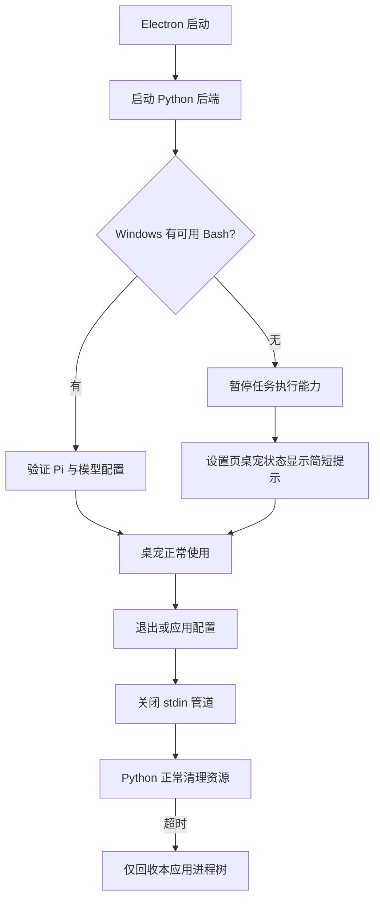

# AuraBot Windows compatibility

当前范围是 **Windows 10/11 x64 的源码运行兼容**。本轮不制作安装包，也不包含运行时捆绑、签名或发布。Mac 回归与 Windows 平台测试分开记录；Mac 测试通过不等于已完成 Windows 桌面实机验收。

## 已实现

| 范围 | 行为 |
| --- | --- |
| 开发启动 | Node 直接运行本地 electron-rebuild、electron-vite 和 Electron CLI，避免 `.cmd` 无法被直接 spawn；安装 Pi 时同样用 Node 执行 npm CLI。 |
| Node 配置 | 使用 Electron 运行时身份生成默认配置，不再通过可执行文件名判断；自动修正旧配置中误填的当前 Electron 路径，保留自选 Node 路径。 |
| 可选 Git Bash | 检测系统安装、用户安装以及 PATH 中可用的原生 Bash，验证后将相同路径交给 Pi。缺失不阻止启动，不弹报错。 |
| 桌宠状态 | 缺失 Bash 时只在设置页“桌宠状态”显示“未检测到 Git Bash，任务执行暂不可用；聊天和语音不受影响。”安装后重新应用配置进行检测。 |
| 任务能力 | 不向对话模型提供分配、恢复、重跑和继续回答任务的工具；保留历史查询与取消/删除。已排队任务等待能力恢复，避免启动到 Bash 调用时才失败。 |
| 工作区读取 | Unix 保留目录描述符实现；Windows 使用原生句柄，拒绝重解析点、目录联接、设备名、ADS 和路径别名，并在读取期间防止路径被替换。保留敏感文件过滤、体积限制与分页。 |
| 后端退出 | Electron 关闭专用 stdin 管道，Python 请求 Uvicorn 正常关闭，让 lifespan 回收 Profile、语音和任务；超时后只终止本应用持有的进程树。 |
| Pi 退出 | 先 abort/关闭 stdin；Windows 超时直接执行进程树回收，避免先杀父进程后丢失后代。 |
| 测试路径 | 去除测试中的 Unix shell 假 Node 和 URL pathname 别名；启动测试覆盖空格、中文及 `&` 字符。 |



## Windows 源码启动

先安装 Node.js 22.19+（含 npm）和 uv。代码需放在有读写权限的目录。Git Bash 是任务执行的可选依赖，基础聊天和语音无需它。

在仓库根目录打开 PowerShell：

```powershell
npm.cmd ci --prefix frontend
$env:AURABOT_USER_DATA_DIR = Join-Path $env:LOCALAPPDATA 'AuraBot-dev'
node frontend/scripts/install-runtime.mjs "$env:AURABOT_USER_DATA_DIR"
npm.cmd --prefix frontend run dev
```

PowerShell 示例使用 `npm.cmd`，避免系统的 PowerShell 脚本执行策略拦截 `npm.ps1`。应用内部不通过 shell 启动这些 `.cmd` 文件。首次启动由 uv 同步后端及语音依赖，需要网络。模型和语音服务的配置仍通过应用设置/Profile 完成。

## 自动化检查与实机验收

`.github/workflows/windows-compatibility.yml` 在 Windows runner 上检查启动脚本、桌面配置、Bash 提示、后端生命周期、原生文件句柄、目录联接与进程树回收，并编译桌面源码；不会生成安装程序。

Windows 原生测试位于 `backend/tests/test_windows_compatibility.py`。Mac 执行时明确跳过原生句柄和 Windows 进程树测试，不模拟成“已通过”。

还需 Windows 桌面实机确认：

- 无 Git Bash 时，启动、Profile 激活、聊天和语音正常，设置页只有简短提示。
- 安装 Git Bash 后重新应用配置，任务可启动、暂停和结束。
- Live2D、透明窗口、鼠标穿透、多屏缩放和麦克风设备切换。
- 有活动任务时退出/应用配置，旧后端及子进程退出，6401 端口释放。
- 中文用户名、带空格工作目录、配置保存、Profile 切换和历史数据库。

Electron 的 `setVisibleOnAllWorkspaces` 在 Windows 上没有跨虚拟桌面的效果；本轮不承诺与 macOS 的“显示于所有空间”行为相同。Windows 安装包及自带 Node/Python/Pi 仍属于后续发行工作。
